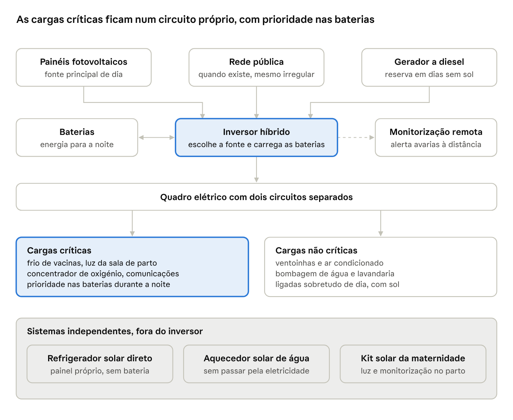

# Energia elétrica em unidades de saúde na comunidade

Versão de 20/11/2026 · Adelson Guaraci Jantsch

## Como ler este estudo

O estudo trata da energia elétrica em unidades de saúde na comunidade: postos, centros de saúde e clínicas de cuidados primários, com foco em fontes alternativas à rede. A maior parte dos casos é de África, em zonas remotas ou com rede fraca e irregular; há também uma secção sobre clima quente e frio e casos de outras regiões que servem de referência. Hospitais entram só pelo que ensinam de aplicável.

**Páginas.** "p." indica a página impressa. Estão conferidas no PDF apenas as citações do guia de unidades resilientes ao clima (OMS, 2020), gravado na pasta `buildings`. As restantes foram identificadas por leitor web e podem ter erro de uma página.

**Custos.** Mantêm-se na moeda e no ano da fonte; os valores marcados (calc.) foram calculados aqui a partir da própria fonte.

## Situação

Na África Subsaariana, cerca de 15% das unidades de saúde não têm eletricidade nenhuma e só cerca de 40% têm eletricidade fiável. Os centros de saúde e postos estão pior que os hospitais, e as unidades rurais pior que as urbanas. No mundo, cerca de 1 bilhão de pessoas são servidas por unidades sem eletricidade ou com eletricidade não fiável. Fonte principal: [Energizing Health, OMS, Banco Mundial, IRENA e SEforALL, 2023](https://www.seforall.org/system/files/2023-01/energizing_health.pdf).

| Indicador | Valor | Página |
| --- | --- | --- |
| Unidades sem eletricidade, África Subsaariana | ~15% | pp. vi, xiii, xx |
| Unidades sem eletricidade, Ásia do Sul / América Latina e Caraíbas | ~12% / 8% | pp. xiii, xx |
| Unidades com eletricidade fiável, África Subsaariana | ~40% (hospitais: ~50%) | pp. xiii, xx |
| Unidades analisadas na África Subsaariana (41 países) | ~166.720: pelo menos 25.000 sem acesso e 68.350 sem eletricidade fiável | p. xxi |
| Pessoas servidas por unidades sem eletricidade / com eletricidade não fiável | 433 milhões / 478 milhões | pp. xiii, xxi |

O conceito de "fiável" usado em inquéritos anteriores é não ter tido nenhum corte de mais de 2 horas na semana anterior ([OMS e Banco Mundial, 2015](https://breathelife2030.org/wp-content/uploads/2016/09/9789241507646_eng.pdf), p. 16).

**Consequências.** Cerca de um terço das avarias de dispositivos médicos é atribuído à má qualidade do fornecimento elétrico. Segundo modelação da OMS, eletrificar e equipar 30.000 unidades de cuidados primários salvaria cerca de 7,8 milhões de vidas até 2050 ([Relatório global 2025](https://www.washinhcf.org/wp-content/uploads/2025/09/Global-progress-report-on-WASH-waste-electricity-in-HCF-2025.pdf), pp. 4, 11).

**Planeamento nacional.** Só 36% dos países que responderam têm um roteiro orçamentado para a eletricidade nas unidades de saúde, e 44% têm indicadores de eletricidade no sistema de informação de saúde (Relatório global 2025, p. xiv).

### Moçambique e Angola

- **Moçambique** ([IRENA, 2025](https://www.irena.org/-/media/Files/IRENA/Agency/Publication/2025/Jan/IRENA_Electrification_renewables_healthcare_Mozambique_2025.pdf), secções 2–4): cerca de 40% das unidades de nível I dependem só de solar; só 52,5% cobrem as necessidades básicas de iluminação; os cortes duram em média 4 horas e chegam a 18; 30 de 40 locais não tinham reserva; 25% relatam equipamento danificado por oscilação de tensão. O FUNAE tinha eletrificado 561 centros de saúde até 2019. Em 2021, 19% de 1.643 unidades públicas não tinham energia ([Gavi, 2025](https://www.gavi.org/vaccineswork/during-mozambiques-all-too-frequent-climate-disasters-solar-powered-batteries-are)).
- **Angola:** não foi encontrado levantamento da eletricidade nas unidades de saúde. Um estudo técnico-económico modelou postos de saúde no Cunene e na Huíla com 1,2 kW de solar, a EUR 3.255 sem bateria, e concluiu que o investimento não se paga face ao gasóleo subsidiado em mais de 70% ([Mbumba et al., JSDEWES 2024](https://www.sdewes.org/jsdewes/pid12.0524)). É um modelo, não uma avaliação no terreno.

## Quanto consome uma unidade de cuidados primários

Um posto de saúde com equipamento eficiente precisa de cerca de 2 kWh por dia; um centro de saúde de cuidados primários, cerca de 10 kWh. Com equipamento tradicional, o mesmo centro gasta quase o dobro. O ar condicionado e o aquecimento elétrico de água são as cargas mais pesadas e as que mais se podem evitar.

### Consumo por nível de unidade

| Nível | Consumo (kWh/dia) | Fonte |
| --- | --- | --- |
| Posto, primeiro ponto de atenção | 4,5 tradicional / 1,9 eficiente | [Energizing Health](https://www.seforall.org/system/files/2023-01/energizing_health.pdf), p. 97 |
| Centro de cuidados primários | 18,4 tradicional / 10 eficiente (potência máxima 7.870 / 4.620 W) | Energizing Health, p. 98 e Tabela 3, p. xxx |
| Primeira referência | 54 / 39,6 | Energizing Health, p. 99 |
| Clínica rural pequena / média / grande com ar condicionado (exemplos de cálculo da USAID) | 0,7–0,8 / 18,6 / 85,2 | [USAID Powering Health](https://uatweb.usaid.gov/sites/default/files/2022-05/Powering-Health_Load-Calculation-Examples.pdf), pp. 4–9 |
| Centro de saúde rural tipo II, Moçambique | 8,3; solar 3,2 kWp; bateria 12,8 kWh | [IRENA Moçambique](https://www.irena.org/-/media/Files/IRENA/Agency/Publication/2025/Jan/IRENA_Electrification_renewables_healthcare_Mozambique_2025.pdf) |
| Centro de saúde rural tipo I, Moçambique | 27,6; solar 11 kWp; bateria 44,8 kWh | IRENA Moçambique |
| Centro de saúde urbano A, Moçambique | 35,4; solar 14 kWp; bateria 55 kWh | IRENA Moçambique |

Os valores de Moçambique assumem 2 dias de autonomia, 4,5 horas de sol e baterias de lítio. Só para cargas críticas, o tipo II desce para 2 kWp e 7,7 kWh de bateria. Na Libéria, a potência solar média instalada é de 530–890 Wp por unidade de cuidados primários e 1,7 kWp por centro de saúde (Energizing Health, Tabela 2.3).

### Potência por equipamento

| Equipamento | Potência | Nota | Fonte |
| --- | --- | --- | --- |
| Lâmpada LED | 5–13 W | incandescente: 40–100 W | [OMS e Banco Mundial 2015](https://breathelife2030.org/wp-content/uploads/2016/09/9789241507646_eng.pdf), Tabela 3, pp. 23–24 |
| Refrigerador de vacinas (165 L) | 150–200 W em corrente alternada; 40–80 W em contínua | 0,6–1,44 kWh/dia em alternada | idem |
| Refrigerador solar direto (pré-qualificado OMS) | painel de 250–370 W próprio, sem bateria | — | idem |
| Concentrador de oxigénio (5 L/min) | 280–350 W | 6,7–8,4 kWh em 24 h | [SEforALL](https://www.seforall.org/system/files/2020-05/Efficiency-Oxygen-Concentrator.pdf) |
| Autoclave de bancada | 1.200–2.850 W | carga alta e curta | OMS e Banco Mundial 2015 |
| Microscópio LED | 20–30 W | — | idem |
| Centrífuga | 250–400 W | mini em contínua: 25 W | idem |
| Rádio VHF / portátil / satélite | 2–30 / 20–60 / 85–500 W | — | idem |
| Ventoinha de teto | 30–100 W | em contínua: 28 W | idem |
| Bomba de água (clínica) | 50–200 W | — | idem |
| Aquecedor elétrico de água (200 L) | 4–5 kW | ~12–15 kWh/dia (calc.) | Energizing Health, p. 59 |
| Ar condicionado (3 aparelhos) | 4.500 W | 36 kWh/dia | USAID Powering Health, p. 9 |

### O efeito da eficiência

No centro de cuidados primários de exemplo, trocar por equipamento eficiente baixa o consumo de 18,4 para 10 kWh por dia (−46%). O campo solar necessário desce de 10,1 para 6 kW e a bateria de 6.100 para 3.300 Ah a 12 V (Energizing Health, p. 98). Os modelos eficientes poupam cerca de 75% num concentrador de oxigénio, 55% num refrigerador de banco de sangue e 53% num berço aquecido (p. xxv). Por isso, investir primeiro em eficiência — LED, refrigeradores em corrente contínua, aquecimento solar de água, desenho que evita o ar condicionado — reduz o tamanho e o custo de todo o sistema.

## Tecnologias

A base de quase todas as experiências é o solar fotovoltaico com baterias, sozinho ou combinado com rede e gerador. À volta dele há soluções específicas para o que mais importa: o refrigerador solar direto para as vacinas, o kit solar para a sala de parto e o aquecimento solar de água. Biogás e micro-hídrica servem em locais com condições particulares.

| Tecnologia | Quando serve | Limites | Manutenção e vida útil | Custo indicativo | Fonte |
| --- | --- | --- | --- | --- | --- |
| Solar autónomo com baterias | Base para unidades fora da rede; sistemas de 0,5 a 20 kWp | Roubo; reposição de baterias muitas vezes sem financiamento | Pelo menos 1 visita técnica por ano; painéis 20–25 anos | USD 4–8 por Wp com armazenamento | [SEforALL 2020](https://www.seforall.org/system/files/2020-05/Efficiency-Oxygen-Concentrator.pdf), p. 5; [Energizing Health](https://www.seforall.org/system/files/2023-01/energizing_health.pdf), pp. 71–72, 81 |
| Baterias de chumbo-ácido | Mais baratas, reparáveis localmente | Só se pode usar 50% da capacidade; sensíveis ao calor | 5–6 anos; 4–5 trocas na vida do painel; a troca chega a 35% do custo do equipamento solar | Burkina Faso: bateria USD 2.800 num sistema de USD 9.900–11.000 (2021) | Energizing Health, pp. 75, 80–82 |
| Baterias de lítio-ferro-fosfato | Unidades onde a manutenção é difícil; clima quente | Custo inicial mais alto; não carregam abaixo de 0 °C | Uso de 80% da capacidade; 2–3 vezes mais ciclos; 7–10 anos | — | Energizing Health, pp. 74, 80 |
| Híbrido solar + diesel (+ rede) | Rede irregular ou cargas grandes | Logística e preço do combustível | — | Exemplo do custo a evitar: hospital no Haiti gastava ~USD 22.000/mês em diesel | Energizing Health, p. 77; [Banco Mundial 2025](https://www.worldbank.org/en/news/feature/2025/05/27/improving-healthcare-access-through-renewable-energy) |
| Mini-rede comunitária | A aldeia e a unidade servidas pelo mesmo operador | Licenciamento demorado; depende dos outros clientes | Operador faz a manutenção | ~USD 8.500 por kWp (referência de 2022) | Energizing Health, Tabela 4.3, p. 89; [SEforALL 2024](https://seforall.org/system/files/2024-08/CAPEXOPEX%20PPT_final.pdf), slide 12 |
| Refrigerador solar direto (sem bateria) | Cadeia de frio de vacinas em qualquer unidade | Só serve as vacinas | Na RD Congo, 531 instalados entre 2013 e 2018 estavam quase todos a funcionar em 2021 | USD 1.690–10.740 | [UNICEF Supply](https://www.unicef.org/supply/sites/unicef.org.supply/files/2019-06/cold-chain-equipment-sdd-drive-and-mains-powered-refrigerators.pdf), p. 10; Energizing Health, p. 131 |
| Kit solar de maternidade (Solar Suitcase) | Sala de parto sem luz fiável | Só iluminação e pequenas cargas | Painel de 100 W, bateria de lítio de 256 Wh que dura 4–7 anos, 4 luzes LED, carregador de doppler fetal | não publicado | [We Care Solar](https://wecaresolar.org/wp-content/uploads/2026/07/We-Care-Solar-V3-Solar-Suitcase-Spec-Sheet_2026.pdf.pdf) |
| Aquecimento solar de água | Substitui o aquecedor elétrico de 4–5 kW | — | — | não encontrado | Energizing Health, p. 59; OMS 2020, pp. 50, 61 (conferido no PDF) |
| Biogás | Onde há resíduos orgânicos regulares | Gestão do digestor; fugas | Monitorização remota de fugas | Uganda: subvenção de USD 85.000 para 3 centros em campos de refugiados | [SEforALL](https://www.seforall.org/news/biogas-innovation-powers-ugandan-health-facilities-in-displacement-settings) |
| Micro-hídrica | Onde há curso de água com desnível | Depende do local | — | Quirguistão: unidades de 3 kW em postos rurais; Kisiizi (Uganda): 60 kW para hospital e aldeia | [PNUD Quirguistão](https://mptf.undp.org/sites/default/files/documents/20000/00074590_supply_of_reliable_energy_to_rural_first_aid_stations_undp_unido_who_unv.pdf); [UK Gov](https://www.gov.uk/research-for-development-outputs/case-studies-micro-hydro-system-kisiizi-uganda) |
| Bomba de calor | Aquecimento em clima frio | Exige eletricidade fiável | — | Quirguistão: 5,1 unidades de calor por unidade de eletricidade, até −30 °C | [PNUD Quirguistão](https://www.undp.org/kyrgyzstan/news/heat-pumps-guard-villagers-health) |

Não foram encontrados dados de custo nem casos em unidades de saúde para eólica pequena e GPL.

**Autonomia.** A premissa mais usada é de 2 dias de autonomia em baterias (IRENA Moçambique; SEforALL). O guia da OMS de 2020 pede reserva para pelo menos 3 dias de eletricidade nas cargas críticas (p. 56, conferido no PDF), o que em solar costuma ser coberto por baterias mais um gerador.

## Experiências em África

Há programas grandes em quase toda a África Subsaariana, quase todos baseados em solar com baterias e financiados por doadores: Fundo Global e PNUD (*Solar for Health*), Gavi, Banco Mundial, Reino Unido e EUA. A cobertura e o custo estão bem documentados; os resultados em serviço, muito menos. A única avaliação aleatorizada encontrada é a do kit solar de maternidade no Uganda, com melhoria clara da qualidade do parto noturno. A avaliação da Serra Leoa mostra que a eletricidade, sozinha, não aumenta a utilização dos serviços.

### Programas por país

| País | Programa e escala | Solução | Custo | Resultado ou estado | Fonte |
| --- | --- | --- | --- | --- | --- |
| Zimbabwe | *Solar for Health* (Fundo Global e PNUD): 1.044 unidades em 2024, mais de 11 MW | Solar com baterias e monitorização remota; garantia de 12 anos nos componentes | USD 18,5 milhões, ~USD 17.700 por unidade (calc.) | Antes, 4–5 h de eletricidade por dia; o solar cobre até 70% das necessidades. Sem avaliação formal de resultados em saúde | [PNUD 2024](https://www.undp.org/zimbabwe/press-releases/undp-global-fund-hands-over-solar-systems-ministry-health-and-child-care-strengthening-zimbabwes-healthcare-infrastructure); [REACH](https://reachalliance.org/wp-content/uploads/2021/03/Zimbabwe-Solar-final.pdf), pp. 2–10 |
| Zimbabwe | Banco Mundial: 200 locais em 16 distritos rurais | Painéis solares e furos de água solares; pelo menos 2 profissionais treinados em manutenção por unidade | USD 6,6 milhões, ~USD 33.000 por local (calc.) | Atendimento 24 horas | [Banco Mundial 2025](https://www.worldbank.org/en/news/feature/2025/06/16/empowering-the-health-sector-through-solar-access-a-lifeline-for-afe-zimbabwe-medical-facilities) |
| Moçambique | FUNAE: 561 centros de saúde eletrificados até 2019 | Solar autónomo | — | ver "Quanto falha" | [IRENA 2025](https://www.irena.org/-/media/Files/IRENA/Agency/Publication/2025/Jan/IRENA_Electrification_renewables_healthcare_Mozambique_2025.pdf) |
| Moçambique, Sofala | Power Africa: 92 centros de saúde | ~0,6 kWp e 2,4 kWh por centro (cargas críticas) | USD 320 mil, ~USD 3.500 por centro (calc.) | Manutenção paga no 1.º ano, depois 5 anos pela empresa | [Energypedia](https://energypedia.info/wiki/Electrifying_Health_Centers_in_Mozambique) |
| Moçambique | GIZ: 42 postos de saúde em 4 províncias (2020) | Solar com desinfeção de água | — | — | idem |
| Moçambique | Fundo Global e PNUD: 16 unidades em 2026, mais 84 previstas | — | — | Em comissionamento | [PNUD Moçambique](https://www.undp.org/mozambique/stories/powering-better-health-through-sustainable-energy) |
| Angola | *Solar for Health* (2019) | — | ~USD 610 mil em instalações | Sem dados de estado | [PNUD Angola](https://info.undp.org/docs/pdc/Documents/AGO/AGO10_00118881.PDF) |
| Angola, 14 províncias | 280 refrigeradores solares diretos | Cadeia de frio | — | Sem resultados medidos | [Dulas 2024](https://dulas.org.uk/dulas-refrigerators-extending-access-to-healthcare-across-angola/) |
| Nigéria | Gavi e UNICEF: 371 centros de cuidados primários; ~2.600 de 4.000 visados concluídos no país | — | USD 9 milhões, ~USD 24.000 por centro (calc.) | Em Kano, atendimento 24 horas e frequência mais que duplicada num centro (de 1.300 para mais de 3.000 por mês) | [Guardian NG](https://guardian.ng/?p=2804385); [eHealth Africa](https://ehealthafrica.org/press-release/unicef-gavi-ehealth-africa-deliver-28-solar-powered-primary-healthcare-facilities-boost-maternal-child-care-kano-state/) |
| Nigéria | Banco Mundial e REA: 100 instituições de saúde, 5.000 kWp | Híbridos solares | — | Entregue em 2024 | [REA](https://rea.gov.ng/rea-deploys-150kwp-capacity-renewable-energy-3-hospitals-fct-5000kwp-100-healthcare-institutions-nationwide) |
| Serra Leoa | Reino Unido e UNOPS: 54 centros de saúde comunitários e depois 90 mini-redes em aldeias | Solar autónomo e mini-redes | GBP 34,5 milhões no projeto inteiro | Avaliação de impacto, abaixo | [UNOPS](https://www.unops.org/news-and-stories/stories/access-to-energy-giving-sierra-leone-the-power-to-change) |
| Serra Leoa | HealthGrid: 26 unidades remotas | Solar, com fundo de manutenção separado e receita de quiosque | Fundo iniciado com USD 150 mil | Concluído em 2024; expansão para mais 60 locais | [RESOLVE 2025](https://resolve.ngo/news/resolves-healthgrid-sierra-leone-successfully-concludes-paving-way-for-heta-sierra-leone-and-a-pioneering-new-sustainability-mechanism) |
| Libéria | Banco Mundial: 39 unidades fora da rede | 2–18 kWp e 15–70 kWh por unidade; manutenção por 2 anos | — | — | [SolarQuarter 2026](https://solarquarter.com/2026/01/21/jivo-energy-powers-39-off-grid-health-facilities-in-liberia-with-solar-bess/) |
| Uganda | Gavi: 250 centros HC III | 3–30 kWp | USD 4,25 milhões, ~USD 17.000 por centro (calc.) | Em Acet, atendimentos maternos de ~24 para ~62 por mês e horário de 12 h para 24 h (relato) | [Gavi 2026](https://www.gavi.org/vaccineswork/how-solar-powering-maternal-care-and-immunisation-rural-uganda) |
| Etiópia, Zâmbia, Uganda, Nigéria (Gavi, total) | Mais de 1.700 unidades: Etiópia 380, Zâmbia 296 | — | Mais de USD 30 milhões; ~USD 14.000–17.000 por unidade (calc.) | Sem resultados medidos | [Gavi 2026](https://www.gavi.org/news/media-room/health-facility-solarisation-drive-unlocks-benefits-over-140-million-people) |
| Somália | OMS: 51 unidades | 5 kWp com baterias; manutenção por 5 anos pela empresa local | ~USD 35.000 por sistema | Em monitorização | [NRC](https://www.nrc.no/globalassets/pdf/reports/briefing-on-healthcare-electrification-in-humanitarian-settings/briefing-on-humanitarian-health-facility-electrification.pdf), pp. 44–47 |
| Madagáscar | Banco Mundial (LEAD): 500 de 1.250 centros rurais sem eletricidade | Kits solares | — | Partos e pequenas cirurgias com iluminação adequada | [Banco Mundial](https://www.worldbank.org/en/news/feature/2025/01/21/bringing-light-and-life-to-rural-health-centers-in-afe-madagascar) |

Não foram encontrados dados públicos verificáveis para Gana, Ruanda, Tanzânia, RD Congo, Sudão do Sul, Burkina Faso, Mali, Níger, Cabo Verde, Guiné-Bissau e São Tomé, nem para programas angolanos específicos de postos de saúde.

### Maternidades e cadeia de frio

- **Kit solar de maternidade (We Care Solar):** mais de 10.000 kits em 49 países; cobertura de todas as maternidades com necessidade na Libéria, no Zimbabwe, no Uganda e na Serra Leoa ([We Care Solar 2025](https://wecaresolar.org/wp-content/uploads/2025/07/We-Care-Solar-At-a-Glance-2025.pdf)). Moçambique e Angola não aparecem.
- **Refrigeradores solares diretos (Gavi CCEOP):** mais de 66.000 refrigeradores em ~50 países desde 2016, ~60% solares, por ~USD 400 milhões; a avaliação final em três países relatou menos roturas de stock e sessões de vacinação mais frequentes ([Gavi 2023](https://www.gavi.org/vaccineswork/how-solar-power-revolutionising-immunisation-most-remote-parts-world)).

### O que as avaliações mostram

**Uganda, ensaio aleatorizado do kit solar de maternidade** ([Rokicki et al., GHSP 2021](https://www.ghspjournal.org/content/9/4/777)): 30 maternidades rurais, 1.118 partos observados.

- O kit foi usado em 83% dos partos noturnos; o recurso a querosene ou lanterna caiu de 44% para 0%.
- A iluminação adequada aumentou 45 pontos percentuais.
- O índice de qualidade dos cuidados subiu 4,2 pontos, sobretudo no controlo de infeção, na prevenção da hemorragia pós-parto e nos cuidados ao recém-nascido; os atrasos nos cuidados caíram ~11 minutos.
- Um ano depois, 90–93% das unidades ainda usavam as luzes, mas menos tinham todos os componentes a funcionar.

**Serra Leoa, avaliação de impacto** ([Levine et al., IGC 2022](https://www.theigc.org/sites/default/files/2022/06/Levine-et-al.-Final-Report-2022.pdf)):

- ~79% dos centros do programa tinham pelo menos 10 horas de luz por dia, contra 48% nas unidades de comparação (p. 84).
- Houve mais consultas de crianças menores de 5 anos (p. 92), mas sem diferença significativa em vacinação e consultas pré e pós-natais (pp. 96–97). Os autores concluem que a eletrificação, sozinha, não aumenta a utilização (p. 97).
- Os profissionais ligam a falta de luz nas residências à rotatividade do pessoal (p. 103).
- Painéis pequenos não aguentam um refrigerador de forma consistente (p. 84).

**Outros relatos**, sem desenho de avaliação: mais partos em hospitais do *Solar for Health* no Zimbabwe (correlação, segundo os próprios autores); serviços aumentados em 5 de 6 centros de saúde em campos de refugiados no Uganda, mas nenhum com o pessoal mínimo recomendado ([GIZ](https://energypedia.info/images/7/71/An_Intermediate_Outcome_Study_After_the_Electrification_of_Six_Health_Centers.pdf), pp. 22–29).

Não foi encontrada evidência robusta sobre mortalidade materna ou neonatal, partos noturnos contados ou fixação de pessoal.

## Zonas quentes e zonas frias

O clima muda três coisas: o rendimento dos painéis, a vida das baterias e a energia gasta para manter a unidade confortável. Em clima quente, o calor encurta a vida das baterias e o arrefecimento é a maior carga evitável; a resposta mais barata é o desenho passivo antes do ar condicionado. Em clima frio, os painéis rendem mais, mas as baterias de lítio não podem carregar abaixo de 0 °C e o aquecimento passa a ser a maior carga; a resposta é isolar o edifício e usar bombas de calor ou biomassa eficiente.

### Zonas quentes

**Painéis.** A potência nominal é medida com a célula a 25 °C. Cada grau acima disso custa 0,2–0,5% da potência, conforme a tecnologia. A célula fica 20–35 °C acima do ar: com a célula a 70 °C, um painel PERC comum rende cerca de 82% e um HJT cerca de 89% ([Couleenergy](https://couleenergy.com/maximize-solar-panel-efficiency-temperature-coefficient-guide/)). Painéis elevados, com ar a circular por baixo, aquecem menos; em Mirebalais (Haiti) foram montados ~30 cm acima de um telhado branco ([PIH](https://www.pih.org/article/solar-powered-hospital-in-haiti-yields-sustainable-savings)). A SEforALL recomenda montagem ventilada e um campo solar um pouco maior que o necessário ([SEforALL 2025](https://www.seforall.org/system/files/2025-02/SEforALL-phc-climate-resilience-study.pdf), pp. 15, 34).

**Baterias.**

- Chumbo-ácido selada: por regra prática, cada 8 °C acima de 25 °C corta a vida para metade. Uma bateria de 10 anos a 25 °C dura ~5 anos a 33 °C e ~30 meses a 41 °C ([Battery University](https://batteryuniversity.com/article/how-heat-and-harsh-loading-reduces-battery-life)).
- Lítio-ferro-fosfato (LFP): faixa ótima de 15–35 °C; acima disso precisa de gestão térmica (dado de fabricante). A SEforALL prefere lítio ao chumbo em clima quente (pp. 16, 34).
- Na prática: baterias num compartimento à sombra e ventilado, do lado menos exposto do edifício, nunca sob o telhado. O chumbo-ácido precisa de ventilação também por libertar hidrogénio.

**Arrefecer a unidade com pouca energia** ([SELCO, diretrizes de desenho](https://selcofoundation.org/wp-content/uploads/2022/01/Guidelines-for-Sustainability-and-Efficiency-in-Building-Design-Health-centers-24-051.pdf)):

- poucas fachadas a nascente e poente; palas de 0,60 m nas janelas a norte e sul e aletas verticais a nascente e poente;
- janelas e ventiladores com pelo menos 20% da área de cada sala;
- pátio interior e efeito chaminé em clima quente e seco; edifícios lineares com varandas em clima quente e húmido;
- telhado refletor, que baixa a temperatura interior 2–5 °C (SEforALL 2025, p. 36);
- alvos de conforto: 24–26 °C nas enfermarias, 17–27 °C em salas de parto e bloco operatório.

Equipamento eficiente reduz a carga: um ar condicionado de 1,5 TR eficiente consome 1.172 W contra 1.702 W, e a carga máxima de um PHC indiano desce de 7.870 W para 4.620 W com equipamentos eficientes (SEforALL 2025, pp. 35–36). Ventoinhas e ar condicionado devem ficar no circuito não crítico (p. 38).

**Vacinas.** A OMS classifica os refrigeradores por zona climática; a zona "quente" corresponde a +43 °C. Um refrigerador solar direto pré-qualificado mantém 2–8 °C durante ~78 horas a +43 °C sem sol, mas só funciona acima de +5 °C ambiente ([ficha Dulas VC150SDD](https://dulas.org.uk/downloads/vaccine-cold-chain/vc150sdd/Dulas-VC150SDD-Datasheet-2025-EN.pdf)). Em planaltos frios é preciso verificar também o limite inferior.

**Poeira (Sahel).** Numa central no oeste do Senegal, a sujidade reduziu a produção 0,33–0,49% por dia na estação seca, com o máximo durante o harmatão. O ciclo ótimo de limpeza foi de 14 dias, que reduziu o custo total associado à poeira em 31% ([EPJ Photovoltaics 2022](https://www.epj-pv.org/10.1051/epjpv/2022019)).

### Zonas frias e de altitude

- **Painéis:** o frio melhora o rendimento, e a radiação em altitude é alta. A neve custa 1–12% da produção anual; painéis mais inclinados deixam-na escorregar ([The Better India](https://thebetterindia.com/renewable-energy/why-solar-panels-perform-differently-delhi-ladakh-winter-10924049)).
- **Baterias de lítio:** não carregam abaixo de 0 °C sem dano irreversível; devem ficar dentro do edifício aquecido ([SolarQuotes](https://www.solarquotes.com.au/blog/your-battery-warm-enough-winter/)).
- **Desenho:** edifício alongado no sentido nascente-poente, envidraçado maior virado ao sol e paredes isoladas (SELCO).

| Local | Solução | Resultado | Fonte |
| --- | --- | --- | --- |
| Lesoto, montanhas (7 centros da PIH, 2022) | Solar completo, com gerador de reserva para os dias de inverno sem sol | Diesel de ~USD 700 para ~350 por centro por mês; deixaram de existir os ~5 cortes por semana | [PIH](https://pih.org/article/qa-how-solar-power-improving-patient-care-lesotho) |
| Lesoto, Leribe (4 centros, cooperação italiana) | Fotovoltaico, aquecimento elétrico, água quente, LED, troca de portas e janelas | EUR 730 mil; estado de execução incerto na fonte | [MASE Itália](https://www.mase.gov.it/sites/default/files/archivio/allegati/sviluppo_sostenibile/schede_progetto/lesotho_energy_refurbishment_four_health_centers_lesotho_EN.pdf) |
| Quirguistão (19 postos de primeiros socorros rurais) | 18 sistemas fotovoltaicos de 1,2–3 kW e 7 mini-hídricas de 3 kW; isolamento de paredes, tetos e caves | Isolar o edifício melhorou o rendimento das tecnologias instaladas; orçamento ~USD 988 mil | [PNUD/UNIDO/OMS](https://mptf.undp.org/sites/default/files/documents/20000/00074590_supply_of_reliable_energy_to_rural_first_aid_stations_undp_unido_who_unv.pdf), pp. 4–9 |
| Quirguistão, Zhin-Zhigen | Bombas de calor ar-ar no lugar de aquecedores elétricos | 5,1 unidades de calor por unidade de eletricidade; funcionam até −30 °C | [PNUD](https://www.undp.org/kyrgyzstan/news/heat-pumps-guard-villagers-health) |
| Nepal, montanha (Pajaru, 2023) | 10 painéis para luz, berços aquecidos e aquecedores | Mais partos no posto, segundo os profissionais | [OMS Nepal](https://www.who.int/nepal/news/detail/22-02-2024-electrifying-healthcare-facilities-in-nepal-s-remote-mountains) |
| Alasca, Huslia | Rede de aquecimento a lenha para clínica, lavandaria e escola | Substitui ~75% do gasóleo de aquecimento; ~USD 57 mil/ano poupados; custo USD 723 mil | [FHWA](https://www.fhwa.dot.gov/ipd/project_profiles/ak_huslias_wood_biomass_system.aspx) |
| Mongólia | Estudo de conversão de caldeira a carvão em bomba de calor geotérmica num centro de saúde familiar | Em estudo | [UNICEF Mongólia](https://www.unicef.org/mongolia/media/5071/file/Impact%20of%20Air%20Pollution%20on%20Maternal%20and%20Child%20Health%20Project%20%282018-2023%29.pdf), p. 19 |

Não foram encontrados casos com dados verificáveis em planaltos da Etiópia, nos Andes (muros de acumulação solar só documentados em habitação), no Afeganistão ou no Tajiquistão.

## Experiências fora de África

A experiência mais estudada é a da Índia: programas estaduais de solarização de centros de saúde, com a SELCO como executor e, em Chhattisgarh, um estudo que associou o solar a mais internamentos e partos. No Brasil, há casos em aldeias indígenas e na Amazónia, sem avaliação publicada.

| Local | Solução | Custo ou poupança | Resultados | Fonte |
| --- | --- | --- | --- | --- |
| Chhattisgarh, Índia (2012–2016) | Agência estadual instalou 2 kWp com bateria em 570 centros de saúde primários, com 3–4 h de autonomia | Diesel 24–26 INR/kWh contra 12–14 INR/kWh com solar; 90% dos centros pouparam | Estudo CEEW/Oxfam em 147 centros: os solarizados internaram mais de 50% mais doentes e fizeram quase o dobro dos partos por mês. Estudo transversal, sem prova de causalidade | [Mercom](https://www.mercomindia.com/solar-power-drastically-improves-healthcare-systems-chhattisgarg-ceew); [CEEW](https://www.ceew.in/publications/powering-primary-healthcare-through-solar-india) |
| Karnataka, Índia (desde 2024) | Programa estadual com a SELCO: postos 0,25–1 kW, centros primários 4–5 kW, hospitais de distrito até 10 kW | INR 120 crore; fatura de energia 70–85% menor | ~3.000 unidades instaladas, meta de 5.000 em 2026 | [Saur Energy](https://www.saurenergy.com/solar-energy-news/karnatakas-3600-solarised-health-centres-deliver-80-savings-on-power-bills-10900772) |
| Meghalaya, Índia (Nongpoh) | SELCO, solar no hospital civil, com manutenção incluída por 5 anos (~2% do custo por ano) | Diesel para cargas críticas −76%; mais de USD 110 mil em 5 anos | — | [SELCO Health](https://selcofoundation.org/wp-content/uploads/2022/11/1_-SELCO-Health.pdf), pp. 29–31, 55 |
| Nepal | Subsídio público de até 65% (máx. USD 6.500) a sistemas padrão de 1 e 2 kWp; 10% retido 2 anos até o fornecedor cumprir a assistência técnica | — | Modelo de retenção que obriga o fornecedor à manutenção | [Energizing Health](https://www.seforall.org/system/files/2023-01/energizing_health.pdf), pp. xxxvi–xxxvii |
| Mirebalais, Haiti (2013) | 1.800 painéis num hospital; excedente vendido à rede | ~USD 379 mil/ano a menos em custos de operação | Hospital, só como referência | [PIH](https://www.pih.org/article/solar-powered-hospital-in-haiti-yields-sustainable-savings) |
| Vanuatu (2025) | 20 sistemas isolados novos e 20 recuperados; centro de Saramauri com 10 kW | não informado | Sem resultados clínicos | [REnew Pacific](https://www.aiffp.gov.au/news/renew-pacifics-first-project-completes-powering-healthcare-remote-vanuatu-communities) |
| Ucayali, Amazónia peruana (2022) | Painéis em centros de Masisea e Iparia | Deixou de ser preciso transportar combustível | Luz 24 horas | [PIH](https://pih.org/article/how-solar-panels-are-supporting-care-indigenous-communities-peru) |
| Peru (2021) | 1.100 congeladores solares diretos para os Andes e a Amazónia | Compra por acordos de longo prazo | — | [UNICEF Peru](https://www.unicef.org/peru/en/stories/Peru-the-sun-helps-vaccines-keep-their-cool) |
| Avá-Canoeiro, Goiás, Brasil (2020) | UBS isolada da rede: ~8 kWp, 2 baterias de 14,4 kWh, 2 inversores de 5 kVA | ~R$ 95 mil (compensação ambiental) | Funciona 24 h e conserva vacinas | [Canal Solar](https://canalsolar.com.br/unidade-de-saude-em-aldeia-indigena-e-alimentada-por-energia-solar-off-grid/) |
| Terra Yanomami, Brasil (2023) | 62 sistemas fotovoltaicos com bateria em postos de saúde, pelo programa Mais Luz para a Amazônia | não informado | — | [Canal Solar](https://canalsolar.com.br/mme-instalara-62-sistemas-fotovoltaicos-com-baterias-na-terra-yanomami/) |
| UBS fluvial de Tefé, Brasil | Gerador diesel (contexto, sem solar) | Combustível = 12,11% do custo de R$ 761.706 em 9 viagens | A seca encarece as expedições | [Medicina S/A](https://medicinasa.com.br/custos-ubs-fluviais-amazonia/) |

## Como se organiza um sistema híbrido

O desenho mais comum nas experiências descritas combina painéis solares, baterias, a rede quando existe e um gerador de reserva, ligados por um inversor híbrido. O ponto decisivo é separar as cargas: o que não pode parar fica num circuito próprio, servido pelas baterias à noite; o que consome muito funciona de dia, com sol.

Componentes do diagrama:

- **Fontes:** painéis fotovoltaicos (fonte principal de dia), rede pública (quando existe, mesmo irregular) e gerador a diesel (reserva em dias sem sol).
- **Inversor híbrido:** escolhe a fonte e carrega as baterias; ligado às baterias (energia para a noite) e à monitorização remota (alerta avarias à distância).
- **Quadro elétrico com dois circuitos separados:**
    - cargas críticas — frio de vacinas, luz da sala de parto, concentrador de oxigénio, comunicações; prioridade nas baterias durante a noite;
    - cargas não críticas — ventoinhas e ar condicionado, bombagem de água e lavandaria; ligadas sobretudo de dia, com sol.
- **Sistemas independentes, fora do inversor:** refrigerador solar direto (painel próprio, guarda o frio sem bateria e fica independente de avarias no resto do sistema), aquecedor solar de água (não gasta eletricidade) e kit solar da maternidade (luz e monitorização no parto).

## Custos e financiamento

O relatório *Energizing Health* estima em cerca de USD 4,9 mil milhões (valor atual líquido) o necessário para eletrificar as unidades de saúde de 63 países, dos quais ~USD 2,5 mil milhões na África Subsaariana. O custo por unidade dos programas africanos vai de ~USD 3.500 (só cargas críticas) a ~USD 25.000–33.000 (centro de saúde com todas as cargas). O ponto fraco comum é o financiamento da manutenção e da troca de baterias depois dos primeiros anos.

### Estimativa global ([Energizing Health](https://www.seforall.org/system/files/2023-01/energizing_health.pdf))

- Total ~USD 4,9 mil milhões: ~2,8 para sistemas de reserva fora da rede e ~2,1 para novas ligações (1,5 pela rede, 0,48 fora dela) (pp. xxxii, 110–111).
- Por região: África Subsaariana ~2,54 mil milhões; Ásia do Sul 1,96 mil milhões (p. 111).
- Das 459.206 unidades analisadas, 100.926 precisam de ligação nova e 223.506 de reserva (p. xxxii). Dividindo, ~USD 10.700 por unidade (calc.).
- Se o consumo das unidades não hospitalares subir de 15 para 32 kWh/dia, o total passa a ~USD 8,9 mil milhões (p. 112): a eficiência é também uma decisão de custo.
- Os programas costumam financiar a manutenção por 5 anos, que é quando acabam as garantias e as baterias precisam de troca; o relatório recomenda reservar fundos para 10–15 anos (pp. 137, 139).

### Custo por unidade em programas

| Programa | Custo | Por unidade | Fonte |
| --- | --- | --- | --- |
| Solar for Health, Zimbabwe (PNUD e Fundo Global) | ~USD 18,5 milhões para 1.044 unidades, mais de 11 MW | ~USD 17.700 (calc.) | [PNUD Zimbabwe, 2024](https://www.undp.org/zimbabwe/press-releases/undp-global-fund-hands-over-solar-systems-ministry-health-and-child-care-strengthening-zimbabwes-healthcare-infrastructure) |
| Power Africa, Sofala, Moçambique (2021) | USD 320.000 para 92 unidades (55,2 kWp e 220,8 kWh no total) | ~USD 3.500 (calc.); só cargas críticas, manutenção só no 1.º ano | [Club of Mozambique](https://clubofmozambique.com/news/u-s-government-lights-up-92-health-facilities-in-sofala-province-with-a-320000-investment-in-solar-power/) |
| Estimativa IRENA, Moçambique | USD 16,5 milhões para 1.649 unidades, todas as cargas | ~USD 6.700 (rural tipo II), ~25.000 (rural tipo I), ~33.000 (urbano A) (calc.) | [IRENA 2025](https://www.irena.org/-/media/Files/IRENA/Agency/Publication/2025/Jan/IRENA_Electrification_renewables_healthcare_Mozambique_2025.pdf) |
| Burkina Faso (2021) | Sistema de USD 9.900–11.000; manutenção USD 180–200/ano | — | Energizing Health, pp. 81–82 |
| UBS Avá-Canoeiro, Brasil (2020) | ~8 kWp e ~29 kWh de baterias | ~R$ 95 mil | [Canal Solar](https://canalsolar.com.br/unidade-de-saude-em-aldeia-indigena-e-alimentada-por-energia-solar-off-grid/) |
| Gavi, cadeia de frio (CCEOP) | Compromisso inicial de USD 250 milhões com cofinanciamento dos países; mais de 41.000 refrigeradores solares diretos até 2022 | — | [UNICEF Supply](https://www.unicef.org/supply/sites/unicef.org.supply/files/2019-06/cold-chain-equipment-sdd-drive-and-mains-powered-refrigerators.pdf), p. 5; Energizing Health, p. 131 |

### Solar contra diesel

- Lesoto: o diesel desceu de ~USD 700 para ~350 por centro por mês com solar ([PIH](https://pih.org/article/qa-how-solar-power-improving-patient-care-lesotho)).
- Chhattisgarh: ~24–26 INR/kWh com diesel contra ~12–14 INR/kWh com solar e bateria ([Mercom](https://www.mercomindia.com/solar-power-drastically-improves-healthcare-systems-chhattisgarg-ceew)).
- Angola: com o gasóleo subsidiado em mais de 70%, um estudo não encontrou retorno para o solar em postos de saúde ([Mbumba et al., 2024](https://www.sdewes.org/jsdewes/pid12.0524)). Enquanto durar o subsídio, o argumento para o solar é a fiabilidade e a independência do abastecimento, mais do que o custo.

### Modelos de financiamento

| Modelo | Como funciona | Exemplo |
| --- | --- | --- |
| Doação ou subvenção com transferência ao Ministério | O doador financia e instala; o Ministério fica com o sistema | Zimbabwe (Fundo Global/PNUD); Sofala (Power Africa) |
| Subsídio público com retenção | O Estado paga parte e retém 10% até o fornecedor cumprir 2 anos de assistência | Nepal (Energizing Health, pp. xxxvi–xxxvii) |
| Financiamento estadual com filantropia | O Estado paga 60–80% e o resto vem de filantropia | Índia, SELCO (Energizing Health, pp. xxxv–xxxvi) |
| Energia como serviço | O governo paga uma anuidade fixa num contrato de 10 anos ligado ao desempenho; o fornecedor faz toda a manutenção e troca de componentes e paga penalidades quando falha | Nigéria, RD Congo, Benim, Gana ([Shell Foundation 2024](https://shellfoundation.org/app/uploads/2024/02/Health-Electrification-Final-Report.pdf)) |
| Arrendamento com opção de compra ou tarifa | Contratos de 10–15 anos, tarifa por kWh ou taxa fixa | Gana: USD 0,13/kWh; Benim: USD 200/mês por 10 anos (Shell Foundation) |
| Fundos de saúde verticais | Gavi para cadeia de frio; Fundo Global para solarização | CCEOP; Solar for Health |

No modelo de energia como serviço, o risco principal é o pagamento público: houve atrasos de mais de 270 dias, e os operadores pedem garantias. O relatório da Shell Foundation conclui que as subvenções continuam necessárias durante 5 a 10 anos.

## Operação e manutenção

Entre cerca de 30% e quase 90% dos sistemas solares em unidades de saúde africanas falham ou funcionam mal poucos anos depois da instalação. A causa principal são as baterias, seguidas da falta de orçamento recorrente e de um responsável definido. A tecnologia raramente é o problema.

### Quanto falha

| Contexto | Achado | Fonte |
| --- | --- | --- |
| Malawi, 24 unidades (2021) | 87,5% falhados ou com desempenho fraco; duravam tipicamente 2–4 anos | [SolarAid/Mzuzu 2022](https://solar-aid.org/wp-content/uploads/2022/04/Powering-Healthcare-Malawi-March-2022.pdf), p. 2 |
| Malawi, mais de 150 unidades (2015) | Só 57% funcionais | idem, p. 1 |
| Moçambique, 40 locais | 87% relatam problemas; baterias não funcionais nos locais visitados; 47% dos profissionais dizem que o sistema não cobre a iluminação básica | [IRENA 2025](https://www.irena.org/-/media/Files/IRENA/Agency/Publication/2025/Jan/IRENA_Electrification_renewables_healthcare_Mozambique_2025.pdf), pp. 34–35 |
| Uganda | Menos de 50% dos sistemas instalados funcionais | [PNUD Uganda](https://www.undp.org/sites/g/files/zskgke326/files/2023-01/Solar%20PV%20Installation%20in%20Uganda.pdf), p. 2 |
| Uganda, 78 unidades com solar (2026) | 22% com falha de bateria e 22% de inversor; 45% só fazem manutenção quando algo avaria e 21% nunca fazem | [MUWRP](https://muwrp.org/wp-content/uploads/2026/07/MUWRP_Solar_Assessment_Report.pdf), pp. 14–15 |
| Nigéria | Mais de 30% dos sistemas em centros de cuidados primários param até 3 anos após a instalação (Ministro de Estado da Saúde, 2026) | [Premium Times](https://www.premiumtimesng.com/news/top-news/905842-over-30-of-solar-systems-in-phcs-fail-within-three-years-health-minister.html) |
| Burkina Faso (2022) | ~30% dos sistemas parados ao fim de 3–5 anos | [Energizing Health](https://www.seforall.org/system/files/2023-01/energizing_health.pdf), cap. 2 |
| Contextos humanitários, 81 locais | 40% com pouca ou nenhuma eletricidade por sistemas avariados | [NRC](https://www.nrc.no/globalassets/pdf/reports/briefing-on-healthcare-electrification-in-humanitarian-settings/briefing-on-humanitarian-health-facility-electrification.pdf), p. 22 |
| Geradores a gasóleo (comparação) | Menos de 30% operacionais em 6 países | [Boletim da OMS 2014](https://pmc.ncbi.nlm.nih.gov/articles/PMC3949541) |

O gerador a gasóleo não é alternativa mais segura: falha ainda mais, por falta de combustível e manutenção.

### Porque falham

1. **Baterias.** São 76% das falhas no Malawi, à frente do inversor (11%) e do roubo (8%) (SolarAid, p. 2). Precisam de troca a cada 4–7 anos, e o setor público raramente tem orçamento para isso (IRENA Moçambique, p. 35).
2. **Sem orçamento recorrente e sem dono.** Faltam manutenção preventiva, peças e uma rubrica orçamental; os orçamentos humanitários duram 1–2 anos (NRC, pp. 18–19).
3. **Má instalação.** Painéis de tipos misturados, sombreamento, cablagem de má qualidade e baterias fora da especificação (SolarAid, p. 2).
4. **Roubo.** Em Beitbridge (Zimbabwe), os painéis de várias clínicas foram roubados e as vacinas tiveram de ir para o hospital ([Herald](https://www.heraldonline.co.zw/criminals-target-solar-panels-at-clinics/)).
5. **Subdimensionamento.** Sistemas pequenos não aguentam um refrigerador (IGC, p. 84), e na estação das chuvas não cobrem os serviços noturnos (GIZ, p. 37).
6. **Garantias curtas.** Nos refrigeradores da Gavi, as garantias são em geral de 2 anos, e não há dados de desempenho depois de 5–6 anos ([JSI 2020](https://gavi.org/news/document-library/jsi-cceop-market-shaping-evaluation-report-2020)).

### O que está a ser testado

- **Contrato de manutenção de 3–5 anos com o instalador, mais monitorização remota:** PNUD no Uganda, OMS na Somália, Power Africa em Moçambique, Zimbabwe.
- **Garantias longas**, de 10–12 anos nos componentes e 8–12 nas baterias: Zimbabwe.
- **Retenção de parte do pagamento** até o fornecedor cumprir 2 anos de assistência: Nepal.
- **Fundo de manutenção separado**, alimentado por um quiosque de energia: HealthGrid na Serra Leoa. No Uganda, os quiosques previstos para o mesmo fim não funcionavam (GIZ, p. 38).
- **Energia como serviço:** o fornecedor fica com a manutenção e a troca de baterias durante 10 anos, pago por desempenho.
- **Profissionais treinados em cada unidade:** pelo menos 2 por unidade no programa do Banco Mundial no Zimbabwe.
- **Kits simples de lítio, sem inversor**, para unidades pequenas (recomendação da SolarAid, p. 4).
- **Orçamentar a manutenção por 10–15 anos**, e não apenas 5 (Energizing Health, pp. 137, 139; IRENA Moçambique recomenda pelo menos 10).

### Rotinas mínimas na unidade

- Limpar os painéis; no Sahel, a cada ~14 dias na estação seca.
- Manter as baterias à sombra, ventiladas e, em clima frio, dentro do edifício aquecido.
- Visita técnica pelo menos uma vez por ano (Energizing Health, Tabela 4.1, p. 81).
- Ligar o ar condicionado, a bombagem e a lavandaria de dia, com sol, e reservar as baterias para as cargas críticas à noite.
- Registar as avarias e a autonomia, de preferência com monitorização remota.

## Imagens de referência

As imagens não podem ser trazidas para dentro do documento a partir desta sessão. A lista aponta para as páginas de origem; a descrição vem da legenda publicada, quando existe.

| O que mostra | Contexto | Página de origem |
| --- | --- | --- |
| Parteira junto dos painéis de 12 kW do centro HC III de Nakifuma, refrigerador solar e berço aquecido | Rural, Uganda | [Gavi](https://www.gavi.org/vaccineswork/how-solar-powering-maternal-care-and-immunisation-rural-uganda) |
| Centro HC III de Amomwa iluminado à noite; parteira na sala de partos | Rural, Uganda | [UNICEF Uganda](https://www.unicef.org/uganda/stories/solar-electrification-boosts-ugandas-health-centres) |
| Inversores solares na clínica de Ngapa (Cabo Delgado) e painéis a ser instalados em Sofala | Moçambique | [Gavi](https://www.gavi.org/vaccineswork/during-mozambiques-all-too-frequent-climate-disasters-solar-powered-batteries-are) |
| Painéis no telhado de unidades em Chicualacuala, Gaza | Moçambique | [PNUD Moçambique](https://www.undp.org/mozambique/stories/powering-better-health-through-sustainable-energy) |
| Centro de saúde de Mateliona Betafo com kits solares | Rural, Madagáscar | [Banco Mundial](https://www.worldbank.org/en/news/feature/2025/01/21/bringing-light-and-life-to-rural-health-centers-in-afe-madagascar) |
| Centros de saúde solares nas montanhas | Lesoto | [PIH](https://pih.org/article/qa-how-solar-power-improving-patient-care-lesotho) |
| Posto de saúde de Pajaru com painéis | Montanha, Nepal | [OMS Nepal](https://www.who.int/nepal/news/detail/22-02-2024-electrifying-healthcare-facilities-in-nepal-s-remote-mountains) |
| Bombas de calor no posto de Zhin-Zhigen | Clima frio, Quirguistão | [PNUD Quirguistão](https://www.undp.org/kyrgyzstan/news/heat-pumps-guard-villagers-health) |
| UBS com painéis numa estrutura de cobertura, aldeia Avá-Canoeiro | Brasil | [Canal Solar](https://canalsolar.com.br/unidade-de-saude-em-aldeia-indigena-e-alimentada-por-energia-solar-off-grid/) |
| Painéis elevados sobre telhado branco no hospital de Mirebalais | Haiti | [PIH](https://www.pih.org/article/solar-powered-hospital-in-haiti-yields-sustainable-savings) |

Se descarregar as fotos destas páginas para a pasta `buildings`, insiro-as nas secções correspondentes.

## Lacunas e links não abertos

**O que não foi encontrado**

- Levantamento da eletricidade nas unidades de saúde de Angola e programas angolanos específicos de solarização de postos (MINEA, PRODESI, ADRA).
- Dados verificáveis para Gana, Ruanda, Tanzânia, RD Congo, Sudão do Sul, Sahel (Burkina Faso, Mali, Níger), Cabo Verde, Guiné-Bissau e São Tomé.
- Evidência robusta sobre mortalidade materna ou neonatal, partos noturnos e fixação de pessoal depois da eletrificação.
- Custos de eólica pequena, GPL e aquecimento solar de água em unidades de saúde.
- Casos verificáveis em planaltos da Etiópia, Andes, Afeganistão e Tajiquistão.
- Confirmação de que o projeto de referência das UBS do Novo PAC inclui fotovoltaico de origem.

**Links que não abriram ou abriram só em parte**

| Documento | Situação | Link |
| --- | --- | --- |
| Energizing Health (2023) | Lido em parte; a tabela completa de cargas do capítulo 4 não saiu | https://www.seforall.org/system/files/2023-01/energizing_health.pdf |
| IRENA, eletrificação de unidades de saúde em Moçambique (2025) | Lido até ~60%; sem paginação visível em parte do texto | https://www.irena.org/-/media/Files/IRENA/Agency/Publication/2025/Jan/IRENA_Electrification_renewables_healthcare_Mozambique_2025.pdf |
| Avaliação IGC da Serra Leoa (2022) | Lida até ~86% | https://www.theigc.org/sites/default/files/2022/06/Levine-et-al.-Final-Report-2022.pdf |
| Briefing NRC sobre eletrificação humanitária | Lido até ~55% | https://www.nrc.no/globalassets/pdf/reports/briefing-on-healthcare-electrification-in-humanitarian-settings/briefing-on-humanitarian-health-facility-electrification.pdf |
| Base de dados da OMS sobre eletrificação de unidades de saúde | Erro na secção de valores nacionais | https://www.who.int/data/gho/data/themes/database-on-electrification-of-health-care-facilities |
| HeRAMS República Centro-Africana (2025) | PDF de 159 páginas não aberto | https://www.who.int/publications/m/item/herams-central-african-republic-elecricity-access-2025-12 |
| Factsheet do projeto rural da Serra Leoa e projeto Aldeia Solar Angola 2017 (ESMAP) | Erro do servidor | https://rise.esmap.org |
| Estudo CEEW sobre Chhattisgarh | Só o comunicado; relatório completo não obtido | https://www.ceew.in/publications/powering-primary-healthcare-through-solar-india |
| Postos de saúde na Terra Yanomami (Brasil Energia) | Erro do servidor | https://brasilenergia.com.br |
| Entrega de refrigeradores solares à Bolívia (OPAS 2024) | Não aberto | https://www.paho.org/es/noticias/26-4-2024-opsoms-entrega-al-ministerio-salud-deportes-refrigeradores-solares-para |

Se gravar na pasta `buildings` o *Energizing Health*, o relatório IRENA de Moçambique e a avaliação da Serra Leoa, posso conferir as páginas citadas.

## Fontes

As fontes de cada dado estão ligadas no texto. Abaixo, os documentos de referência.

**Relatórios globais**

- [OMS, Banco Mundial, IRENA e SEforALL, Energizing Health (2023)](https://www.seforall.org/system/files/2023-01/energizing_health.pdf)
- [OMS e UNICEF, Relatório global de progresso sobre WASH, resíduos e eletricidade em unidades de saúde (2025)](https://www.washinhcf.org/wp-content/uploads/2025/09/Global-progress-report-on-WASH-waste-electricity-in-HCF-2025.pdf)
- [OMS e Banco Mundial, Access to modern energy services for health facilities in resource-constrained settings (2015)](https://breathelife2030.org/wp-content/uploads/2016/09/9789241507646_eng.pdf)
- [SEforALL, estudo de resiliência climática dos cuidados primários (2025)](https://www.seforall.org/system/files/2025-02/SEforALL-phc-climate-resilience-study.pdf)
- OMS, *Guidance for climate-resilient and environmentally sustainable health care facilities* (2020) — ficheiro `9789240012226-eng.pdf` na pasta `buildings`

**Países e programas**

- [IRENA, Electrification with renewables of health care facilities in Mozambique (2025)](https://www.irena.org/-/media/Files/IRENA/Agency/Publication/2025/Jan/IRENA_Electrification_renewables_healthcare_Mozambique_2025.pdf)
- [Mbumba et al., postos de saúde no sul de Angola, JSDEWES (2024)](https://www.sdewes.org/jsdewes/pid12.0524)
- [REACH, Solar for Health no Zimbabwe](https://reachalliance.org/wp-content/uploads/2021/03/Zimbabwe-Solar-final.pdf)
- [Levine et al., avaliação de impacto do projeto de energia rural da Serra Leoa, IGC (2022)](https://www.theigc.org/sites/default/files/2022/06/Levine-et-al.-Final-Report-2022.pdf)
- [Rokicki et al., ensaio do kit solar de maternidade no Uganda, GHSP (2021)](https://www.ghspjournal.org/content/9/4/777)
- [SolarAid, Powering Healthcare Malawi (2022)](https://solar-aid.org/wp-content/uploads/2022/04/Powering-Healthcare-Malawi-March-2022.pdf)
- [NRC, eletrificação de unidades de saúde em contextos humanitários](https://www.nrc.no/globalassets/pdf/reports/briefing-on-healthcare-electrification-in-humanitarian-settings/briefing-on-humanitarian-health-facility-electrification.pdf)
- [Shell Foundation, Health Electrification (2024)](https://shellfoundation.org/app/uploads/2024/02/Health-Electrification-Final-Report.pdf)
- [PNUD/UNIDO/OMS, postos de primeiros socorros rurais no Quirguistão](https://mptf.undp.org/sites/default/files/documents/20000/00074590_supply_of_reliable_energy_to_rural_first_aid_stations_undp_unido_who_unv.pdf)

**Equipamentos e desenho**

- [SELCO, diretrizes de desenho para centros de saúde](https://selcofoundation.org/wp-content/uploads/2022/01/Guidelines-for-Sustainability-and-Efficiency-in-Building-Design-Health-centers-24-051.pdf) · [SELCO Health](https://selcofoundation.org/wp-content/uploads/2022/11/1_-SELCO-Health.pdf)
- [USAID, exemplos de cálculo de cargas (Powering Health)](https://uatweb.usaid.gov/sites/default/files/2022-05/Powering-Health_Load-Calculation-Examples.pdf)
- [UNICEF Supply, refrigeradores solares diretos](https://www.unicef.org/supply/sites/unicef.org.supply/files/2019-06/cold-chain-equipment-sdd-drive-and-mains-powered-refrigerators.pdf)
- [We Care Solar, ficha técnica do kit (2026)](https://wecaresolar.org/wp-content/uploads/2026/07/We-Care-Solar-V3-Solar-Suitcase-Spec-Sheet_2026.pdf.pdf)
