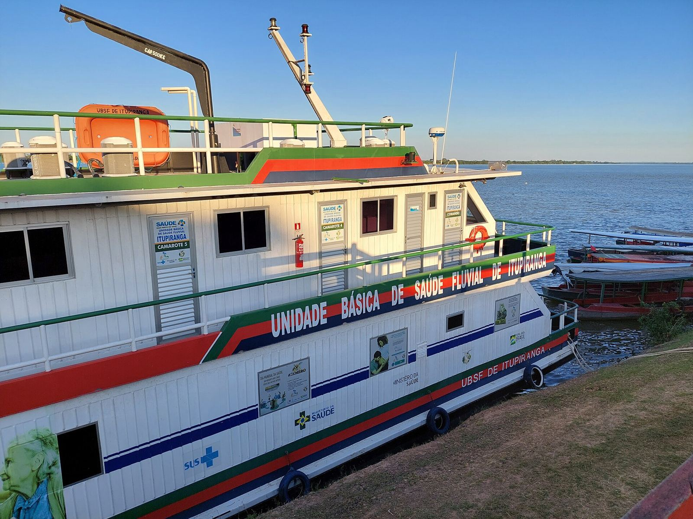
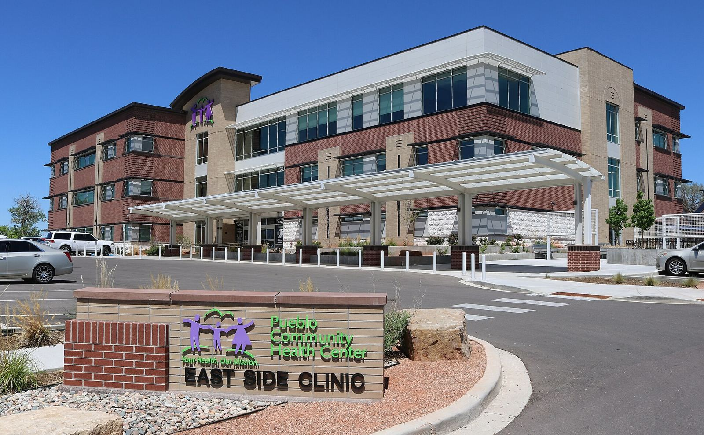
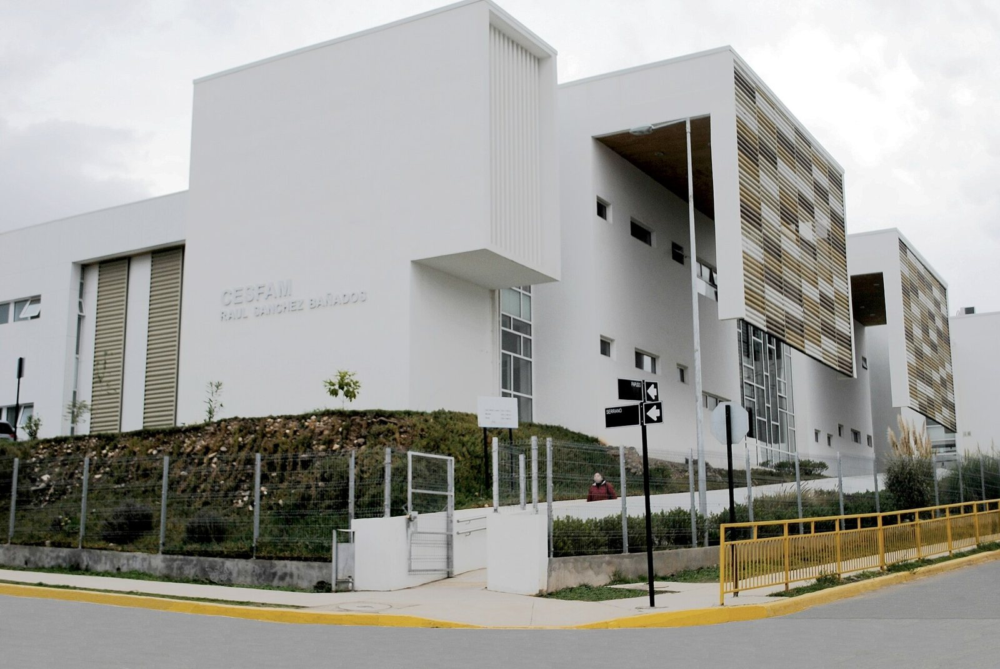
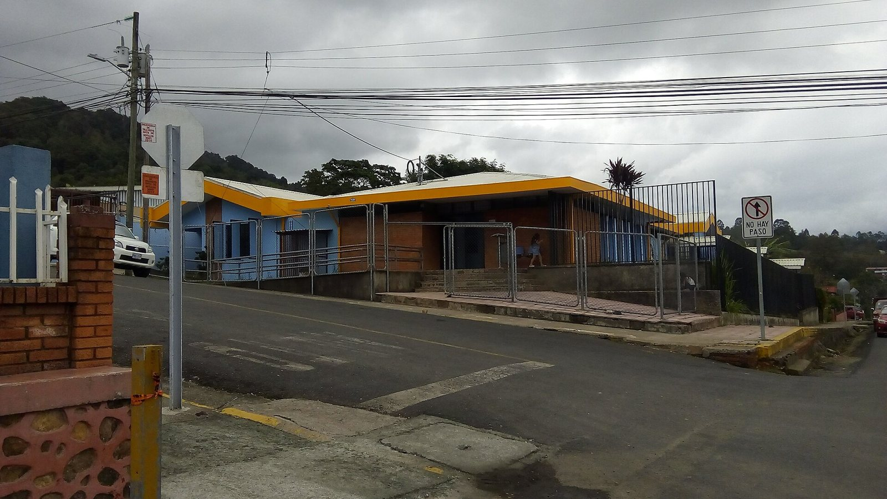
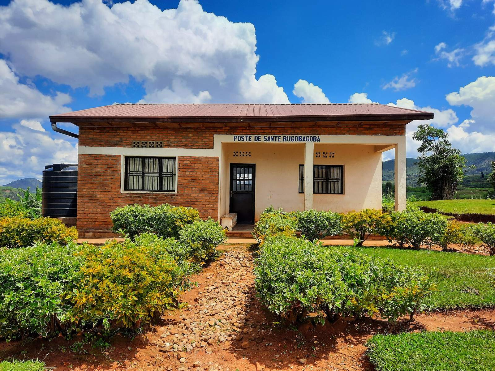
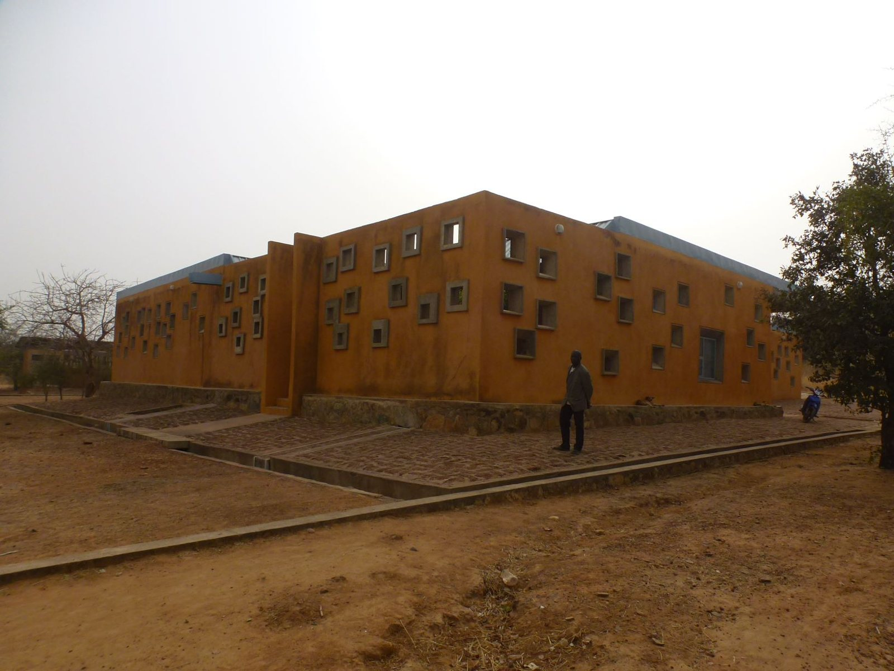
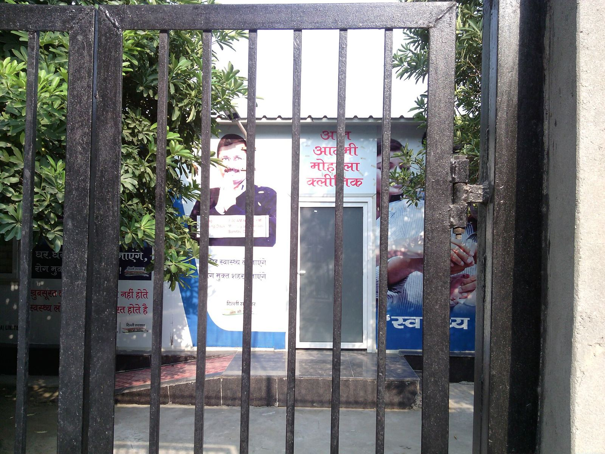
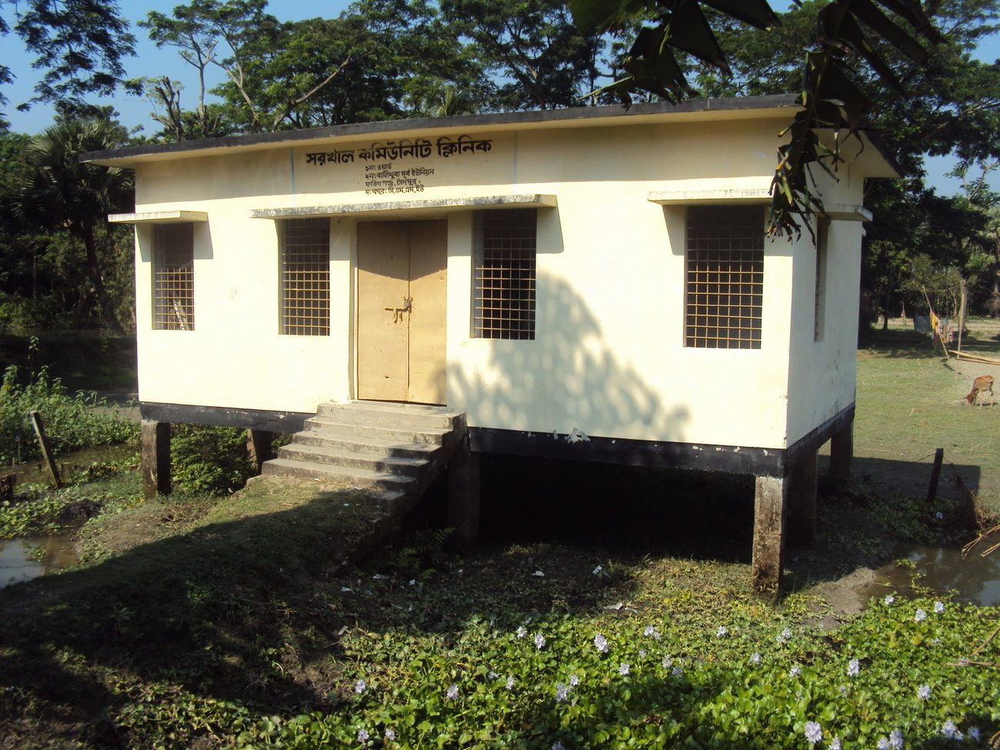

# Estrutura física de unidades de cuidados de saúde primários: estudo comparativo

Versão de 19/11/2026 · Adelson Guaraci Jantsch

Não existe norma internacional única de metragem para unidades de cuidados primários: a OMS fixa padrões de condições (água, saneamento, ventilação, resíduos, energia, resiliência) e cada país fixa o programa de áreas. Comparando países, um consultório genérico fica entre 9 e 16 m², a área bruta entre 0,05 e 0,10 m² por pessoa inscrita, e o custo de obra varia de cerca de US$ 330/m² (alvenaria ou terra em África) a mais de US$ 4.000/m² (Europa e EUA).

## Sobre este estudo

Este estudo inicia uma exploração sobre o que existe internacionalmente, principalmente em países de baixa e média renda, quanto a padrões de construção de unidades de cuidados primários e de base comunitária. Aborda desde postos de 35 m² a centros de 7.000 m², mais as unidades de urgência e emergência e os centros de atenção psicossocial (UPA e CAPS) brasileiros. Hospitais ficaram de fora. O foco é a estrutura física: áreas, água e saneamento, resíduos, energia, ventilação, expansão, ambiência, acessibilidade, custo e financiamento.

**Fiabilidade das páginas.** Na primeira versão, o descarregamento direto dos PDF foi bloqueado e os documentos foram lidos por um leitor web que devolve texto corrido. Nesta versão, os quatro PDF gravados na pasta `buildings` foram lidos página a página (ver a secção "Verificação com os PDF da pasta"). Por isso:

- "p." indica a página **impressa** no documento.
- **Verificadas no PDF:** todas as citações de *Essential environmental health standards* (OMS 2008), do *Guidance for climate-resilient and environmentally sustainable health care facilities* (OMS 2020), das diretrizes da Tupapa (AusHFG) e do livro do Prémio Pritzker 2022 (Kéré). Nos dois documentos da OMS, a página impressa é a página do PDF menos 1 (2008) e menos 10 (2020).
- **Não verificadas no PDF:** as restantes. Foram identificadas a partir do texto extraído e podem ter erro de uma página.
- "s/p" indica página web ou norma sem paginação.
- Dados sem página confirmada estão marcados como tal.

**Custos.** Mantêm-se na moeda e no ano da fonte. Os valores por m² marcados como (calc.) foram calculados aqui a partir do custo e da área publicados na mesma fonte. As comparações entre países são indicativas: diferem o ano, o que está incluído (equipamento, honorários, obras externas) e o preço local da construção.

## Normas internacionais por eixo

A OMS não fixa área total para unidades primárias. Fixa condições mínimas, que são a base dos programas nacionais. O único programa de áreas internacional encontrado é o guia da UNICEF de 2005.

### Programa de referência (UNICEF 2005)

O centro de cuidados primários típico serve 5.000 a 10.000 habitantes (p. 6). Uma unidade só com tratamento, injeção/curativo e espera é um posto; passa a centro de saúde quando ganha consultório e reanimação (p. 7).

| Ambiente | Área (m²) | Página |
| --- | --- | --- |
| Espera/multiuso | 25 | p. 8 |
| Consultório/exame (incl. saúde reprodutiva) | 15 | p. 13 |
| Tratamento/curativo/injeção | 14 | p. 15 |
| Laboratório | 14 | p. 21 |
| Posto de enfermagem | 10 | p. 9 |
| Sala de parto | 19 | p. 17 |
| Reanimação (opcional) | 20 | p. 12 |
| Quarto de 2 leitos (opcional) | 14 | p. 16 |
| Utilidade limpa / utilidade suja | 8 + 8 | pp. 10, 20 |
| Sanitário público / funcionários / pacientes | 8 / 6 / 3+3 | pp. 8, 11, 17, 19 |

Soma dos ambientes (calc.): cerca de 133 m² sem opcionais e 167 m² com eles, antes de circulação e paredes. Fonte: [UNICEF, Planning Guide 2005](https://moh.gov.vu/images/health_policies/plans/UNICEF_Primary_Health_Care_and_Referral_Hospital_Planning_Guide_2005-_Final.pdf).

### Água, saneamento e higiene

A referência é [WHO, Essential environmental health standards in health care, 2008](https://nl.ircwash.org/sites/default/files/Adams-2008-Essential.pdf) (EHS 2008). Volumes, qualidade da água, sanitários e esgoto estão em detalhe em [Água e esgoto](../sanitation/).

- **Quantidade de água** (Tabela 3.1, pp. 29–30): ambulatório 5 L/consulta; internamento 40–60 L/doente/dia.
- **Reserva:** pelo menos 2 dias (ficha WASH FIT, p. 2); a OPAS recomenda 3 dias. A norma indiana IPHS 2022 também exige 3 dias. Volumes de referência no Malawi: dispensário 700 L/dia com 830 L de reserva; centro de saúde 8.400 L/dia com 11.550 L (norma nacional 2024, p. 27).
- **Sanitários:** no ambulatório, pelo menos 4 (equipa, mulheres, homens, crianças), a no máximo 30 m dos utentes (p. 32). Ao menos 1 sanitário acessível e 1 com condições para higiene menstrual (indicadores básicos OMS/UNICEF, citados na norma do Malawi, p. 16).
- **Higiene das mãos:** ponto de lavagem a até 5 m dos sanitários (WHO 2024, *overview* de unidades resilientes, p. 31).

O instrumento de gestão é o [WASH FIT 2022](https://www.washinhcf.org/wp-content/uploads/2023/03/WASH-Fit-2022-SP.pdf): 7 domínios e mais de 90 indicadores pontuados 0/1/2 (p. 12, Quadro 3). O domínio "energia e ambiente" cobre energia de reserva, iluminação, eficiência, ventilação, vetores, águas pluviais e aparência da unidade (p. 12).

### Resíduos

- **Segregação:** 4 categorias (perfurocortantes, infetantes, comuns, perigosos). Contentores a no máximo 5 m do ponto de geração; infetantes em recipientes de 15–40 L trocados 2 vezes/dia (EHS 2008, pp. 35–36).
- **Tempo máximo de armazenamento de infetantes:** 24 h em estação quente de clima quente; 72 h em inverno temperado (tabela OPAS/OMS 2020, s/p).
- **Composição:** 10–25% do total é perigoso (WHO 2014, *Safe management of wastes*, p. 3). Geração em unidades pequenas: 0,008–0,075 kg/doente-dia (Tabela 2.5, p. 17), valores só ilustrativos.
- **Tecnologias** ([WHO 2019, Overview of technologies](https://www.susana.org/downloads?documentID=53471)): o documento coloca as autoclaves e o micro-ondas como primeira opção. A autoclave gravitacional com pulsação de pressão (5 a mais de 50 kg/h, 220–240 V) foi desenhada para baixo recurso (pp. 30–31). O incinerador de câmara única é barato, mas dura menos de 5 anos e pode emitir até cerca de 400 vezes o recomendado de dioxinas (pp. 34–36). A manutenção anual custa 3–5% do investimento (p. 13).
- **Custo indicativo de equipamento** ([OPAS, Smart Hospitals Toolkit](https://cdn.who.int/media/docs/default-source/climate-change/smart-hospital-toolkit-paho.pdf), pp. 30–33): calor seco de pequena escala cerca de US$ 5 mil; micro-ondas pequeno US$ 12–85 mil; autoclave gravitacional US$ 30–200 mil.

### Energia

A referência é [Energizing Health (OMS, Banco Mundial, IRENA, SEforALL, 2023)](https://www.seforall.org/system/files/2023-01/energizing_health.pdf). Situação, consumo, tecnologias e custos estão em detalhe em [Energia elétrica](../energia/).

- Unidade de cuidados primários típica (Tabela 3, p. xxx): 18,4 kWh/dia com equipamento tradicional e 10 kWh/dia com equipamento eficiente, com fotovoltaico de 3,6–6 kW.
- Orçamentar operação e manutenção, incluindo troca de baterias, para 10–15 anos (p. xxxix).
- Iluminação LED poupa até 79% (ficha WASH FIT, p. 2).
- Reserva de energia: muitos países dimensionam para 72 h; em Kerala (2018), hospitais ficaram 3 a 9 dias sem energia ([WHO 2020, climate-resilient HCF](https://globalplatform.undrr.org/2022/sites/default/files/2022-04/WHO%20guidance%20for%20climate%20resilient%20and%20environmentally%20sustainable%20health%20care%20facilities.pdf), p. 10, Caixa 2). A tabela 4.4.1A do mesmo guia fixa reserva para **pelo menos 3 dias** de eletricidade, climatização, água e insumos (p. 56).
- **Intervenções de energia ligadas ao edifício** (WHO 2020, tabelas 4.3.1–4.3.2, pp. 49–53):
    - isolar coberturas, sobretudo as planas, que são o ponto de maior perda térmica (p. 49);
    - reserva de energia a cobrir pelo menos todas as áreas e equipamentos críticos (p. 49);
    - estabilizadores de tensão para proteger equipamentos (p. 50);
    - aquecedores solares de água (pp. 50, 61);
    - equipamento de reserva elevado em zonas inundáveis e ancorado em zonas de vento forte (p. 50);
    - LED, sensores de presença, luz natural e janelas com rede mosquiteira (p. 52);
    - ventiladores de teto eficientes e substituição de aparelhos antigos por modelos eficientes (p. 52);
    - pé-direito alto, janelas grandes e claraboias para maximizar a ventilação natural (p. 53);
    - fotovoltaico com baterias como fonte principal ou de reserva, com plano de manutenção (p. 53);
    - sistemas híbridos (renovável, baterias e gerador) (p. 61).

### Ventilação e conforto térmico

A referência é [WHO, Natural ventilation for infection control, 2009](https://depts.washington.edu/edgh/app-ipc/web/project-resources/natural_ventilation.pdf). Normas, evidência e ar condicionado estão em detalhe em [Ventilação](../ventilacao/).

- **Taxas mínimas, média horária** (pp. xx, 21–22): ambulatório e enfermaria geral 60 L/s/doente; sala de precaução aérea 160 L/s/doente, nunca abaixo de 80; corredores 2,5 L/s/m³.
- **Desenho:** ventilação cruzada com aberturas semelhantes em faces opostas; efeito chaminé; corredor lateral, pátio, torre de vento (pp. 33, 45–50). Ventilação de um só lado não garante a taxa (p. 28).
- **Ordem de grandeza:** sala de 7 × 6 × 3 m com janela e porta abertas dá cerca de 37 renovações/h; com a porta fechada, 4,2 (Tabela 4.1, p. 30).
- **Calor:** acima de 30 °C a ventilação natural pode tornar-se intolerável; aumentar velocidade do ar e usar arrefecimento evaporativo (pp. 36–37).
- **Regras do edifício (OMS 2008, Diretriz 9, pp. 42–44):**
    - luz natural pode bastar em ambulatórios que só funcionam de dia, mas é preciso iluminação para emergências noturnas (p. 43);
    - organizar a unidade em zonas, com fluxo do "limpo" para o "sujo" (p. 44);
    - paredes, pisos e tetos lisos, não porosos e laváveis com água quente e desinfetantes (p. 44);
    - leitos separados por pelo menos 1 m e acessíveis a pessoas com deficiência e idosos (p. 44);
    - redes nas janelas e portas exteriores com fecho automático para excluir mosquitos e moscas (p. 45).
- **Orientação:** lado maior perpendicular ao vento dominante; em clima quente, fachadas longas a norte e sul; forro isolado e ventilado (MSF, *Temporary Health Structures*, 2012, pp. 17–18).

### Acessibilidade

- [ISO 21542:2021](https://www.iso.org/standard/71860.html) cobre acesso, circulação, saída e evacuação; a base dimensional é a cadeira de rodas de 800 × 1.300 mm. Larguras de porta e rampa exigem o texto integral, pago e não consultado.
- A OMS adota um acréscimo de 10% no custo para tornar intervenções acessíveis ([Global report on health equity for persons with disabilities, 2022](https://digitallibrary.un.org/record/3998942/files/9789240063600-eng.pdf), p. 43).

### Resiliência climática

- O guia de 2020 organiza as intervenções em 4 componentes (força de trabalho; WASH e resíduos; energia; infraestrutura e produtos) e trata a escolha do terreno como primeira medida (pp. 2, 10).
- **Água e saneamento** (tabela 4.2.1B, pp. 42–43): reservatórios fora de zona inundável; águas pluviais geridas sem poças; fossas sépticas seladas e respiros acima da cota de cheia (ver [Água e esgoto](../sanitation/)).
- **Implantação e estrutura** (tabela 4.4.1A, pp. 54–56):
    - mapear perigos e evitar costas de alto risco e áreas sujeitas a ciclones, cheias ou subida do mar (p. 55);
    - projetar com base na topografia, histórico de cheias e clima local, e considerar secas, chuvas prolongadas e ondas de calor (p. 55);
    - ventilação natural suficiente, com proteção contra vetores (p. 55);
    - materiais resistentes ao fogo e não tóxicos; rotas de evacuação sinalizadas e livres (p. 55);
    - vidros laminados ou protegidos; janelas e portas de vidro resistentes a ventos de 200–250 km/h, com proteção solar e estanques (p. 56);
    - portas automáticas que se abrem manualmente se faltar energia (p. 56);
    - telhados brancos refletivos, bem fixados, isolados e estanques, com drenagem suficiente; em zonas de tempestades tropicais, resistentes a ventos de 175–250 km/h (p. 56).
- **Calor** (tabela 4.4.1B, p. 57): monitorizar a temperatura interna, sombrear contra o sol direto e aumentar o fluxo de ar em calor extremo.
- **Sustentabilidade do edifício** (tabelas 4.4.2A–C, pp. 61–63): critérios ambientais nos planos de obra e abordagem de baixo carbono (p. 61); corredores junto às paredes exteriores, para luz natural e ventilação (p. 61); árvores e plantas nativas para sombra em ondas de calor; plantas resistentes à seca; drenagem de águas residuais sem contaminar o entorno (p. 63).
- **Resíduos:** abandonar a incineração em favor de tecnologias sem queima, como a autoclave; recolha separada por tipo de risco; reciclagem de não perigosos (tabela 4.2.2B, p. 46).
- Para unidades pequenas e médias (até cerca de 20 leitos, incluindo cuidados primários) há uma versão do Índice de Segurança com 94 itens (OPAS, Smart Hospitals Toolkit, pp. 9–10).

## Dimensionamento comparado

As normas convergem num consultório genérico de 9 a 16 m², com valor mais comum entre 12 e 14 m² e numa área bruta de 0,05 a 0,10 m² por pessoa inscrita. O Brasil (9 m²) e os EUA (7,4 m² livres) ficam no limite inferior; o Reino Unido desaconselha consultórios abaixo de 16 m².

| País / norma | Consultório | Outros ambientes | Área por pessoa ou por unidade | Fonte |
| --- | --- | --- | --- | --- |
| Reino Unido, HBN 11-01 (2013) | 16 m² recomendado; 12 m² desaconselhado | Módulos de 8, 16 e 32 m² | 0,06–0,10 m² brutos por paciente inscrito (Devon, 2018) | HBN 11-01 §3.17–3.21, p. 11 |
| Portugal, USF (2006) | 14 m² | Tratamentos 14–16 m²; espera 30–42 m² | 320 m² brutos para 5.000 inscritos; 818 m² para 18.000 (0,045–0,064 m²/inscrito, calc.) | Orientações DGIES, pp. 11–17 |
| Austrália/NZ, AusHFG | 12 m² (geral); 16 m² (ORL/oftalmologia) | Gabinete dentário 14 m²; oficina dentária 12 m²; depósito de farmácia 5 ou 10 m²; tratamento 14 m² | — | Diretrizes Tupapa (AusHFG), pp. 8–9, 13–15; HPU 0132, pp. 24–26 |
| EUA, FGI 2022 | 80 sf (7,4 m²) livres; 100 sf com dupla entrada | Folga de 0,81 m em 3 lados da maca | — | FGI §2.1-3.2.2.2, p. 3 (checklist MA) |
| Brasil, Portaria 2.468/2021 | 9 m² | Vacina 9 m²; curativo 9 m²; espera 1,3 m²/pessoa | Requalifica 2013: 277 m² (1 eSF) a 544 m² (4 eSF) | Anexo, s/p |
| Brasil, RDC 50/2002 | 7,5 m² (lado mín. 2,2 m) | Curativo 9 m²; odontologia 9 m² por cadeira | — | Tabelas reproduzidas, s/p |
| Chile, CESFAM (obras 2016–22) | — | — | 2.100–2.700 m² para 20–25 mil inscritos (~0,1 m²/inscrito, calc.) | Notas MINSAL, s/p |
| Índia, IPHS 2022 (PHC) | ≥ 12 m² | Registo ≥ 15 m²/guichê; vacinação 12 m²; parto ~32 m² | PHC para 30 mil (planalto) ou 20 mil (montanha) | IPHS PHC, pp. 7, 18–21 |
| UNICEF (2005) | 15 m² | Tratamento 14 m²; espera 25 m² | ~133–167 m² de ambientes para 5–10 mil (calc.) | pp. 6–21 |
| Bangladesh, community clinic | — | 2 salas + varanda de espera | 42 m² para ~6.000 pessoas | Relatório DFID 2002, pp. 3, 26–27 |

Três pontos de método se repetem nas normas mais maduras:

- **Dimensionar por fluxo, não por equipa.** A HBN 11-01 calcula salas a partir de população, taxa de contacto, duração da consulta e utilização mínima de 60%. Exemplo: 10.000 pessoas dão 7,3 consultórios e 1,9 salas de tratamento (§4.14–4.16, p. 16).
- **Circulação explícita.** O Brasil soma 20% de circulação às áreas úteis (Portarias 2.226/2009 e 340/2013); a PPP de Recife usa 25%; Portugal multiplica a área útil por 1,6.
- **Terreno com folga.** O Requalifica previa terrenos de 500 a 890 m² (1 a 4 eSF). A norma peruana NTS 113 reserva 50% do terreno ao programa, 20% a circulação, estacionamento e expansão, e 30% a área livre (citada em tese, p. 10 da norma). O Quénia exige 1 acre (nível 2) e 2 acres (nível 3).

## Brasil

O Brasil tem a regulamentação mais detalhada entre os países de renda média: áreas mínimas por sala, portes por número de equipas, projetos de referência nacionais e incentivos de construção por porte. O custo licitado de uma UBS Porte I do Novo PAC ficou em cerca de R$ 5.000–5.550/m² em 2025.

### UBS e Unidades de Saúde da Família

**Manual de Estrutura Física das UBS (MS, 2008).** Recomenda no máximo 5 eSF por UBS (p. 15) e define a quantidade de ambientes por porte (p. 16): espera para 15 a 75 pessoas; de 2 a 8 consultórios; 1 sala de vacina, curativo, nebulização, farmácia, reunião e ACS em qualquer porte. Diretrizes: acessibilidade universal, integração com o entorno, uso partilhado das salas e espaço para ensino (pp. 7–13). Lido em cópia OCR, sem metragens ([SlideShare](https://www.slideshare.net/slideshow/manual-estrutura-ubs/8813523)).

**Evolução dos portes e incentivos federais**

| Norma | Porte | Equipas | Área mínima | Incentivo de construção |
| --- | --- | --- | --- | --- |
| Portaria 2.226/2009 | I | 1 eSF | 153 m² (127,7 + 20%) | R$ 200 mil |
| Portaria 2.226/2009 | II | ≥ 3 eSF | 293 m² (244,4 + 20%) | R$ 400 mil |
| Portaria 340/2013 (Requalifica) | I | 1 eSF | 277 m²; terreno 500 m² | R$ 408 mil |
| Portaria 340/2013 | II | 2 eSF | 353 m²; terreno 600 m² | R$ 512 mil |
| Portaria 340/2013 | III | 3 eSF | 460 m²; terreno 760 m² | R$ 659 mil |
| Portaria 340/2013 | IV | 4 eSF | 544 m²; terreno 890 m² | R$ 773 mil |
| Portaria 6.185/2024 (Novo PAC) | I a V | 1 eSF + 1 eSB a 5 eSF + 5 eSB | Sem área total fixa; Porte I ~390–480 m², Porte V ~1.000–1.300 m² | Valores regionalizados por UF (tabela oficial não localizada) |

Fontes: [Portaria 2.226/2009](https://saude.sc.gov.br/edocman/legislacao/legislacao-geral/portarias/Portaria%20MS%202.226-2009-.PDF) (DOU 23/09/2009, pp. 654–655); [Portaria 340/2013](https://bvsms.saude.gov.br/bvs/saudelegis/gm/2013/prt0340_04_03_2013.html), Anexo I e art. 5; [Portaria 6.185/2024](https://saude.campinas.sp.gov.br/lista_legislacoes/legis_2024/U_PT-MS-GM-6185_201224.pdf), art. 705-A.

**Novo PAC Saúde (2023–2026).** A primeira seleção previu 1.800 UBS por R$ 4,2 bilhões, cerca de R$ 2,3 milhões por unidade (calc.), com fotovoltaico, LED, jardins internos, separação de recicláveis e sala de teleconsulta ([Agência Gov, 09/11/2023](https://agenciagov.ebc.com.br/noticias/202311/novo-pac-saude-preve-a-construcao-de-1-800-unidades-basicas-de-saude-sustentaveis)). O [Manual de Uso do Projeto de Referência](https://www.gov.br/saude/pt-br/centrais-de-conteudo/publicacoes/guias-e-manuais/2025/manual-de-uso-do-projeto-de-referencia-novo-pac-saude.pdf) define:

- estrutura em concreto, aço ou mista; drywall nas divisórias e alvenaria nas vedações externas (pp. 29–31); piso em granilite (p. 32);
- ventilação pela NBR 7256:2021 (pp. 41–42); acessibilidade pela NBR 9050:2020 e piso tátil pela NBR 16537:2024 (pp. 30, 42–43);
- ventilação e iluminação naturais, reúso de água e energia renovável como diretrizes (p. 47); fotovoltaico opcional (p. 26);
- proibição de enfermaria (pp. 8, 14).

A ANVISA validou o Porte I contra a RDC 50 e criou um fluxo simplificado de aprovação para projetos de baixa complexidade ([Nota Técnica 120/2024](https://www.gov.br/anvisa/pt-br/assuntos/servicosdesaude/novo-pac-saude/notas-tecnicas/nota-tecnica-120-2024/@@download/file), pp. 3–4).

Custo licitado do Porte I (SINAPI 2025): Santos Dumont/MG, R$ 1,96 milhão para ~390 m² (~R$ 5.026/m², [ETP, p. 14](https://www.santosdumont.mg.gov.br/arquivos/files/Processo%20164%202025%20-%20ETP%20-%20ESTUDO%20TECNICO%20PRELIMINAR_compressed.pdf)); Caratinga/MG, R$ 2,16 milhões (~R$ 5.551/m², [ETP, p. 3](https://caratinga.mg.gov.br/wp-content/uploads/2026/04/ETP_OBRAS_assinado-1.pdf)).

**Ambiência (PNH).** Três eixos: conforto e privacidade; espaço de encontro que produz subjetividade; espaço como ferramenta do processo de trabalho ([Ambiência, MS 2004](https://www.saude.sp.gov.br/resources/humanizacao/biblioteca/pnh/ambiencia.pdf), p. 5). Recomenda acolhimento com balcões baixos e sem grades (p. 16), luz natural, cor, som e áreas externas (pp. 8–11). O material de formação da PNH sugere retirar muros e criar praças de acesso, pactuado com a comunidade ([RedeHumanizaSUS](https://redehumanizasus.net/wp-content/uploads/2019/04/19231-1-1.pdf), pp. 37–41).

### Clínicas da Família do Rio de Janeiro

O Rio construiu 76 novos centros de saúde na comunidade, nomeados lá de Clínicas da Família, entre 2009 e meados de 2015, que abrigavam 732 das 860 eSF da cidade; a cobertura da ESF passou de 3,5% (2008) para mais de 40% (2013) (Soranz, Pinto e Penna, [Ciênc. Saúde Coletiva 2016](https://www.redalyc.org/pdf/630/63045664002.pdf), pp. 1327, 1333–1334). Eram 110 em novembro de 2016 ([Soranz e Pisco 2017](https://www.redalyc.org/pdf/630/63050018002.pdf), p. 682) e 139 em setembro de 2026.

- **Programa:** unidades grandes, de 5 a 9 eSF mais eSB, com raio-X e ultrassom em parte delas, e espaço para ensino (residência).
- **Custo por unidade (imprensa):** R$ 2,5–3 milhões em 2010–2011; R$ 4,8 milhões em 2015 (Jabour); R$ 5 milhões previstos em 2026 para ~1.500 m² no Recreio (~R$ 3.300/m², calc.). As obras foram feitas pela RioUrbe com recursos municipais; a gestão é por Organizações Sociais. A CF Recreio é financiada por emenda de bancada federal.
- **Novo modelo (2026):** pé-direito alto, brises externos e climatização total, com foco no calor extremo (CF Taquara, 9 eSF, 10 consultórios, auditório e Academia Carioca).
- **Críticas:** implantação em praças desafetadas, com pouco diálogo com moradores (Menezes e Tângari, [SBQP 2019](https://eventos.antac.org.br/index.php/sbqp/article/download/3125/2577/9346), pp. 165–177); redução de 1.251 para 1.090 equipas entre 2017 e 2019, mostrando que a rede física depende de custeio estável ([Melo et al., CSC 2019](https://www.scielo.br/j/csc/a/DvfHFsvqYzXN4bPX9HbsBxj/?lang=pt)). Não foi encontrada avaliação pós-ocupação.

### CAPS e Unidades de Acolhimento

O [Manual de Estrutura Física dos CAPS e UA (MS, 2013)](https://participemais.prefeitura.sp.gov.br/system/documents/attachments/000/001/094/original/abfcd89c348bcc27881c88f592a4af6ea281fb73.pdf) parte de princípios de ambiência explícitos: "portas abertas" em sentido literal e simbólico, permeabilidade com o território, acolhimento sem guichê, convivência que não se confunde com corredores e salas de grupo com mobiliário móvel (sec. 4.1–4.2, s/p).

| Tipo | Área interna + 20% | Com áreas externas | Incentivo 2013 (Portaria 615) | Novo PAC 2025 |
| --- | --- | --- | --- | --- |
| CAPS I, II, i e AD | 438 m² | 534 m² | R$ 800 mil | R$ 2–2,5 milhões |
| CAPS III | 494 m² | 590 m² | R$ 1 milhão | R$ 2–2,5 milhões |
| CAPS AD III | 516 m² | 612 m² | R$ 1 milhão | R$ 2–2,5 milhões |
| Unidade de Acolhimento | 274 m² | 319 m² | R$ 500 mil | — |

Ambientes comuns: acolhimento 30 m²; 3 salas individuais de 9 m²; 2 salas de grupo de 24 m²; convivência 65 m²; refeitório 60 m²; área externa de convivência 75 m². O Novo PAC selecionou 130 CAPS por R$ 324 milhões, com diretrizes de "ver e ser visto", usos partilhados entre equipa e utentes e preparo para fotovoltaico ([apresentação MS 2025](https://www.gov.br/saude/pt-br/centrais-de-conteudo/apresentacoes/2025/recepcao-dos-selecionados-pac-2025-caps.pdf), slides 4–5). Fonte do incentivo: [Portaria 615/2013](https://saude.campinas.sp.gov.br/saude/lista_legislacoes/legis_2013/U_PT-MS-GM-615_150413.pdf), art. 5.

### UPA 24h

A UPA não é unidade de cuidados primários: é o componente pré-hospitalar fixo da Rede de Urgência, entre a UBS e o hospital, e exige cobertura de atenção básica de pelo menos 50% no município sede (Portaria 342/2013, arts. 2º e 9º).

| Porte | População | Área mínima (2011–2013) | Leitos de observação | Investimento UPA nova (2013) | Custeio mensal habilitada/qualificada (2013) |
| --- | --- | --- | --- | --- | --- |
| I | 50–100 mil | 700 m² | 7 | R$ 2,2 milhões | R$ 100/170 mil |
| II | 100–200 mil | 1.000 m² | 11 | R$ 3,1 milhões | R$ 175/300 mil |
| III | 200–300 mil | 1.300 m² | 15 | R$ 4,0 milhões | R$ 250/500 mil |

Fonte: [Portaria 342/2013](https://www.conass.org.br/?p=1905), arts. 12, 18, 32–33. A Portaria 10/2017 retirou a área mínima dos critérios de porte e criou 8 opções de custeio por número de médicos ([nota COSEMS-SC](https://www.cosemssc.org.br/wp-content/uploads/2017/04/NOTA-UPAS-2017-0-1.pdf), pp. 5–6).

A lição principal da UPA é sobre custeio: em 2017, 165 UPAs e 993 UBS construídas estavam fechadas, cerca de R$ 1 bilhão em obras sem uso ([IHU, 05/05/2017](https://www.ihu.unisinos.br/567329-sem-verba-1-158-unidades-do-sus-estao-fechadas)). Numa amostra de 280 UPAs, só 64% se articulavam com a atenção básica (Doll et al., [Cad. Saúde Pública 2022](https://scielosp.org/pdf/csp/2022.v38n8/e00009922/pt), pp. 4–5).

### Outras experiências brasileiras

- **UBS Fluvial (Amazônia):** embarcação de cerca de 24 m; incentivo de construção de R$ 1,89 milhão (Portaria 1.355/2015) e custeio de R$ 90 mil/mês; 26 de 64 propostas concluídas entre 2011 e 2016 ([El Kadri et al., Interface 2019](https://www.scielo.br/j/icse/a/jJWLyMsndVmG3N9BTc5M4GG/?lang=pt)).
- **Pré-fabricação de Lelé no Rio (1986–1988):** 28 postos de saúde em argamassa armada, com ventilação e iluminação por aberturas na laje. Depois de 1994, sem a fábrica, surgiram patologias, desconforto térmico e manutenção difícil ([Longhi, FAU-UFRJ 2001](https://pantheon.ufrj.br/bitstream/11422/11477/1/531360.pdf), pp. 19–21). A lição é que sistemas pré-fabricados exigem uma cadeia de manutenção própria.
- **Light steel frame na PPP de Belo Horizonte:** 40 centros de saúde construídos em cerca de 9 meses cada (ver Financiamento).

## Países de alta renda

Os países de alta renda convergem em três ideias: salas genéricas e intercambiáveis, crescimento previsto desde o projeto e metas energéticas ou de carbono. O custo de obra fica entre cerca de €1.500 e €4.000/m².

### Reino Unido

A [HBN 11-01 (2013)](https://www.england.nhs.uk/wp-content/uploads/2021/05/HBN_11-01_Final.pdf) é a referência mais completa para cuidados primários e comunitários.

- **Salas genéricas:** módulos de 8, 16 e 32 m² (§3.17, p. 11); consultório genérico de 16 m² com maca encostada a uma parede (§3.20, p. 11); diretório de salas partilhadas por agenda, com utilização mínima de 60% (§3.7, §4.14, pp. 9–16).
- **Flexibilidade:** divisórias dobráveis acústicas para juntar duas salas numa de 32 m² (p. 28); pontos de água tamponados para lavatórios futuros (§3.18, §3.27); estrutura em pórtico e pré-fabricação fora do local (§3.30–3.33, pp. 13–14).
- **Crescimento:** prever expansão ou redução no início do planeamento, reservar área ao lado do setor que vai crescer e, se o serviço encolher, subdividir ou arrendar (§3.37–3.40, p. 14).
- **Sustentabilidade:** BREEAM Healthcare obrigatório acima de um limiar de investimento (§1.23, p. 4). O [NHS Net Zero Building Standard (2023)](https://www.england.nhs.uk/wp-content/uploads/2023/02/B1697-NHS-Net-Zero-Building-Standards-Feb-2023.pdf) aplica-se a novos centros grandes (Tabela 1, p. 10), com limites de energia e carbono calculados por projeto; o guia de uso traz um centro de 2 pisos com 362 kgCO₂e/m² de carbono incorporado (pp. 59, 64–66).
- **Estado atual:** cerca de 20% do parque de cuidados primários é anterior a 1948; o plano de 2025 recomenda especificação padrão para os novos centros de bairro ([relatório de infraestrutura](https://assets.publishing.service.gov.uk/media/6939b9297a605b2d61cd90e0/physical-infrastructure-enabling-working-group-report-10-year-health-plan.pdf), pp. 5, 17, 21).

### Austrália e Nova Zelândia

As AusHFG trabalham com *standard components* (salas-padrão) e *room data sheets* por sala; componentes derivados ajustam tamanho e conteúdo mantendo o padrão como referência ([HPU 0132](https://aushfg-prod-com-au.s3.amazonaws.com/HPU_B.132_8_1.pdf), p. 19). O consultório geral recomendado é de 12 m²; o de ORL/oftalmologia, de 16 m², também serve para consulta geral e exige 3 m entre o optotipo e o espelho; sala de entrevista em saúde mental com 14 m² e até 6 pessoas (fichas RDS 2025).

As diretrizes da **Tupapa Health Centre** (Ilhas Cook, 2021) mostram como um pequeno país aplica a AusHFG a um centro de cuidados primários. A unidade tem ambulatório de adultos e crianças, urgência 24 h e clínica dentária com 6 gabinetes, com receção e espera partilhadas, a segregar por causa da covid (p. 3). Pontos úteis:

- consultórios atuais de ~12,5 m², dentro da norma de 12 m²; gabinetes dentários de ~12,5 m², abaixo dos 14 m² recomendados (pp. 8, 13);
- cada sala tem ficha com área, horário, ocupação, acabamentos duráveis, instalações elétricas, de dados, de água e de gases, a definir com os utilizadores finais (p. 5);
- requisitos por sala: privacidade acústica alta nos consultórios; área elétrica "body protected" nos consultórios e "cardiac protected" na sala de pequenos procedimentos (pp. 8–11);
- a farmácia de 14 m² não tem depósito separado; a norma prevê balcão e depósito de 5 ou 10 m², e o cofre de controlados exige parede para fixação (p. 15);
- sanitário assistido conforme a norma australiana AS 1428, com fraldário e botão de chamada quando fica em área de doentes (p. 19);
- espaços em falta na unidade atual: saúde mental comunitária, serviço social, nutrição, reabilitação, colheita de sangue e sala para grupos de apoio (p. 4).
- Fonte: [Design Guidelines for Tupapa Health Centre](https://health.gov.ck/wp-content/uploads/2022/12/Design-Guidelines-for-Tupapa-Clinic.pdf).

O programa **GP Super Clinics** é um exemplo de risco de execução: A$ 418,7 milhões anunciados para 65 clínicas, com A$ 1 a 15 milhões cada; só 3 das 29 concluídas ficaram prontas no prazo, e a 1.ª ronda não usou referências de custo por m² ([ANAO, Audit Report 50, 2013](https://www.anao.gov.au/sites/default/files/201213%20Audit%20Report%20No%2050.pdf), pp. 9, 13–18). A maior dificuldade das clínicas em funcionamento foi fixar pessoal (p. 20).

### Canadá

A CSA Z8000-18 inclui instalações comunitárias no seu âmbito e define folgas para salas de exame acessíveis e bariátricas. Em Ontário, 75 Community Health Centres funcionam em 145 locais; o capital foi de apenas C$ 16 milhões em 2016/17, contra C$ 401 milhões de custeio ([Auditor General 2017](https://www.auditor.on.ca/en/content/annualreports/arreports/en17/v1_303en17.pdf), pp. 185–189). No Quebec, o Estado financia a operação e o imóvel fica com os médicos ou terceiros; o reembolso de adaptação de espaço de um GMF vai até C$ 30–60 mil.

### Países nórdicos e Países Baixos

- **Dinamarca, *sundhedshuse* (casas de saúde):** juntam médicos de família, serviços municipais e regionais. Fundo nacional de cerca de 210 milhões DKK/ano em 2018–2020, com procura 4 vezes maior que a oferta ([resposta ao Folketing, 2019](https://ft.dk/samling/20191/lovforslag/L1/spm/30/svar/1603513/2098561.pdf)). Modelo de "comunidade de aluguer": cada profissional paga o seu espaço e uma parte das áreas comuns ([Burau et al., IJIC](https://pmc.ncbi.nlm.nih.gov/articles/PMC5354220)).
- **Suécia, Mönsterås (2023):** hälsocentral de ~2.250 m² num edifício de 3.520 m² com reabilitação, 149,8 milhões SEK (~42.600 SEK/m², calc.) ([Region Kalmar](https://oskarshamns-nytt.se/wp-content/uploads/2023/10/underlagforgenomforande.pdf), pp. 2–6).
- **Finlândia, Nastola (2026):** centro de ~6.200 m² que reúne serviços sociais, saúde, reabilitação e bombeiros, ~~€25 milhões (~~€4.000/m², calc.) ([STT](https://www.sttinfo.fi/tiedote/72342738/)).
- **Países Baixos, Waalre (2022):** 2 práticas de medicina geral, farmácia e fisioterapia; rótulo energético A++++ e 144 painéis solares; consultórios reversíveis para pandemias. Cerca de 10 anos entre a ideia e a obra, incluindo mudança de zoneamento ([De Dokter 5/2025](https://www.lhv.nl/wp-content/uploads/2025/11/DD2505_06-07_Binnenkijken.pdf), pp. 6–7).

### EUA

- **Norma:** FGI 2022 exige 7,4 m² livres por sala de exame (80 sf), com folga de 0,81 m em 3 lados da maca ([checklist de Massachusetts](https://www.mass.gov/doc/op1-outpatient-medical-services-facilities/download), p. 3).
- **Financiamento federal de capital:** os Federally Qualified Health Centers receberam subsídios do HRSA, por exemplo US$ 727 milhões para 143 centros em 2010 e US$ 1 bilhão do American Rescue Plan em 2021. O total do ACA para obras aparece como US$ 1,0 ou 1,5 bilhão conforme o relatório do CRS; a diferença não foi esclarecida.
- **Energia zero:** Pueblo Community Health Center, East Side Clinic (Colorado), 5.936 m² e US$ 24 milhões (~US$ 4.040/m², calc.). O desenho energia zero acrescentou cerca de 6,25% ao custo; no 1.º ano produziu 435.744 kWh e consumiu 423.024 kWh ([NBI, 2023](https://newbuildings.org/news/pueblo-community-healths-new-east-side-clinic-is-first-zero-energy-health-center-in-u-s/)).

### Portugal e Espanha

- **Portugal:** as [Orientações para Instalações de USF (2006)](https://www.cascais.pt/sites/default/files/anexos/gerais/new/anexo_6_orientacoes_instalacoes_e_equipamentos_para_usf.pdf) dão gabinetes de 14 m², corredores de pelo menos 1,40 m, portas de 0,90–1,10 m e elevador obrigatório em mais de um piso (pp. 5–17). O PRR financia 55 centros de saúde novos e 335 requalificados, com prazo em 31/08/2026; custos por projeto entre €1,9 e 4,3 milhões (Pousos, Mafra, Arganil), sem área publicada.
- **Espanha:** Artà (Baleares, 2025), 2.024 m² por €5,6 milhões (~~€2.770/m², calc.); Vilagarcía (Galiza, 2025), mais de 8.000 m² por €19 milhões (~~€2.375/m², calc.), com 17 consultórios de medicina de família e 17 de enfermagem.

### Madeira e biofilia

- Cranleigh Health Centre (Inglaterra, 2012): 1.300 m² com 400 m³ de madeira lamelada cruzada (CLT) ([Stora Enso](https://references.buildingsolutions.storaenso.com/en/projects/health/uk/cranleigh-health-centre)).
- Tall Tree Integrated Health Centre (Canadá, 2015): 463 m² em CLT, ventilação natural e claraboias voltadas para a copa das árvores ([naturally:wood](https://www.naturallywood.com/project/tall-tree-integrated-health-centre/)).

## América Latina

O Chile e a Costa Rica têm os programas de investimento mais consistentes: tipologias escalonadas por população (CECOSF, CESFAM, SAR no Chile; sedes de EBAIS e áreas de saúde na Costa Rica) e canais de financiamento variados.

### Chile

O Plano Nacional de Investimentos 2014–2018 previa 100 CESFAM, 100 CECOSF e 132 SAR, cerca de 300.000 m² ([MINSAL, 2015](https://www.minsal.cl/proyectos-de-atencion-primaria-de-salud/)). As notas de obra do MINSAL permitem montar o padrão:

| Tipologia | Função | Área típica | População | Exemplo de custo |
| --- | --- | --- | --- | --- |
| CECOSF | Centro comunitário de saúde familiar, satélite do CESFAM | 250–300 m² | ~5.000 | Arica 2016: CLP 340 milhões de obra, 283 m² (~CLP 1,2 milhão/m², calc.) |
| CESFAM | Centro de saúde familiar | 1.400–2.700 m² | 7.000–25.000 | Arica Sur 2018: CLP 4.200 milhões, 2.132 m² (~CLP 1,97 milhão/m², calc.) |
| SAR | Serviço de urgência de alta resolutividade, anexo ao CESFAM | ~500 m² | >30.000 | Villa Alegre 2018: >CLP 790 milhões, 500 m² (~CLP 1,58 milhão/m², calc.) |

Financiamento por três canais: setorial (MINSAL), Fundo Nacional de Desenvolvimento Regional (FNDR) e convénios de programação entre MINSAL e governo regional. No CECOSF de Arica, o MINSAL pagou a obra e o município paga a operação. Fontes: notas MINSAL de [Arica Sur](https://www.minsal.cl/arica-obras-de-cesfam-sur-tienen-un-76-de-avance-y-estaria-listo-en-noviembre/), [Villa Alegre](https://www.minsal.cl/construccion-de-sar-en-villa-alegre-presenta-un-99-de-avance/) e [CECOSF Arica](https://www.minsal.cl/servicio-de-salud-arica-confirmo-80-por-ciento-de-avance-en-obras-de-cecosf-dr-rene-garcia/). O guia de desenho do MINSAL não foi encontrado.

### Costa Rica

- A CCSS prevê 334 novos EBAIS até 2026, além dos ~1.000 existentes ([observador.cr, 2022](https://observador.cr/ccss-pretende-construir-334-ebais-en-proximos-cinco-anos-se-crearan-1-670-plazas/)). Estimativa política de cerca de US$ 1 milhão por EBAIS.
- Sedes com vários EBAIS: San Vito de Coto Brus (2023), sede "tipo 3" com 3 EBAIS por ~₡1.450 milhões; La Ribera e Escobal (2017), US$ 2,1 milhões por dois edifícios com 3 EBAIS.
- **Fideicomisso imobiliário CCSS/BCR (2017):** US$ 700 milhões para 53 imóveis, entre eles 30 sedes de área de saúde ([Semanario Universidad](https://semanariouniversidad.com/pais/junta-directiva-de-la-caja-analiza-si-continuara-con-fideicomiso-bcr-ccss-para-construir-30-areas-de-salud/)). Exemplos: Cariari, 7.060 m² para mais de 75.000 pessoas (2026); La Unión, 6.221 m² para mais de 41.000 (2025).
- **Cooperativa:** a sede de EBAIS de El Llano (2025) foi paga pela cooperativa gestora com crédito do INFOCOOP, ~~₡1.950 milhões para 1.940 m² (~~₡1 milhão/m², calc.) ([El Mundo CR](https://elmundo.cr/costa-rica/coopesalud-r-l-inaugura-nueva-sede-de-ebais-en-el-llano-de-desamparados-con-inversion-de-%c2%a21-950-millones/)).

### Peru, México, Colômbia, Uruguai e Argentina

- **Peru:** a NTS 113-MINSA (2015, modificada em 2016 e 2024) regula o primeiro nível, categorias I-1 a I-4. A distribuição do terreno (50% programa, 20% circulação e expansão, 30% livre) é citada numa tese (pp. 68–71); as áreas por categoria não foram verificadas. Histórico: o "posto de saúde estandardizado" de 1988 tinha 106 m² ([ideassonline](https://www.ideassonline.org/tecnologias/S008.Puestos%20de%20salud%20estandarizados%20distribuci%C3%B3n.Peru.pdf)). Empréstimo BIRF + BID de US$ 250 milhões (2019) para redes integradas com foco no primeiro nível.
- **México:** modelos de unidade da DGPLADES (casa de saúde para 500–2.500 habitantes; centro de saúde de 1 a 12 núcleos básicos), sem m² nem custo ([documento](https://www.gob.mx/cms/uploads/attachment/file/329717/10_25_Modelos_de_Unidades_de_atenci_n_a_la_Salud__DGPLADES__LML_.pdf)). Inovação de gestão: o programa *La Clínica es Nuestra* (2024) transfere até MXN 1,2 milhão diretamente a comités comunitários para manutenção e reabilitação.
- **Colômbia:** COP 3,06 trilhões (3,06 \*billones\*) em 1.386 projetos de infraestrutura e dotação de cuidados primários em 480 municípios (2022–2025).
- **Uruguai (ASSE):** policlínicas pequenas, 137–316 m² para 10–25 mil usuários (~UYU 63–89 mil/m², calc.). Policlínicas de fronteira com doação do KfW e execução pela UNOPS.
- **Argentina:** empréstimo BID de US$ 230 milhões para a estratégia de cuidados primários.

### Cuba

O consultório do médico e enfermeira de família (desde 1984) juntava sala de consulta, tratamento, espera e sanitários; a "casa modelo" posterior integrava o consultório à moradia da equipa, para 600–800 pessoas por médico ([Rev. Méd. Electrón. 2021](https://www.medigraphic.com/pdfs/revmedele/me-2021/me213u.pdf), pp. 873–876). A rede foi reorganizada em 2008 de 17.188 para cerca de 11.000 consultórios ([Rev Cubana MGI 2012](https://www.medigraphic.com/pdfs/revcubmedgenint/cmi-2012/cmi121a.pdf), pp. 1–2). É o modelo de menor escala física e maior proximidade da região.

## África e Ásia

Nestes contextos, as boas experiências combinam desenho padrão simples, materiais e mão de obra locais, ventilação natural e energia solar. O custo de obra de postos e centros pequenos fica em cerca de US$ 300–800/m².

### Ruanda

As [Diretrizes Nacionais de Postos de Saúde (2022)](https://extranet.who.int/cpcd/sites/default/files/public_file_repository/RWA_Rwanda_National-Guidelines-for-establishment-and-functionality-of-health-posts_in-Rwanda_2022.pdf) definem duas gerações de posto.

| Tipo | Programa | Área (calc.) | Obra | Mobiliário e equipamento | Total |
| --- | --- | --- | --- | --- | --- |
| Posto de 1.ª geração | 4–5 salas: consulta, observação, depósito, farmácia, espera | ~64 m² | US$ 20.243 | US$ 8.097 | US$ 28.340 |
| Posto de 2.ª geração | 17 espaços: 2 consultórios, laboratório, curativos, esterilização, maternidade, farmácia, odontologia e oftalmologia | ~175 m² | US$ 58.005 | US$ 20.132 | US$ 78.137 |

Custos na Tabela 4 (p. 26); programa na p. 42. A obra sai a ~US$ 315–330/m² (calc.). Critério de implantação: mais de 45 minutos a pé até outra unidade (p. 42). Financiamento misto: o distrito cofinancia; um empresário privado pode construir seguindo o desenho aprovado e operar; a comunidade identifica o terreno e dá mão de obra (pp. 13, 21–22, 26).

Duas lições adicionais:

- Cerca de 200 de mais de 1.300 postos ficaram mal localizados (longe da população ou perto demais de centros de saúde), e estão a ser convertidos para outros usos ([New Times, 2026](https://www.newtimes.co.rw/article/34260/news/health/how-200-health-posts-ended-up-in-wrong-locations)). O desenho padrão resolve a velocidade, não a implantação.
- O protótipo Health Builders/ASA é adaptável a topografia e orientação, existe em 3 tamanhos, aceita materiais diferentes e prevê avaliação após 1 ano de uso para corrigir a versão seguinte ([Health Builders](https://www.healthbuilders.org/post/future-health-posts-in-remote-areas-of-rwanda)).

Centro de saúde de Masoro (General Architecture Collaborative): 1.000 m² por US$ 800 mil (~US$ 800/m², calc.).

### África do Sul, Quénia e Etiópia

- **África do Sul:** as normas IUSS (2014) têm um guia de cuidados primários e um estimador de custo para clínicas novas, em folha de cálculo que não foi possível ler. O CSIR desenvolveu um desenho genérico modular de clínica básica que permite acrescentar funções ([CSIR, 2016](https://researchspace.csir.co.za/signposting/describedby/c3088e60-d33b-45c8-b058-56561ba708a4)). Obra recente: Hikhensile Clinic (Joanesburgo, 2024), 2.173 m² e 16 consultórios por R 28 milhões (~R 12.900/m², calc.) ([JDA](https://joburg.org.za/media_/Newsroom/Pages/2024%20News%20Article/August/JDA-starts-construction-of-new-R28m-Hikhensile-Clinic.aspx)).
- **Quénia:** a norma de 2006 define o nível 2 (10.000 habitantes rurais, 3 consultórios, terreno de 1 acre, moradia para 2 profissionais) e o nível 3 (30.000, 4 consultórios, maternidade, 2 acres) ([Norms and Standards 2006](https://www.nta.or.ke/wp-content/uploads/2024/07/Norms-and-Standards-for-Health-Service-Delivery-2006.pdf), pp. 5–16). A política de 2023 indica que só 17% das unidades cumprem as normas ([Infrastructure Policy](https://www.health.go.ke/sites/default/files/2023-06/Infrastructure%20Policy.pdf), pp. 2, 4).
- **Etiópia:** 17.561 postos e 3.731 centros de saúde em 2021. Os governos locais pagaram os postos e a comunidade deu materiais e mão de obra; doadores financiaram centros de saúde (Global Fund ~US$ 185 mil e Gavi ~US$ 122 mil por centro, calc.) (Banco Mundial, *Yes Africa Can*, pp. 438–442).

### Arquitetura de referência: Kéré e MASS

- **Kéré, Laongo (Burkina Faso, 2014):** ~1.300 m², construção de US$ 444 mil (~US$ 340/m², calc.), com mão de obra local ([Architectural Record](https://architecturalrecord.com/articles/5925-center-for-health-care-and-social-promotion)). Construído em argila local e pedra laterítica, com madeira de eucalipto e coberturas salientes. Três unidades encaixadas (ginecologia e obstetrícia, odontologia, medicina geral) ligadas por pátios sombreados que servem de sala de espera; janelas em várias alturas, com vista para quem está de pé (médico), sentado (visitante) ou deitado (doente) ([Pritzker 2022, Image Book](https://www.pritzkerprize.com/sites/default/files/inline-files/2022%20Pritzker%20Prize%20Image%20Book.pdf), p. 7).
- **Kéré, Léo (2014):** dez unidades modulares em tijolo de terra; a massa térmica absorve o ar fresco da noite e liberta-o de dia, num clima que passa de 45 °C; telhados largos e destacados para arrefecimento passivo ([Kéré](https://archilovers.com/projects/127540/surgical-clinic-in-leo.html)). As águas cinzentas são tratadas com oxigenação movida a energia solar e juntadas à água da chuva para regar o terreno (Pritzker 2022, p. 9). A moradia para médicos (2019), em blocos de terra comprimida estabilizada e reboco, apoia a fixação de profissionais (p. 15).
- **MASS, Butaro (Ruanda):** corredores exteriores, ventilação cruzada com ventiladores de apoio, pé-direito alto e lâmpadas UV germicidas. O arquiteto sublinha que a ventilação natural precisa de sistemas redundantes ([Healthcare Design](https://healthcaredesignmagazine.com/?p=9807)).
- **MASS, Kasungu (Malawi, 2015):** aldeia de espera materna com 36 leitos e orçamento-alvo de ~US$ 100 mil; substituiu um barracão sem luz, ventilação nem saneamento, que as mulheres abandonavam ([Architectural Record](https://architecturalrecord.com/articles/11775-kasungu-maternity-waiting-village)).
- **MASS e Muso, Bankass (Mali):** 8 centros redesenhados com ventilação natural e energia solar para ~125.000 pessoas.

### Índia

- **Normas IPHS 2022:** Health and Wellness Centre de subcentro para 5.000 pessoas (3.000 em zonas montanhosas, tribais ou desérticas), acesso em até 30 minutos ([Volume IV](https://nhm.hp.gov.in/storage/app/media/uploaded-files/Volume%204_SHC_HWC_UHWC.pdf), pp. 8–14); PHC para 30.000 (planalto) ou 20.000 (montanha) ([IPHS PHC](https://nhsrcindia.org/sites/default/files/PHC%20IPHS_2022_Guideline_pdf.pdf), p. 7).
- **Tetos de custo da 15.ª Comissão de Finanças (2021):** subcentro novo ₹ 55,5 lakh; PHC novo ₹ 1,43 crore; HWC urbano ₹ 75 lakh ([diretrizes](https://www.nhsrcindia.org/sites/default/files/2021-09/FCXV%20Technical%20and%20Operational%20GLs%20to%20States%20dated%2031082021.pdf), pp. 15, 33, 38).
- **SELCO Foundation:** trata edifício e energia em conjunto. Desenho bioclimático reduziu em 88% o consumo de ventiladores num subcentro, permitindo painéis e baterias menores ([estudos de caso](https://selcofoundation.org/wp-content/uploads/2022/01/Case-studies-Guidelines-for-Sustainability-and-Efficiency-in-Building-Design-Health-24-051.pdf)). Subcentro típico: 700 W de carga, 2 kWh/dia, 1,2–2 kWp ([SELCO India](https://selco-india.com/solutions-services/healthcare/)). Karnataka pretende solarizar 5.000 unidades desde 2024.
- **Mohalla Clinics (Déli):** ~35 m² por ₹ 15–20 lakh, contra ₹ 3–4 crore de um PHC; parte em contentores reaproveitados e pré-fabricados, transportados por empilhadora ([Business Standard, 2015](https://www.business-standard.com/article/news-ians/mohalla-clinics-taking-healthcare-to-doorsteps-of-poor-115080900429_1.html); [architecture.live](https://architecture.live/mohalla-clinics-delhi-by-architecture-discipline/)). Em 2021, 326 de 520 funcionavam em cabines pré-fabricadas e 166 em imóveis alugados.

### Bangladesh e Indonésia

- **Bangladesh, community clinics:** 42 m² (2 salas e uma varanda que serve de espera) para ~6.000 pessoas, em terreno de ~200 m² doado pela comunidade. Cerca de 10.000 construídas até 2002 a ~Tk 2,75 lakh cada (~Tk 6.600/m², calc.) ([relatório DFID 2002](https://assets.publishing.service.gov.uk/media/57a08c35ed915d3cfd001236/bang_comm_clinics_web_version.pdf), pp. 3, 20–28). Hoje o doador do terreno assina compromisso em cartório.
- **Indonésia, Puskesmas:** a norma de 2014 fixa coeficientes urbanísticos (ocupação ≤ 60%, área verde ≥ 15%) e a lista de ambientes, incluindo moradia para pelo menos 2 profissionais ([Permenkes 75/2014, anexo](https://pkm-mpunda.bimakota.go.id//upload/download/b245fcfa736c6c4f9fb221c4867032b9_Lampiran-Permenkes%20No-75%20%20Tahun%202014%20tentang%20Puskesmas.pdf), pp. 3, 9–14).

## Modulares e pré-fabricados

Os pré-fabricados ganham em velocidade (10 a 14 dias de montagem na Ucrânia; 9 meses por centro em Belo Horizonte) e perdem em custo por m² e, quando falta cadeia de manutenção, em durabilidade. São mais úteis em emergência, reposição rápida ou programas com fábrica própria.

| Experiência | Sistema | Escala e prazo | Custo | Fonte |
| --- | --- | --- | --- | --- |
| OMS Ucrânia (2023–2025) | Módulos pré-fabricados (5 a 8 por clínica) | 4 consultórios para >3.000 pessoas; montagem em 10–14 dias; ~30 clínicas | US$ 100–200 mil por unidade, com equipamento | [OMS Europa](https://www.who.int/europe/news/item/04-10-2023-restoring-access-to-primary-health-care-in-war-torn-areas--who-installs-modular-facilities-to-serve-ukraine-s-frontline-communities); [Ukrinform](https://ukrinform.net/rubric-society/3954189-who-plans-to-set-up-up-to-20-modular-medical-facilities-in-ukraine-this-year.html) |
| OMS Sofala, Moçambique (2019) | Clínica pré-fabricada | 36 m²: espera, depósito, atendimento, 2 sanitários | MZN 3,0 milhões (~US$ 48 mil; ~US$ 1.330/m², calc.) | [OMS AFRO](https://www.afro.who.int/news/who-donation-prefabricated-clinic-sofala-provincial-health-directorate-whos-support-0) |
| Mohalla Clinics, Déli | Contentor reaproveitado ou cabine pré-fabricada | ~35 m²; 520 clínicas em 2021 | ₹ 15–20 lakh | ver Índia |
| PPP de Belo Horizonte | Light steel frame | 40 centros de saúde, ~9 meses por obra | ~R$ 400 milhões no total | ver Financiamento |
| Lelé, Rio de Janeiro (1986–1988) | Argamassa armada de fábrica municipal | 28 postos | não publicado | [Longhi 2001](https://pantheon.ufrj.br/bitstream/11422/11477/1/531360.pdf), pp. 19–21 |

Comparação indicativa: o pré-fabricado de Sofala custou cerca de 4 vezes por m² o posto de alvenaria do Ruanda (~US$ 330/m²) e a obra em terra de Kéré em Laongo (~US$ 340/m²). A comparação é imperfeita: diferem ano, país, equipamento incluído e frete. Uma fonte secundária indiana estima o modular em 1,1–1,4 vezes o custo da alvenaria, não confirmado em fonte primária.

O caso de Lelé (ver "Outras experiências brasileiras") mostra o principal risco: sem a fábrica ou a equipa que conhece o sistema, a manutenção degrada-se. Em clima quente, contentores e cabines metálicas exigem isolamento e sombreamento adicionais.

## Custos de construção comparados

O custo de obra por m² varia cerca de 50 vezes entre os extremos: de ~US$ 115/m² nas clínicas comunitárias do Bangladesh (2002) a ~US$ 6.000/m² no Reino Unido (2024, com honorários e equipamento). Entre unidades públicas recentes de renda média, a faixa típica é US$ 700–2.000/m².

| Unidade / país | Ano | Custo na fonte | Ordem de grandeza (US$/m²) | O que inclui |
| --- | --- | --- | --- | --- |
| Community clinic, Bangladesh | 2002 | ~Tk 6.600/m² (calc.) | ~115 | Obra; terreno doado |
| Posto de 2.ª geração, Ruanda | 2022 | US$ 58.005 para ~175 m² | ~330 | Só obra |
| Centro de saúde Kéré, Laongo, Burkina Faso | 2014 | US$ 444 mil para ~1.300 m² | ~340 | Só construção |
| Clínica Hikhensile, África do Sul | 2024 | R 28 milhões para 2.173 m² | ~700 | Obra |
| Mohalla Clinic, Índia | 2015 | ₹ 15–20 lakh para ~35 m² | ~670–890 | Unidade completa |
| Centro de saúde de Masoro, Ruanda | — | US$ 800 mil para 1.000 m² | ~800 | Não especificado |
| UBS Porte I Novo PAC, Brasil | 2025 | R$ 5.026–5.551/m² | ~900–1.000 | Obra orçada em SINAPI |
| Clínica da Família Recreio, Rio | 2026 (previsto) | R$ 5 milhões para ~1.500 m² | ~600 | Valor anunciado |
| Clínica pré-fabricada OMS, Moçambique | 2019 | ~US$ 48 mil para 36 m² | ~1.330 | Unidade montada |
| CESFAM e SAR, Chile | 2016–2022 | CLP 1,2–2,6 milhões/m² | ~1.500–3.300 | Obra |
| Sede de EBAIS, Costa Rica (cooperativa) | 2025 | ~₡1 milhão/m² | ~2.000 | Obra |
| Policlínicas ASSE, Uruguai | 2020–2023 | UYU 63–89 mil/m² | ~1.500–2.200 | Obra |
| Centros de saúde, Espanha | 2009–2025 | €1.500–2.770/m² | ~1.700–3.000 | Licitação |
| Consultório médico, EUA (RSMeans) | 2019 | US$ 2.320–2.546/m² | ~2.300–2.550 | Obra |
| Hälsocentral, Suécia | 2023 | ~42.600 SEK/m² | ~4.000 | Investimento total |
| Centro sote, Finlândia | 2026 | ~€4.000/m² | ~4.400 | Estimativa de contratação |
| Centro energia zero Pueblo, EUA | 2023 | US$ 24 milhões para 5.936 m² | ~4.040 | Projeto completo |
| Primary care centre, Reino Unido | 2010 → 2024 | £ 2.040/m² (sem honorários) → £ 4.865/m² (com tudo) | ~2.600 → ~6.100 | HPCG; parecer NHS 2024 |

A coluna em US$ usa câmbios aproximados do ano de referência e serve só para ordem de grandeza. Fontes de cada linha nas secções por país.

Três leituras:

- **Material e mão de obra locais baixam o custo** de forma consistente (Ruanda, Kéré, Bangladesh), desde que o desenho resolva o conforto térmico.
- **O que fica fora do custo de obra pesa muito.** No Reino Unido, honorários, equipamento e contingências levam o custo de cerca de £ 2.300 a £ 4.865/m²; no Ruanda, mobiliário e equipamento acrescentam 35–40% à obra (Tabela 4, p. 26).
- **Energia zero custa pouco a mais:** 6,25% em Pueblo (EUA). Na Índia, o desenho eficiente reduz o tamanho e o custo do sistema solar.

## Modelos de financiamento

Há seis modelos principais. O fator comum nas experiências que falharam não é o modelo de capital, mas a falta de custeio garantido para operar o edifício depois da obra.

| Modelo | Como funciona | Exemplos | Pontos fortes | Riscos observados |
| --- | --- | --- | --- | --- |
| Transferência pública por porte | O nível central paga um valor fixo por unidade, conforme projeto de referência, em parcelas por etapa | Brasil (Requalifica, Novo PAC, CAPS); Índia (15.ª Comissão de Finanças, PM-ABHIM); Portugal (PRR) | Escala, padrão mínimo, controlo por etapa | Obras paradas ou prontas sem custeio: 165 UPAs e 993 UBS fechadas no Brasil em 2017 |
| Fundos regionais e convénios | Fundo de desenvolvimento regional ou convénio entre ministério e governo regional | Chile (FNDR, convénios MINSAL–GORE); Dinamarca (fundo nacional com região e município) | Partilha de custo e corresponsabilidade local | Procura acima da oferta: 4 vezes na Dinamarca |
| PPP de infraestrutura e serviços não clínicos | Parceiro privado projeta, constrói, financia e mantém; o poder público paga contraprestação mensal ligada a indicadores | Reino Unido (NHS LIFT); Belo Horizonte; Recife; Jaboãtão | Obra rápida, manutenção contratada por 20–25 anos | Custo de capital mais alto; rigidez contratual; espaço ocioso pago |
| Fideicomisso imobiliário | Banco público gere carteira de obras com recursos da seguradora social | Costa Rica (CCSS/BCR, US$ 700 milhões, 30 sedes) | Agilidade de contratação fora do orçamento anual | Dependente da capacidade do banco gestor |
| Empréstimos e doações multilaterais | Banco Mundial, BID, KfW, Global Fund, Gavi, USAID | Peru (BIRF + BID US$ 250 milhões); Etiópia (Global Fund e Gavi para centros de saúde); Uruguai (KfW) | Escala e assistência técnica | Ciclos de projeto longos; custeio posterior fica com o país |
| Contribuição comunitária e privada local | Terreno, materiais ou mão de obra da comunidade; cooperativa ou empresário constrói e opera | Bangladesh (terreno doado em cartório); Etiópia e Ruanda (mão de obra); Costa Rica (cooperativa); México (comitês recebem verba de manutenção) | Baixo custo e apropriação local | Terreno em local inadequado; qualidade de obra variável |

### PPP: o que os números mostram

- **NHS LIFT (Reino Unido, desde 2001):** 340 edifícios e £ 2,5 bilhões de capital obtidos com £ 100 milhões públicos ([HSJ](https://www.hsj.co.uk/finance-and-efficiency/uplifting-nhs-estates-to-build-quality-care/7020859.article)). O NAO considerou que o modelo parecia oferecer valor pelo dinheiro, mas apontou retorno do capital próprio de 14–16%, cronograma irrealista e fraca prestação de contas ([NAO, 2005](https://www.nao.org.uk/wp-content/uploads/2005/05/050628es.pdf), pp. 2–7). Críticas posteriores: contratos de 25 anos e custo de ocupação por paciente muito acima do convencional ([Building](https://www.building.co.uk/focus/lift-fiasco/3062082.article)). Mesmo assim, o governo retomou o modelo: 56 dos 70 novos centros de bairro previstos até 2030 serão financiados com capital privado ([doctors.net.uk, 2026](https://www.doctors.net.uk/news/four-in-five-new-neighbourhood-health-centres-to-be-built-with-private-finance-government-reveals)).
- **Belo Horizonte (primeira PPP de cuidados primários no Brasil):** contrato de 20 anos, 40 centros de saúde em light steel frame entregues até 2022, cerca de R$ 400 milhões; o BNDES financiou R$ 180 milhões. Em 2026 foram autorizadas debêntures incentivadas de até R$ 523 milhões para mais 29 centros.
- **Recife:** PPP de 41 USF por 20 anos, com BNDES, IFC e BID; programa de necessidades de 328 m² (1 eSF) a 725 m² (4 eSF) ([Apêndice 1 do Anexo 04.1](https://parcerias.recife.pe.gov.br/wp-content/uploads/2023/10/APENDICE-1-DO-ANEXO-04.1-PROGRAMA-DE-NECESSIDADES.pdf), pp. 13–21).
- **Jaboãtão dos Guararapes (2026):** 5 USF, investimento de R$ 36,6 milhões (~R$ 7,3 milhões por unidade, calc.), contrato de 19 anos e contraprestação de R$ 922,5 mil/mês paga só depois da obra e ligada a indicadores ([Movimento Econômico](https://movimentoeconomico.com.br/saude/2026/09/01/consorcio-investira-r-366-mi-em-ppp-de-saude-de-jaboatao-estruturada-pelo-bndes/)).

### Outros instrumentos

- **Contribuições urbanísticas (Reino Unido):** loteamentos novos pagam a ampliação da rede primária que geram (Section 106 e CIL). Em Devon, cerca de £ 405 por habitação ([Devon County Council, 2018](https://middevon.gov.uk/media/356542/id19-devon-cc-health-contributions-spd.pdf), p. 6).
- **Emendas parlamentares (Brasil):** financiam unidades individuais, como a Clínica da Família do Recreio.
- **Subsídio solar:** o Nepal subsidia até 65% (máximo US$ 6.500) de sistemas de 1–2 kWp em unidades de saúde (Energizing Health, p. xxxvi; ver [Energia elétrica](../energia/)); a Gavi financiou solarização de ~1.277 unidades por ~US$ 28 milhões (~US$ 22 mil por unidade, calc.).

## Boas práticas por eixo

O quadro abaixo junta, para cada eixo pedido, a referência normativa e as experiências que mais se destacam.

| Eixo | Prática | Onde se vê |
| --- | --- | --- |
| Tamanho e programa | Dimensionar salas por fluxo de atendimento e utilização mínima de 60%, não só por número de equipas | HBN 11-01 (Reino Unido) |
| Tamanho e programa | Tipologias escalonadas que crescem com a população: posto satélite, centro, centro com urgência | Chile (CECOSF, CESFAM, SAR); Ruanda (postos de 1.ª e 2.ª geração); Brasil (portes I a V) |
| Regras sanitárias | Reserva de água de 2–3 dias; 4 sanitários mínimos, um acessível; lavatório a até 5 m dos sanitários | OMS EHS 2008; WASH FIT; IPHS 2022 |
| Resíduos | Abrigo próprio com fluxo sujo separado; tratamento sem queima (autoclave) em vez de incinerador de câmara única | OMS 2019; OPAS Smart Hospitals |
| Energia | Primeiro reduzir a carga pelo desenho e por equipamento eficiente, depois dimensionar o solar; reserva para 72 h | SELCO (Índia); Energizing Health; Pueblo (EUA) |
| Ventilação | Ventilação cruzada, corredores exteriores, pé-direito alto, com ventiladores como redundância; 60 L/s/doente no ambulatório | OMS 2009; MASS (Butaro, Muso) |
| Conforto térmico | Massa térmica, cobertura dupla destacada, brises e sombreamento | Kéré (Léo, Laongo); Clínicas da Família Rio 2026 |
| Espaço interno | Salas genéricas intercambiáveis; divisórias acústicas móveis; pontos de água tamponados | HBN 11-01; AusHFG; Portugal (gabinetes de 14 m²) |
| Expansão | Reservar terreno ao lado do setor que vai crescer; módulos que se acrescentam; protótipo revisto após 1 ano de uso | HBN 11-01; CSIR (África do Sul); Health Builders/ASA (Ruanda); NTS 113 (Peru, 20% do terreno) |
| Ambiência | Acolhimento sem guichê nem grades; convivência e áreas externas; vistas e luz natural; janelas em várias alturas | PNH; Manual CAPS 2013; Kéré; MASS Kasungu; Tall Tree (Canadá) |
| Acessibilidade | Dimensão de referência 800 × 1.300 mm; corredores ≥ 1,40 m; portas 0,90–1,10 m; acréscimo de ~10% no custo | ISO 21542; Portugal; NBR 9050; OMS 2022 |
| Resiliência | Escolher o terreno primeiro (cheias, encostas); equipamentos acima da cota de cheia; Índice de Segurança para unidades pequenas | OMS 2020; OPAS |
| Implantação | Critério explícito de distância e densidade antes de construir | Ruanda (45 min a pé; 200 postos mal localizados); Índia (30 min) |
| Operação | Garantir custeio e manutenção antes da obra | Contraexemplos: UPAs/UBS fechadas (Brasil 2017); Lelé pós-1994 |

Para um estudo seguinte, três temas têm evidência fraca e merecem levantamento próprio: avaliações pós-ocupação de unidades primárias (não encontradas para as Clínicas da Família), custo de ciclo de vida (obra mais 20–25 anos de operação) e efeito do desenho sobre a utilização e a qualidade do cuidado.

## Lacunas e links não abertos

O descarregamento direto foi bloqueado para todos os servidores. Os documentos abaixo não abriram ou abriram só em parte. Se forem anexados em PDF, é possível extrair as tabelas e conferir as páginas.

### Documentos prioritários para fechar lacunas

| Documento | Situação | Link |
| --- | --- | --- |
| Manual de Estrutura Física das UBS (MS, 2008) | Bloqueado; lido só em OCR sem metragens | https://bvsms.saude.gov.br/bvs/publicacoes/manual_estrutura_ubs.pdf |
| Ambiência, 2.ª ed. (MS/PNH, 2010) | Bloqueado; usada a 1.ª ed. (2004) | https://bvsms.saude.gov.br/bvs/publicacoes/ambiencia_2ed.pdf |
| RDC ANVISA 50/2002, texto integral | Bloqueado; aberto incompleto, sem tabelas | https://bvsms.saude.gov.br/bvs/saudelegis/anvisa/2002/rdc0050_21_02_2002.html |
| Portarias 10/2017 (UPA), 1.601/2011 e 615/2013 na BVS | Bloqueadas (usadas cópias em CONASS e secretarias) | https://bvsms.saude.gov.br/bvs/saudelegis/gm/2017/prt0010_03_01_2017.html |
| ETP e área de terreno dos projetos de referência Novo PAC | Exigem login gov.br | https://www.gov.br/saude/pt-br/assuntos/novo-pac-saude |
| Valores de repasse por porte e UF do Novo PAC | Não localizado; apresentação CONASS/CIT com dados inconsistentes | https://conass.org.br/wp-content/uploads/2025/02/2.1-2025.02.26_REUNIAO-PAC_CIT.pdf |
| Relatório da prefeitura do Rio (RAG 2011) | Pedido negado | https://www.prefeitura.rio |
| WASH FIT 2022, Anexo 2 (indicadores, p. 76) | Texto cortado antes do anexo | https://iris.who.int/server/api/core/bitstreams/e992081c-6d92-4511-b091-ce2059820ae7/content |
| WHO 2014, Safe management of wastes (sec. 7.6, abrigo de resíduos) | Texto cortado no cap. 2 | https://www.susana.org/downloads?documentID=54740 |
| WHO 2019, Overview of technologies (link original) | Fora da lista permitida; lido por espelho | https://unemg.org/wp-content/uploads/2020/07/Overview-of-treatment-technologies-for-infectious-and-sharp-waste-from-health-care-facilities_2019.pdf |
| WHO 2009, ventilação natural, cap. 2–3 no NCBI (relação profundidade da sala/pé-direito, Fig. 5.3) | Captcha | https://www.ncbi.nlm.nih.gov/books/n/whoventil/ |
| Sphere Handbook 2018, padrões de unidade de saúde | Só o índice | https://handbook.spherestandards.org/en/sphere |
| Global report on disability 2022, cap. 3 (infraestrutura física) | Não alcançado | https://digitallibrary.un.org/record/3998942/files/9789240063600-eng.pdf |
| Estimadores de custo IUSS (África do Sul) | Ficheiro .xlsx ilegível | https://www.ukesa.info/library/view/estimators-for-infrastructure-cost-of-health-facilities2 |
| Diretrizes de Ruanda, anexos 5, 6, 8 e 9 (orçamento e plantas) | Não vieram na extração | https://extranet.who.int/cpcd/sites/default/files/public_file_repository/RWA_Rwanda_National-Guidelines-for-establishment-and-functionality-of-health-posts_in-Rwanda_2022.pdf |
| IPHS 2022, Anexo 3 (plantas tipo) | Plantas sem texto extraível | https://nhsrcindia.org/sites/default/files/PHC%20IPHS_2022_Guideline_pdf.pdf |
| Mohalla Clinics, artigo PMC | Captcha | https://pmc.ncbi.nlm.nih.gov/articles/PMC5629869 |
| RM 999-2016-MINSA (Peru, NTS 113) | URL longo demais para o proxy | busca em saludarequipa.gob.pe |
| Consultório Médico de la Familia (Cuba, EcuRed) | Acesso proibido pelo site | https://www.ecured.cu/Consultorio_M%C3%A9dico_de_la_Familia |
| Fundo dinamarquês de casas de saúde, 2018–2019 | Fora da lista permitida | https://cdn2.gopublic.dk/indenrigssundhedsmin/Media/5/3/Sundhedshuse-200-mio-kroner-fordelt.pdf |
| HSJ, espaço vazio no NHS (£ 90 milhões/ano) | Paywall | https://hsj.co.uk/finance-and-efficiency/unused-space-costs-nhs-90m-a-year-new-figures-reveal/7037717.article |
| Acordo-quadro modular do NHS (RM6267) | Redirecionamento não seguido | https://www.crowncommercial.gov.uk/agreements/RM6267 |

### Documentos não localizados

- Guia de desenho de CESFAM do MINSAL (Chile).
- Áreas por categoria da NTS 113 (Peru) e Resolução 3100/2019 (Colômbia).
- HPU de *Community Health Centre* da AusHFG e custos indicativos australianos.
- Recomendações técnicas da ACSS para centros de saúde (Portugal) e áreas dos projetos PRR.
- Norma de 2017 do Quénia; Permenkes 43/2019 (Indonésia); desenho padrão das unidades de subdistrito da Tailândia; programa de áreas do policlínico cubano.
- Custo de Butaro (MASS) e de Léo (Kéré).
- Avaliação pós-ocupação ou auditoria de manutenção das Clínicas da Família do Rio; relatório OPAS sobre a reforma do Rio; acórdão do TCU sobre UPAs.
- Diretrizes do CICV e da MSF específicas para centros de saúde (só foram encontradas as de hospital e estruturas temporárias).

## Créditos das imagens

| Figura | Caso | Crédito | Fonte | Licença ou autorização |
|---|---|---|---|---|
| 1 | UBS Fluvial de Itupiranga, Brasil | Hallel | [Wikimedia Commons](https://commons.wikimedia.org/wiki/File:UBS_Fluvial_de_Itupiranga.jpg) | [CC BY-SA 4.0](https://creativecommons.org/licenses/by-sa/4.0/) |
| 2 | East Side Clinic, Pueblo, EUA | Jeffrey Beall | [Wikimedia Commons](https://commons.wikimedia.org/wiki/File:Pueblo_Community_Health_Center_East_Side_Clinic.JPG) | [CC BY 4.0](https://creativecommons.org/licenses/by/4.0/) |
| 3 | CESFAM de La Ligua, Chile | Luis Felipe Tapia Yanfka | [Wikimedia Commons](https://commons.wikimedia.org/wiki/File:Chile,_La_Ligua,_Cesfam_(35278148812).jpg) | [CC BY 2.0](https://creativecommons.org/licenses/by/2.0/) |
| 4 | Sede de EBAIS de San Pablo, Costa Rica | Csavil | [Wikimedia Commons](https://commons.wikimedia.org/wiki/File:EBAIS_de_San_Pablo_de_Le%C3%B3n_Cort%C3%A9s.jpg) | [CC BY-SA 4.0](https://creativecommons.org/licenses/by-sa/4.0/) |
| 5 | Posto de saúde de Rugobagoba, Ruanda | Patricia Debinta | [Wikimedia Commons](https://commons.wikimedia.org/wiki/File:Health_Post_in_Rugobagoba.jpg) | [CC BY-SA 4.0](https://creativecommons.org/licenses/by-sa/4.0/) |
| 6 | CSPS de Laongo, Burkina Faso (Kéré) | Sierd Hoekstra | [Wikimedia Commons](https://commons.wikimedia.org/wiki/File:Foto_Sierd_Hoekstra_(6).jpg) | [CC BY-SA 4.0](https://creativecommons.org/licenses/by-sa/4.0/) |
| 7 | Mohalla Clinic, Déli, Índia | Rrthakur22 | [Wikimedia Commons](https://commons.wikimedia.org/wiki/File:Mohalla_Clinics.jpg) | [CC BY-SA 4.0](https://creativecommons.org/licenses/by-sa/4.0/) |
| 8 | Clínica comunitária, Bangladesh | Asivechowdhury | [Wikimedia Commons](https://commons.wikimedia.org/wiki/File:Local_Community_clinic_01.jpg) | [CC BY-SA 4.0](https://creativecommons.org/licenses/by-sa/4.0/) |

## Fontes principais

As fontes de cada dado estão ligadas no texto. Abaixo, os documentos de referência mais usados.

**Normas internacionais**

- [WHO, Essential environmental health standards in health care (2008)](https://nl.ircwash.org/sites/default/files/Adams-2008-Essential.pdf)
- [WHO, Natural ventilation for infection control in health-care settings (2009)](https://depts.washington.edu/edgh/app-ipc/web/project-resources/natural_ventilation.pdf)
- [WHO, Guidance for climate-resilient and environmentally sustainable health care facilities (2020)](https://globalplatform.undrr.org/2022/sites/default/files/2022-04/WHO%20guidance%20for%20climate%20resilient%20and%20environmentally%20sustainable%20health%20care%20facilities.pdf)
- [WHO, Safe, climate-resilient and environmentally sustainable health care facilities: an overview (2024)](https://www.developmentaid.org/api/frontend/cms/file/2024/11/B09119-eng.pdf)
- [WHO/UNICEF, WASH FIT, 2.ª ed. (2022)](https://www.washinhcf.org/wp-content/uploads/2023/03/WASH-Fit-2022-SP.pdf)
- [WHO, Overview of technologies for the treatment of infectious and sharp waste (2019)](https://www.susana.org/downloads?documentID=53471)
- [WHO/Banco Mundial/IRENA/SEforALL, Energizing health (2023)](https://www.seforall.org/system/files/2023-01/energizing_health.pdf)
- [OPAS, Smart Hospitals Toolkit](https://cdn.who.int/media/docs/default-source/climate-change/smart-hospital-toolkit-paho.pdf)
- [UNICEF, Primary Health Care Centres Planning Guide (2005)](https://moh.gov.vu/images/health_policies/plans/UNICEF_Primary_Health_Care_and_Referral_Hospital_Planning_Guide_2005-_Final.pdf)
- [MSF, Temporary Health Structures (2012)](https://medicalguidelines.msf.org/sites/default/files/2023-07/MSF%20International%20Temporary%20Health%20Structures%20V2%2020120330%20EN%20FR.pdf)
- [ISO 21542:2021](https://www.iso.org/standard/71860.html)

**Brasil**

- [Portaria 340/2013 (Requalifica UBS)](https://bvsms.saude.gov.br/bvs/saudelegis/gm/2013/prt0340_04_03_2013.html) · [Portaria 2.468/2021](https://www.conass.org.br/?p=28330) · [Portaria 6.185/2024](https://saude.campinas.sp.gov.br/lista_legislacoes/legis_2024/U_PT-MS-GM-6185_201224.pdf)
- [Manual de Uso do Projeto de Referência, Novo PAC Saúde (2025)](https://www.gov.br/saude/pt-br/centrais-de-conteudo/publicacoes/guias-e-manuais/2025/manual-de-uso-do-projeto-de-referencia-novo-pac-saude.pdf)
- [Manual de Estrutura Física dos CAPS e UA (2013)](https://participemais.prefeitura.sp.gov.br/system/documents/attachments/000/001/094/original/abfcd89c348bcc27881c88f592a4af6ea281fb73.pdf)
- [Portaria 342/2013 (UPA)](https://www.conass.org.br/?p=1905)
- [Soranz, Pinto e Penna, Ciênc. Saúde Coletiva 2016](https://www.redalyc.org/pdf/630/63045664002.pdf)
- [PNH, Ambiência (2004)](https://www.saude.sp.gov.br/resources/humanizacao/biblioteca/pnh/ambiencia.pdf)

**Países de alta renda**

- [NHS, HBN 11-01 (2013)](https://www.england.nhs.uk/wp-content/uploads/2021/05/HBN_11-01_Final.pdf) · [Healthcare Premises Cost Guides (2010)](https://www.england.nhs.uk/wp-content/uploads/2021/05/Healthcare-premises-cost-guides.pdf) · [Net Zero Building Standard (2023)](https://www.england.nhs.uk/wp-content/uploads/2023/02/B1697-NHS-Net-Zero-Building-Standards-Feb-2023.pdf)
- [NAO, Innovation in the NHS: LIFT (2005)](https://www.nao.org.uk/wp-content/uploads/2005/05/050628es.pdf)
- [ANAO, GP Super Clinics (2013)](https://www.anao.gov.au/sites/default/files/201213%20Audit%20Report%20No%2050.pdf)
- [Orientações para Instalações de USF, Portugal (2006)](https://www.cascais.pt/sites/default/files/anexos/gerais/new/anexo_6_orientacoes_instalacoes_e_equipamentos_para_usf.pdf)

**América Latina, África e Ásia**

- [Ruanda, National Guidelines for Health Posts (2022)](https://extranet.who.int/cpcd/sites/default/files/public_file_repository/RWA_Rwanda_National-Guidelines-for-establishment-and-functionality-of-health-posts_in-Rwanda_2022.pdf)
- [Quénia, Norms and Standards for Health Service Delivery (2006)](https://www.nta.or.ke/wp-content/uploads/2024/07/Norms-and-Standards-for-Health-Service-Delivery-2006.pdf)
- [Índia, IPHS 2022 – PHC](https://nhsrcindia.org/sites/default/files/PHC%20IPHS_2022_Guideline_pdf.pdf) · [diretrizes da 15.ª Comissão de Finanças (2021)](https://www.nhsrcindia.org/sites/default/files/2021-09/FCXV%20Technical%20and%20Operational%20GLs%20to%20States%20dated%2031082021.pdf)
- [SELCO Foundation, Guidelines for sustainability and efficiency in building design](https://selcofoundation.org/wp-content/uploads/2022/01/Guidelines-for-Sustainability-and-Efficiency-in-Building-Design-Health-centers-24-051.pdf)
- [Bangladesh, community clinics (DFID, 2002)](https://assets.publishing.service.gov.uk/media/57a08c35ed915d3cfd001236/bang_comm_clinics_web_version.pdf)
- [MINSAL, Plano de investimentos em APS](https://www.minsal.cl/proyectos-de-atencion-primaria-de-salud/)
