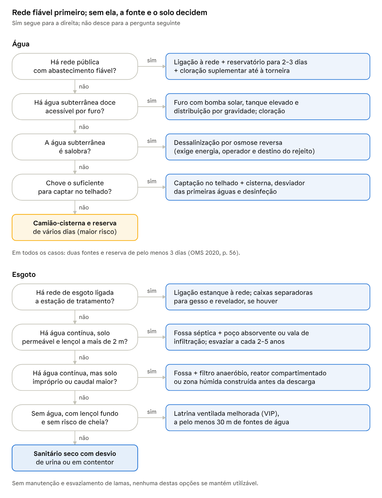

# Água e esgoto em unidades de saúde na comunidade

Versão de 20/11/2026 · Adelson Guaraci Jantsch

## Como ler este estudo

O estudo cobre o abastecimento de água e o esgoto de unidades de saúde na comunidade: postos, centros de saúde, UBS e clínicas de cuidados primários. Hospitais entram só pelo que ensinam de aplicável. As soluções estão organizadas por contexto: centros urbanos, zonas remotas e áreas áridas.

**Páginas.** "p." indica a página impressa. Estão conferidas no PDF apenas as citações dos documentos gravados na pasta `buildings`: *Essential environmental health standards in health care* (OMS, 2008) e *Guidance for climate-resilient and environmentally sustainable health care facilities* (OMS, 2020). As restantes foram identificadas por leitor web e podem ter erro de uma página.

**Custos.** Mantêm-se na moeda e no ano da fonte; os valores marcados (calc.) foram calculados aqui a partir da própria fonte.

## Situação global

Em 2022, 78% das unidades de saúde do mundo tinham serviço básico de água, e cerca de 9% não tinham serviço nenhum, afetando ~743 milhões de pessoas. Na África Subsaariana, em 2023, só 60% tinham água básica e 22% saneamento básico. As unidades não hospitalares e as rurais têm cobertura mais baixa que os hospitais e as urbanas. Fonte principal: [JMP 2024, OMS/UNICEF](https://washdata.org/reports/jmp-2024-wash-hcf) ([PDF](https://washdata.org/report/jmp-2024-wash-hcf-0)), com dados até 2023 e foco nos cuidados primários.

### Definições de serviço básico (JMP)

| Serviço | Básico | Limitado | Sem serviço | Página |
| --- | --- | --- | --- | --- |
| Água | Fonte melhorada nas instalações, com água disponível | Fonte melhorada a até 500 m, ou nas instalações mas sem água quando é precisa | Fonte não protegida, fonte melhorada a mais de 500 m, ou nenhuma | pp. v, 2, 6 |
| Saneamento | Sanitários melhorados e utilizáveis, com pelo menos 1 para a equipa, 1 separado por sexo com meios de higiene menstrual e 1 acessível a pessoas com mobilidade reduzida | Sanitário melhorado que falha algum critério | Sanitário não melhorado ou inexistente | pp. v, 10, 13, 16 |
| Resíduos | Separação em pelo menos 3 recipientes e tratamento seguro de cortantes e infecciosos | — | — | p. 36 |

### Cobertura

| Indicador | Global | África Subsaariana (2023) | Países menos desenvolvidos | Página |
| --- | --- | --- | --- | --- |
| Água básica | 78% (2022); 80% nas unidades não hospitalares | 60% | ~2/3 | pp. vi, 2 |
| Saneamento básico | sem estimativa global, por falta de dados | 22% | 19% | p. 10 |
| Higiene básica | 57% (2022) | 34% | — | pp. vi, 20 |
| Resíduos básicos | 54% (2021) | 26% | — | p. 36 |

- **Hospitais à frente.** Na água, o hospital tem melhor cobertura em 35 países, 16 deles com diferença acima de 20 pontos; na Costa do Marfim, 79% contra 24% (pp. 6–7). No saneamento, na Etiópia, 57% contra 3% (pp. 17–18). Os postos de saúde e outras unidades pequenas têm a cobertura mais baixa (pp. 51–52).
- **Urbano à frente.** Na água, a cobertura urbana é maior em 28 casos, 17 deles com diferença acima de 20 pontos (p. 7).
- **Contextos frágeis (60 países):** 37% sem água básica e 19% com saneamento básico (p. viii).
- **Energia, que condiciona a bombagem:** 433 milhões de pessoas são servidas por unidades sem eletricidade e 478 milhões por unidades com fornecimento não fiável ([Relatório global 2025](https://www.washinhcf.org/wp-content/uploads/2025/09/Global-progress-report-on-WASH-waste-electricity-in-HCF-2025.pdf), pp. ix, 11; ver [Energia elétrica](../energia/)).

### Compromissos e metas

- **Resolução WHA72.7 (2019):** pede avaliações nacionais, roteiros nacionais, normas mínimas integradas na acreditação e financiamento para operação e manutenção, incluindo fontes de reserva, com atenção às maternidades e aos cuidados primários ([WHA72.7](https://www.washinhcf.org/wp-content/uploads/2021/07/A72_R7-en.pdf), pp. 2–3).
- **Metas revistas em 2025:** 80% das unidades com serviço básico até 2028 e 100% até 2030; nos países menos desenvolvidos, 70% até 2028 e 100% até 2030 (Relatório global 2025, Tabela 1, p. x).
- **Financiamento:** só 17% dos países declaram financiamento suficiente (p. 23). O roteiro custeado da Etiópia (2025–2035) soma USD 652 milhões, 27% para água resiliente ao clima (p. 2).

O relatório de 2025 tem números internos que não batem (1,1 mil milhões de pessoas sem água básica na p. ix, 1,7 mil milhões na p. 11); convém citá-lo com cautela.

## Normas e parâmetros

A referência de base continua a ser *Essential environmental health standards in health care* (OMS, 2008), conferido no PDF. O guia de unidades resilientes ao clima (OMS, 2020) acrescenta as medidas contra seca e cheias.

### Quantidade de água (OMS 2008, Tabela 3.1, pp. 29–30)

| Serviço | Volume mínimo |
| --- | --- |
| Ambulatório | 5 L por consulta |
| Internamento | 40–60 L por doente/dia |
| Bloco operatório ou maternidade | 100 L por intervenção |
| Centro de nutrição seco ou suplementar | 0,5–5 L por consulta, conforme o tempo de espera |
| Centro de nutrição húmido | 15 L por consulta |
| Nutrição terapêutica com internamento | 30 L por doente/dia |
| Centro de tratamento de cólera | 60 L por doente/dia |
| Isolamento de doença respiratória aguda grave | 100 L por doente/dia |
| Isolamento de febre hemorrágica viral | 300–400 L por doente/dia |

Os volumes incluem todos os usos (higiene das mãos, limpeza, lavandaria, beber e cozinhar) e servem para dimensionar o sistema. Com sanitários de descarga, a necessidade pode ser muito maior (nota 5, p. 29). O valor real depende do clima, do tipo de sanitário, do nível de cuidados e dos hábitos locais (p. 30).

### Qualidade da água (OMS 2008, pp. 27–30)

- Nenhuma *E. coli* ou coliforme termotolerante em 100 mL de água de beber (p. 27).
- Toda a água de beber com desinfetante residual até ao ponto de uso (p. 27). Cloro: pelo menos 30 minutos de contacto e cloro residual livre de 0,5–1,0 mg/L em todos os pontos, incluindo as torneiras finais (p. 28).
- Turbidez idealmente abaixo de 1 NTU; 5 NTU é o mínimo medido com tubo de turbidez. Acima de 5 NTU, tratar antes de desinfetar, por sedimentação ou filtração (p. 28).
- A água da rede muitas vezes chega sem segurança ao ponto de entrega e pode precisar de cloração suplementar; a água armazenada também (p. 28).
- Água da chuva é aceitável com desinfeção, se a superfície de captação, as caleiras e o reservatório forem mantidos e limpos (pp. 27–28).
- Filtros cerâmicos (velas), cloração e outras tecnologias de pequena escala servem para unidades sem rede ou com rede de qualidade irregular (p. 29).
- Água abaixo da qualidade de beber só para limpeza, lavandaria e saneamento, identificada em cada torneira (p. 27).
- Água quente canalizada abaixo de 20 °C ou acima de 50 °C, por causa de *Legionella* e *Pseudomonas* (p. 31).

### Acesso, sanitários e higiene das mãos (OMS 2008, pp. 30–33)

- Ponto de água de beber acessível a todo o momento, separado e identificado; onde não há rede, recipiente tapado com torneira (pp. 30–31).
- Ponto de água com sabão em todos os pontos críticos: consultórios, salas de curativo, laboratório, esterilização, sanitários, zona de resíduos (p. 30).
- Ambulatório: pelo menos 4 sanitários (1 para a equipa; para utentes, 1 feminino, 1 masculino e 1 infantil), a no máximo 30 m de todos os utentes (p. 32). Internamento: 1 por 20 utilizadores (p. 32).
- Sanitário de descarga só quando há água canalizada fiável e ligação à rede de esgoto ou a fossa séptica funcional; nos outros casos, latrinas secas ou de descarga manual, implantadas sem contaminar o lençol freático nem ficar em zona inundável (p. 32).
- Sanitários acessíveis a pessoas com deficiência, grávidas e idosos; trancáveis por dentro e iluminados à noite, contra a violência sexual; adaptados à higiene anal com água onde for costume (p. 33).
- Limpeza sempre que estiverem sujos e pelo menos 2 vezes por dia (p. 33).

### Esgoto e águas residuais (OMS 2008, pp. 34–35)

- Solução preferida: ligação a rede de esgoto que chegue a uma estação de tratamento. Se a rede não tiver tratamento, é preciso retenção com tratamento no local antes da descarga (p. 34).
- Sem rede: águas cinzentas para poço absorvente ou vala de infiltração, com caixa de gordura verificada semanalmente; águas negras para fossa séptica com efluente para poço absorvente ou vala de infiltração. Cinzentas e negras podem ir para a mesma fossa, maior (p. 34).
- Pelo menos 1,5 m entre o fundo do sistema de infiltração e o lençol freático (mais em areias grossas, cascalho e rocha fissurada) e pelo menos 30 m de qualquer fonte de água subterrânea (pp. 34–35).
- Pequenas quantidades de líquidos infecciosos (sangue, fluidos) podem ir para pias ou sanitários; reagentes tóxicos de laboratório não (p. 34).
- Lamas da fossa séptica não devem ir para a agricultura; enterrar com procedimentos seguros (p. 35).
- Drenagem de águas pluviais separada quando o sistema de esgoto não aguenta chuvas fortes, sobretudo em centros de cólera (p. 35).
- Valas abertas de águas residuais devem ser cobertas, contra vetores (p. 34).
- Isolamento de cólera: solução de cloro a 2% para desinfetar fezes e vómito (p. 33).

### Resiliência à seca e às cheias (OMS 2020)

- Plano de gestão de seca de longo prazo, com fontes alternativas de água segura identificadas (Tabela 4.2.1B, p. 42).
- Reservatórios tapados, fora de zonas inundáveis, e tanques de plástico ancorados contra vento; válvulas de retenção; água residual de desinfeção depois de cheias (p. 42).
- Reserva de água para pelo menos 3 dias, com alternativa de abastecimento (Tabela 4.4.1A, p. 56); fontes alternativas identificadas, como furo profundo, companhia de águas ou tanque móvel (p. 60).
- Fossas sépticas seladas, respiros de esgoto acima da cota de cheia e esvaziamento de latrinas antes da estação das chuvas (p. 43).
- Captação de chuva com armazenamento seguro onde a chuva for suficiente e regular (p. 43). Água da chuva ou águas cinzentas para descargas, limpeza de pavimentos e rega (Tabela 4.2.2C, p. 47).
- Águas residuais tratadas no local (fossa séptica com poço de drenagem) ou enviadas para rede funcional (p. 46).
- Higiene das mãos a até 5 m de todos os sanitários (p. 47).
- Plantas resistentes à seca e drenagem de águas residuais sem contaminar o entorno (Tabela 4.4.2C, p. 63).

### Sphere, WASH FIT e cólera: o que acrescentam

| Parâmetro | Valor | Fonte |
| --- | --- | --- |
| Clínica móvel | 1 L por doente (visitas raras) ou 5 L (frequentes) | [Sphere 2018](https://globalprotectioncluster.org/sites/default/files/2022-11/sphere-handbook-2018-en.pdf), p. 145 |
| Reserva de água | 48 h; 72 h em surtos de Ébola ou cólera | Sphere 2018, pp. 133, 135 |
| Reserva de água | Necessidades de 2 dias (indicador Eau_8) | [WASH FIT 2022](https://www.washinhcf.org/wp-content/uploads/2023/02/WASH-FIT-2022_FR.pdf), p. 76 |
| Continuidade | Fonte principal sem avaria grave há 3 meses; água o ano todo; fonte alternativa identificada | WASH FIT 2022, p. 76 |
| Cloro residual livre no ponto de entrega | ≥ 0,2 mg/L; ≥ 0,5 mg/L em emergência | WASH FIT 2022, p. 76 |
| Sanitários em centros de saúde | Curto prazo: 1 por 20 camas ou por 50 consultas; médio e longo prazo: 1 por 10 camas ou por 20 consultas | Sphere 2018, Apêndice 4, p. 146 |
| Esgoto sem rede | Lamas contidas para esvaziamento; efluente líquido contido; esvaziamento por pessoal treinado com EPI | WASH FIT 2022, p. 77 |
| Esgoto com rede | Ligação estanque; estação com tratamento pelo menos secundário | WASH FIT 2022, p. 77 |
| Águas pluviais e cinzentas | Drenagem sem água parada; reúso da chuva; águas cinzentas sem ligação cruzada com a potável | WASH FIT 2022, p. 77 |
| Centro de cólera | 60 L por doente e 15 L por acompanhante por dia; reserva de 3 dias; fossas não ligadas à rede; fundo da fossa ≥ 1,5 m acima do lençol | [Nota técnica GTFCC](https://www.gtfcc.org/wp-content/uploads/2019/10/gtfcc-technical-note-on-water-sanitation-and-hygiene-and-infection-prevention-and-control-in-cholera-treatment-structures.pdf), pp. 6–13 |
| Latrina ou poço absorvente | ≥ 30 m de fontes de água; fundo ≥ 2 m acima do lençol freático | [Compendium Eawag 2014](https://sswm.info/sites/default/files/reference_attachments/TILLEY%20et%20al%202014%20Compendium%20of%20Sanitation%20Systems%20and%20Technologies%20-%202nd%20Revised%20Edition.pdf), pp. 63, 152 |

O Compendium pede 2 m entre o fundo da fossa e o lençol freático; a OMS (2008) pede 1,5 m para sistemas de infiltração. As normas não coincidem em todos os valores, e convém adotar o mais exigente onde o solo é arenoso ou fissurado.

## Soluções de abastecimento de água

Uma unidade de saúde precisa de três coisas: uma fonte fiável nas instalações, reserva para 2 a 3 dias e tratamento que garanta cloro residual até à torneira. As tecnologias abaixo combinam-se: é comum uma unidade ter ligação à rede, captação de chuva como reserva e filtro para a água de beber.

| Tecnologia | Quando serve | Limites | Manutenção | Custo indicativo | Fonte |
| --- | --- | --- | --- | --- | --- |
| Ligação à rede + reservatório | Zona urbana com rede | Intermitência obriga a reserva de 2–3 dias; reservatório aquecido favorece *Legionella* | Inspeção e limpeza do reservatório; fugas; cloro residual | Capital mediano por unidade não hospitalar: USD 5.000 (urbana), USD 5.757 (rural); recorrente USD 1.500–2.000/ano | [Chaitkin et al., Lancet Glob Health 2022](https://pmc.ncbi.nlm.nih.gov/articles/PMC9090898/), Tabela 3 |
| Furo ou poço próprio | Sem rede | Qualidade e caudal do aquífero; energia para bombear | Bomba, quadro elétrico, cloração | Capital mediano USD 15.601 (rural) a 17.500 (urbana); recorrente ~USD 1.400–1.700/ano | Chaitkin 2022, Tabela 3 |
| Bomba manual | Furo pouco profundo, unidade pequena | Pouco caudal; não pressuriza a rede interna | Peças de desgaste | USD 50–500 | [WEFTA](https://www.wefta.net/wp-content/uploads/2022/08/Considerations-and-Costs-for-Water-Sanitation-Hygiene-System-Improvements-for-Health-Care-Facilities.pdf), p. 3 |
| Bombagem solar | Boa irradiação; substituir o diesel | Capital maior; roubo; baterias caras | Limpar os painéis (o pó reduz até 50% do rendimento); bomba dura 7–10 anos, inversor 6–8, painéis 25 | Instalado < USD 3,2/Wp; ciclo de vida 36% mais barato que o diesel, retorno em 3,6 anos | [Banco Mundial, Solar Pumping 2018](https://openknowledge.worldbank.org/server/api/core/bitstreams/4b15ff25-39f1-5d39-bbe4-f6f23cc6cba4/content), pp. 10–12, 24–25; [Concern 2019](https://admin.concern.net/sites/default/files/documents/2022-09/WASH%20Guidance%20Note%202019%20-%20Solar%20Pumps.pdf) |
| Captação de chuva no telhado | Onde chove o suficiente; fonte principal em ilhas, reserva noutros locais | Sazonalidade; contaminação pelo telhado | Desviador das primeiras águas, telas nas caleiras, limpeza anual, rede contra mosquitos, desinfeção | Sistema completo USD 1.000–5.000; tanque plástico de 1.500–15.000 L USD 500–2.500 | WEFTA, pp. 3, 5–6; [OPAS Smart Hospitals](https://paho.org/sites/default/files/2020-03/smartHosp-RainwaterHarvestingSmartHealthcareFacilit.pdf), pp. 2–3 |
| Cisterna de placas (semiárido brasileiro) | Armazenamento de chuva em zona seca | Dimensionada para famílias; modelo escolar de 52 m³ é o mais próximo de uma UBS | Limpeza antes das chuvas | R$ 5.803–6.908 (16 m³, 2023) | [IN SESAN/MDS 9/2023](https://www.gov.br/mds/pt-br/acoes-e-programas/inclusao-produtiva-rural/acesso-a-agua-1/InstruoNormativaSESAN_MDSn9de3demarode2023Cisternadeplacasde16millitros.pdf), p. 2 |
| Dessalinização por osmose reversa | Poço salobro em zona árida | Energia elétrica; rejeito salino; operador | Membranas, pré-filtros, gestão do concentrado | ~R$ 212 mil por sistema comunitário (calc., Água Doce, 2021) | [Brasil de Fato](https://www.brasildefato.com.br/2021/01/04/no-sertao-de-pernambuco-manari-e-primeira-cidade-a-receber-sistema-de-dessalinizacao) |
| Barragem de areia | Rio sazonal em zona semiárida | Depende do leito e da chuva; longe da unidade | Pouca | USD 0,40–0,80 por m³ armazenado | [Excellent Development](https://old2019.sswm.info/sites/default/files/reference_attachments/EXCELLENT%202012%20Sand%20Dams%20The%20Worlds%20most%20Cost%20Effective%20Method%20of%20Conserving%20Rain%20Water.pdf), pp. 6, 8 |
| Cloração (pastilha, líquido, geração local) | Qualquer fonte, para manter cloro residual | Exige reposição e teste diários | Diária ou semanal | Pastilha USD 25–50; dosador líquido USD 500–1.250; geração local USD 2.500–10.000 | WEFTA, pp. 5–6 |
| Filtro cerâmico (pote ou vela) | Água de beber em unidade pequena ou sala de espera | 1–3 L/h; remoção de vírus variável (19% a > 99%) | Escovar; trocar o pote a cada 1–2 anos | USD 12–25 | [CAWST 2009](https://es.ircwash.org/sites/default/files/CAWST-2009-Household.pdf) |
| Biofiltro de areia | Água turva, uso local | ~0,4 L/min | Agitar e escoar quando o caudal cai | USD 12–40 (betão, dura 30+ anos) | [CAWST, ficha biosand](https://sswm.info/sites/default/files/reference_attachments/CAWST%202009%20Biosand%20Filter%20Fact%20Sheet%20academic_1.pdf) |
| Estação de água clorada e de lavagem das mãos | Unidade sem água canalizada | Não substitui fonte fiável | Encher e clorar todos os dias | Baixo; fabrico local (Zâmbia) | [OMS](https://www.who.int/news-room/feature-stories/detail/simple-solution-improves-water-and-sanitation-in-zambian-health-care-facilities) |
| Condensado de ar condicionado | UBS climatizada | Pequeno volume; só usos não potáveis | Pouca | Muito baixo (5 aparelhos, ~90 L/dia) | [CEJAM](https://simposio.cejam.org.br/documentos/trabalhos/implantacao-de-sistema-de-captacao-de-agua-para-irrigacao-de-hortas-em-uma-unidade-de-saude-um-relato-de-experiencia.pdf) |

Tanques de armazenamento (WEFTA, p. 6): ferrocimento USD 250–1.250 até 3.000 L, cerca de metade do plástico; blocos de betão USD 1.000–10.000; aço USD 3.000–30.000. Os custos da WEFTA vêm de uma ONG e não têm data; servem só como ordem de grandeza.

**Dimensionar a captação de chuva.** A conta habitual é volume captável por ano = área de telhado (m²) × precipitação anual (mm) × coeficiente de escoamento (~0,8 para telhado metálico), em litros. Exemplo (calc.): um telhado de 300 m² com 800 mm/ano capta cerca de 192.000 L. Não foi encontrada fonte normativa que aplique esta fórmula a unidades de saúde; a ABNT NBR 15527 deixou de trazer métodos de cálculo do reservatório na revisão de 2019.

**Não encontrado:** custo e especificações de ultrafiltração, UV e dessalinização solar aplicadas a unidades de saúde.

## Soluções de esgoto e saneamento

A escolha depende de três coisas: haver rede de esgoto com tratamento, haver água contínua para descargas e haver serviço de esvaziamento de lamas. Com rede e água, liga-se à rede. Com água mas sem rede, fossa séptica com tratamento complementar. Sem água contínua, sanitários secos ou latrinas melhoradas. Em todos os casos, sem manutenção o sanitário deixa de ser utilizável: em Agadez, no Níger, nenhuma das latrinas melhoradas estava em uso.

| Tecnologia | Quando serve | Limites | Manutenção | Custo indicativo | Fonte |
| --- | --- | --- | --- | --- | --- |
| Ligação à rede | Rede com estação de tratamento | Exige água contínua | Inspeção de fugas e caixas | Capital mediano USD 8.700 por unidade não hospitalar; recorrente USD 300/ano | [Chaitkin 2022](https://pmc.ncbi.nlm.nih.gov/articles/PMC9090898/), Tabela 3 |
| Fossa séptica | Sem rede, com serviço de esvaziamento | Remove ~50% dos sólidos e 30–40% da CBO; o efluente precisa de infiltração ou tratamento complementar | Esvaziar a cada 2–5 anos; pelo menos 2 câmaras; retenção de 48 h | Capital mediano USD 12.000; recorrente USD 855/ano | [Compendium Eawag 2014](https://sswm.info/sites/default/files/reference_attachments/TILLEY%20et%20al%202014%20Compendium%20of%20Sanitation%20Systems%20and%20Technologies%20-%202nd%20Revised%20Edition.pdf), pp. 74–75; Chaitkin 2022 |
| Poço absorvente (sumidouro) | Após fossa, em solo permeável | 1,5–4 m de profundidade; fundo ≥ 2 m acima do lençol; ≥ 30 m de poços; nunca para esgoto bruto | Refazer quando satura (3–5 anos) | Baixo | Compendium, pp. 152–153 |
| Vala de infiltração | Após fossa, com área disponível | Projeto especializado; solo não saturado | Sem árvores por cima; dura 20+ anos | Relativamente baixo | Compendium, pp. 154–155 |
| Filtro anaeróbio | Tratamento complementar após fossa | Arranque de 6–9 meses; remove 50–80% da CBO | Retrolavagem | Operação barata | Compendium, pp. 78–79 |
| Reator anaeróbio compartimentado (sistema descentralizado, DEWATS) | Caudais de 2–200 m³/dia | Retenção de 48–72 h; remove até 90% da CBO | Lamas a cada 1–3 anos | Operação barata; caso hospitalar em Dar es Salaam: 100 m³/dia por EUR 96.000 | Compendium, pp. 76–77; [GRID-Arendal, caso CCBRT](https://files.grida.no/wp-content/uploads/2023/08/SickWater_CS-6.pdf) |
| Zona húmida construída | Polimento do efluente | Fluxo horizontal: 5–10 m² por pessoa equivalente; vertical: 1–3 m² | Retirar ervas; trocar o meio filtrante a cada 10+ anos | não indicado | Compendium, pp. 116–119 |
| Tratamento no local com reator anaeróbio e infiltração | Centro de cólera sem rede | Exige projeto e controlo | Operador treinado | não publicado | [MASS, GHESKIO](https://modelofarchitecture.org/projects/gheskio-cholera-treatment-center) |
| Latrina ventilada melhorada (VIP) | Zona rural sem água canalizada | Proibida onde há cheias; ≥ 30 m de fontes | Limpar a tela do respiro; esvaziar | Fossa simples USD 200–600 | Compendium, pp. 62–63; [WEFTA](https://www.wefta.net/wp-content/uploads/2022/08/Considerations-and-Costs-for-Water-Sanitation-Hygiene-System-Improvements-for-Health-Care-Facilities.pdf), p. 8 |
| Sanitário seco com desvio de urina (UDDT) ou de compostagem | Sem água; lençol freático alto; zona árida | Exige separação correta e material de cobertura; fezes armazenadas ≥ 6 meses com cinza ou cal | Formação dos utilizadores; manutenção mensal | Compostagem USD 400–800 | Compendium, pp. 46, 59, 70; WEFTA, p. 8 |
| Sanitário em contentor | Emergência; onde não se pode escavar; doentes que não se agacham | Depende de recolha regular | Serviço de recolha | não verificado | [CDC](https://www.cdc.gov/global-water-sanitation-hygiene/stories/innovations-for-the-field.html) |
| Reúso de águas cinzentas ou efluente tratado | Rega | Só com tratamento pelo menos secundário; o NHS desaconselha cinzentas em instalações de saúde | Purgar as linhas | Rede de cinzentas USD 200–2.500 | Compendium, pp. 150–151; WEFTA, p. 9; [HTM 07-04](https://www.england.nhs.uk/wp-content/uploads/2021/05/HTM_07-04_Final.pdf), §7.13 |

### Efluentes específicos de unidades de saúde

- Pequenas quantidades de sangue e fluidos podem ir para pias ou sanitários, evitando salpicos; volumes grandes devem ser desinfetados ou tratados como resíduo patológico (OMS 2008, p. 34; [OMS, resumo de 2017](https://medbox.org/index.php/dl/5e148832db60a2044c2d4e3a), pp. 15–16).
- Reagentes tóxicos de laboratório não vão para a rede de esgoto (OMS 2008, p. 34). No Brasil, a RDC 50 exige caixas separadoras de gesso e de revelador ou fixador radiológico conforme a atividade (item 7.1.3).
- Em surtos de cólera, fezes e vómito são tratados com cloro a 2%, e as fossas do centro de tratamento não se ligam à rede (OMS 2008, p. 33; GTFCC, pp. 7, 11–13).
- Lamas de fossa de unidade de saúde não devem ir para a agricultura (OMS 2008, p. 35).

## Centros urbanos

Nas cidades, a unidade costuma ter rede de água e de esgoto, mas os riscos são outros: abastecimento intermitente, reservatórios mal dimensionados ou aquecidos sob o telhado, contaminação na rede interna do edifício e cheias. As boas práticas encontradas são um plano de segurança da água do edifício, reserva de 2 a 3 dias, captação de chuva e de condensado de ar condicionado para usos não potáveis, e cautela com águas cinzentas.

### Riscos na rede interna e no abastecimento intermitente

O manual da OMS *Water safety in buildings* (2011) é a referência ([cópia do PDF](https://www.certifico.com/component/attachments/download/45071); [página da OMS](https://www.who.int/publications/i/item/9789241548106)).

- *Pseudomonas aeruginosa*, micobactérias não tuberculosas e *Legionella* são as preocupações centrais em serviços de saúde (p. 1). Crescem com baixo fluxo, estagnação e água morna (p. 7).
- Situações de perigo: ramais longos, pontas mortas, torneiras pouco usadas, tanques abertos e ligações cruzadas com água de chuva, incêndio ou reúso sem proteção contra refluxo (p. 8).
- Em clima quente, tanques sob o telhado aquecem o suficiente para favorecer esses patógenos (p. 11). É o caso das caixas de água em laje comuns no Rio, em Luanda e em Maputo.
- As linhas de água dos equipamentos odontológicos colonizam-se com bactérias, fungos e protozoários (pp. 13–14).
- Onde o abastecimento é intermitente, os reservatórios podem ser maiores, dimensionados por entrada, uso, tempo de detenção e integridade (p. 38). O gestor deve conhecer o histórico de interrupções do fornecedor (pp. 44–45). Para edifícios de risco ou abastecimento pouco fiável, prevê tratamento na entrada ou no ponto de uso (pp. 55, 59).
- O plano de segurança da água tem passos definidos: equipa, descrição do sistema, perigos, avaliação de risco, medidas de controlo, monitorização, verificação e revisão (pp. 31–72).

**Cheias.** Em Porto Alegre, a 14/05/2024, pelo menos 37 das 134 unidades de saúde estavam fechadas: 14 por alagamento no próprio local (3 Clínicas da Família e 11 unidades) e 23 por falta de água, luz ou profissionais, ou por alagamento no entorno ([Jornal do Comércio](https://www.jornaldocomercio.com/geral/2024/05/1154611-porto-alegre-tem-37-unidades-de-saude-fechadas-devido-as-cheias.html)).

**Cidades africanas.** Não foi encontrado levantamento publicado sobre água nos centros de saúde de Luanda, Maputo, Lagos ou Kibera. Em Luanda, grande parte da população depende de camiões-cisterna ([VerAngola, 2019](https://www.verangola.net/va/pt/122019/Saude/17672/Desenvolvimento-da-Saúde-em-Luanda-travado-pela-falta-de-saneamento.htm)). Em Moçambique, o MISAU reviu em dezembro de 2025 normas técnicas preliminares de WASH em unidades de saúde e um roteiro 2026–2035 ([UNICEF Moçambique](https://www.unicef.org/mozambique/en/stories/advancing-wash-health-care-facilities-mozambique)).

### Brasil: normas aplicáveis às UBS

| Tema | Parâmetro | Fonte |
| --- | --- | --- |
| Consumo de água | Paciente externo ou visitante ~10 L/dia; funcionário ~50 L/dia; internado 120 L/dia | [RDC ANVISA 50/2002](<https://antigo.anvisa.gov.br/documents/10181/2718376/(1)RDC_50_2002_COMP.pdf/8b6dc86e-5fe7-41ab-9d71-cda206a2401a>), Parte III, item 7.1.1 |
| Reservatório | Com rede pública, reserva mínima de 2 dias, ou mais conforme a confiabilidade; pelo menos 2 compartimentos para limpar sem interromper | RDC 50, item 7.1.1 |
| Esgoto | Com rede pública com tratamento, lançamento direto; sem rede, tratamento antes do lançamento; caixas separadoras conforme a atividade (gordura, gesso, revelador) | RDC 50, item 7.1.3 |
| Tanque séptico | Volume útil V = 1000 + N(C·T + K·Lf). Uso para postos de saúde exige submissão prévia às autoridades sanitárias e ambientais. Distâncias: 1,5 m de construções, 3 m de árvores e rede pública, 15 m de poços e cursos de água | [ABNT NBR 7229/1993](https://macae.rj.gov.br/midia/uploads/NBR%207229%20de%201993%20-%20Projeto%20Constru%C3%A7%C3%A3o%20e%20Opera%C3%A7%C3%A3o%20de%20Sistemas%20de%20Tanques%20Septicos.pdf), itens 4.1.2, 5.1, 5.5 |
| Efluentes de serviços de saúde | Rede ligada a estação de tratamento, conforme a operadora, ou lançamento direto após tratamento especial; esgoto em corpo receptor com DBO até 120 mg/L ou remoção de 60% | [CONAMA 430/2011](https://lamorh.ufes.br/sites/lamorh.ufes.br/files/field/anexo/resolucao_conama_no_430-2011.pdf), arts. 16 e 21 |
| Estado do Rio de Janeiro | Lançamento em corpo receptor só após tratamento licenciado com desinfeção | [NOP INEA-45](https://www.inea.rj.gov.br/wp-content/uploads/2021/03/NOP-INEA-45.pdf), item 10, p. 13 |
| Água de chuva | ABNT NBR 15527 (revista em 2019): usos não potáveis, incluindo reserva de incêndio; controlo de *E. coli*, turbidez e pH; pré-tratamento. NBR 16783: fontes alternativas não potáveis | [apresentação CBIC 2019](https://cbic.org.br/sustentabilidade/wp-content/uploads/sites/22/2019/04/CMA-BC-NORMASDEAGUA.pdf); texto ABNT não consultado |
| Projeto de referência Novo PAC | "Uso e reúso racional da água" entre as estratégias, sem detalhe (p. 47); o projeto hidrossanitário adapta-se à concessionária (p. 43) | [Manual de Uso](https://www.gov.br/saude/pt-br/centrais-de-conteudo/publicacoes/guias-e-manuais/2025/manual-de-uso-do-projeto-de-referencia-novo-pac-saude.pdf) |
| Relatório técnico UBS Porte 1 | Água de chuva e drenos de ar condicionado reaproveitados em torneiras de jardim e limpeza; reservatório de retardo de 2 × 2 m; sem tratamento de efluentes na unidade | [relatório anexo a edital](https://siaiconsultas.tce.rn.gov.br/downloadanexoportalgestor/Edital/PMCNORTE/443782/174479/MS_UBS%20PORTE%201-RELAT%C3%93RIO%20T%C3%89CNICO.pdf) |

O valor ambulatorial da RDC 50 (~10 L por pessoa/dia) é o dobro do da OMS (5 L por consulta). Não há norma federal com consumo ou reservatório específico para UBS. A RDC 50 deve ser conferida face à RDC 51/2011, que revogou partes dela.

### Experiências brasileiras

- **Policlínica Vila Helena, Santo André (SP, abril de 2026):** captação de chuva para limpeza externa e rega, com redução projetada de ~10% no consumo de água potável, e piso drenante. Reforma de R$ 1,4 milhão com recursos do Ministério da Saúde; o mesmo modelo vai para três Clínicas da Família do município ([DGABC](https://www.dgabc.com.br/Noticia/4294920/santo-andre-inaugura-1-unidade-basica-sustentavel-do-brasil)).
- **UBS Maracá, São Paulo:** água de chuva para lavagem externa e jardim suspenso, pelo menos 200 L/semana, e reúso da água de retrolavagem do purificador, ~50 L/mês ([CEJAM](https://simposio.cejam.org.br/documentos/trabalhos/projetoubsmaisverdemaracapavs-simposiocejam.pdf)).
- **Condensado de ar condicionado (relato CEJAM):** 5 aparelhos geram ~90 L/dia, usados para a horta; instalação em 3 dias, com canos comprados com verba da reciclagem ([CEJAM](https://simposio.cejam.org.br/documentos/trabalhos/implantacao-de-sistema-de-captacao-de-agua-para-irrigacao-de-hortas-em-uma-unidade-de-saude-um-relato-de-experiencia.pdf)).
- **UBS em Iguatu (PR), estudo de projeto:** edifício de 324,51 m² com consumo de ~8 mil L/mês; cisterna calculada em ~5.055 L, adotados 2 reservatórios de 6.000 L; redução estimada de mais de 50% nos usos não potáveis ([FAG](https://www2.fag.edu.br/coopex/arquivos/producao/15614225385d116aca34073.pdf)).
- **Rio de Janeiro:** não foi encontrada Clínica da Família com captação de chuva, reúso ou certificação. O novo modelo de 2026 (Camorim) é descrito pelo desempenho térmico, sem menção a água.

As experiências brasileiras são pequenas e locais. A captação de condensado de ar condicionado é a de menor custo e pode ser feita em quase qualquer UBS climatizada.

### Índia e África Oriental

- **Índia, IPHS 2022 (PHC e UPHC):** água canalizada 24 horas com bombagem e pressurização; caixa elevada para pelo menos 3 dias de consumo; tratamento local de efluentes antes da drenagem; captação de chuva "onde possível" ([IPHS PHC](https://nhsrcindia.org/sites/default/files/PHC%20IPHS_2022_Guideline_pdf.pdf), pp. 14, 17–18).
- **Mohalla Clinics, Déli:** segundo a imprensa, a auditoria do CAG encontrou 21 de 74 clínicas sem sanitário e 10 sem água potável ([ThePrint](https://theprint.in/india/governance/cags-grim-diagnosis-of-delhi-mohalla-clinics-30-second-consultations-drugs-out-of-stock-for-months/2514327)). A clínica em contentor resolve a obra, mas não a água nem o esgoto.
- **Quénia, sanitários em contentor (CDC e Sanivation):** sanitários móveis e elevados testados em enfermarias e ambulatórios, úteis para quem não consegue agachar-se e em substituição da arrastadeira ([CDC](https://www.cdc.gov/global-water-sanitation-hygiene/stories/innovations-for-the-field.html)). Em Nairóbi, a Fresh Life opera mais de 5.000 sanitários em contentor com recolha regular, mas sem uso documentado em unidades de saúde.

### Países de alta renda

- **NHS, HTM 04-01 (água segura):** água quente armazenada a 60 °C, chegando a 55 °C às torneiras em 1 minuto; fria abaixo de 20 °C; a faixa 20–45 °C favorece *Legionella*; torneiras pouco usadas são fator de risco; grupo de segurança da água obrigatório ([HTM 04-01 Parte B](https://www.england.nhs.uk/wp-content/uploads/2021/05/DH_HTM_0401_PART_B_acc.pdf), §4.3, §4.7, §6.24).
- **NHS, HTM 07-04 (eficiência hídrica):** água de chuva presumida não potável, só para descargas e rega; águas cinzentas não devem ser usadas em instalações de saúde, salvo exceção avaliada pelo controlo de infeção, e com armazenamento máximo de 24 h ([HTM 07-04](https://www.england.nhs.uk/wp-content/uploads/2021/05/HTM_07-04_Final.pdf), §7.9–7.15, p. 24).
- **Houghton-le-Spring Primary Care Centre (Inglaterra, 2011):** primeiro edifício de saúde com BREEAM "Outstanding"; captação de chuva para descargas e telhado verde para reter a água da chuva ([Willmott Dixon](https://willmottdixon.co.uk/news/willmott-dixons-uk-first-with-breeam-outstanding-health-facility)).
- **Castlemaine Health (Austrália), lição de custo:** tanques de chuva para 17 descargas, AUD 50.000 de investimento; poupança real de 460 kL/ano, contra 1.320 estimados, com retorno simples de 44 anos ([Department of Health Victoria](https://www2.health.vic.gov.au/sites/default/files/migrated/files/collections/research-and-reports/g/greening-castlemaine---pdf.pdf)). É hospital e lar, não cuidados primários.

Nos países de alta renda, a captação de chuva em cidade com água barata raramente se paga pela poupança. Justifica-se pela resiliência e pela gestão de águas pluviais, mais do que pelo custo.

## Zonas remotas e rurais

Em zonas remotas, a solução mais documentada é o furo com bomba solar, reservatório elevado e distribuição por gravidade até à maternidade e aos consultórios, muitas vezes partilhado com a comunidade. A captação de chuva é a fonte principal em ilhas e complemento noutros locais. Os casos com resultados mostram efeito na doença diarreica e na abertura de maternidades, mas quase nenhum publica o custo por unidade.

### Furo com bomba solar

| Local | Unidade | Solução | Resultado relatado | Financiamento | Fonte |
| --- | --- | --- | --- | --- | --- |
| Balaka, Malawi | Chimaliro Health Centre | Rede solar com 6 torneiras comunitárias, 1 na unidade e 1 na residência do pessoal; comité com fundo para reparações | 0 casos de cólera em 2024, contra 40 casos e 1 óbito em 2023; a maternidade passou a poder funcionar | UNICEF, Comité Espanhol | [UNICEF Malawi, 2025](https://www.unicef.org/malawi/stories/piped-water-eliminates-cholera-chimaliro-health-centre-malawi) |
| Karamoja, Uganda | Lemusui HC III | Furo motorizado, 2 tanques de 5.000 L, torneiras, abrigo de banho para mulheres, lavatórios | Serve ~14.600 pessoas, área de captação até 65 km | KOICA, UNICEF (15 centros previstos) | [UNICEF Uganda](https://www.unicef.org/uganda/stories/water-where-it-matters-most) |
| Karamoja, Uganda | Natirae Health Center | Bombas solares, rede com torneiras, reservatório para períodos sem sol; comités de aldeia | Antes, água a ~10 km num rio sazonal; diarreia desceu do 3.º para o 7.º lugar no distrito | não indicado | [Gavi VaccinesWork](https://www.gavi.org/vaccineswork/solar-powered-water-pumps-reduce-hospital-visits-semi-arid-northern-uganda) |
| Buliisa, Uganda | Kigwera HC III | Bombas solares, tanques elevados, gravidade para maternidade e bloco | — | TotalEnergies, EWB East Africa (2026) | [Uganda Online](https://www.ugandaonline.net/news/2026-03-29--solar-water-system-brings-relief-to-kigwera-health-centre-iii-in-buliisa--a5b9dd8f3068) |
| Zambézia e Nampula, Moçambique | 60 unidades | Água a energia solar, blocos sanitários, gestão de resíduos | Fase final em outubro de 2025 | UNICEF, Banco Mundial, MISAU | [UNICEF Moçambique](https://www.unicef.org/mozambique/en/stories/unicef-and-partners-complete-major-wash-upgrade-60-healthcare-facilities) |
| Monapo, Moçambique | C.S. de Metocheira | Torre de água e infraestrutura de resíduos | Parte de 186 unidades em 5 províncias | multidoador | [UNICEF Moçambique](https://www.unicef.org/mozambique/en/stories/water-sanitation-and-hygiene-initiative-health-centres-supports-community-health-monapo) |
| Inhambane, Moçambique | Maternidade de Linga Linga | Painéis no telhado, bomba, torre de água | Clínica fechada há 3 anos reabriu; 58 partos de maio a agosto de 2024 | ONG Project Vita (fonte: blogue do fabricante) | [LONGi](https://wf-eu.longi.com/blog/solar-powered-water-for-a-maternity-clinic-in-rural-mozambique) |

Escala: em 2019 a UNICEF instalou mais de 1.200 sistemas solares de água em mais de 40 países; na Nigéria, 371 sistemas servem 85 unidades de saúde e 52 escolas ([UNICEF](https://www.unicef.org/wash/solar-powered-water-systems)). A UNICEF estima o retorno do investimento solar em 2–5 anos face ao diesel ([UNICEF Supply](https://www.unicef.org/supply/stories/unicef-water-pumps-source-life-health-and-resilience)).

O ponto fraco relatado em Karamoja é o lençol freático a baixar, que obriga a furos mais fundos e mais caros.

### Captação de chuva

- **Vanuatu:** a maioria das unidades de cuidados primários bombeia água da chuva do telhado para tanques; nos atóis é a única fonte, e a seca é o risco principal. O esgoto vai sobretudo para fossa séptica, com pouca gestão de lamas ([OMS-UTS 2024](https://drupal.uts.edu.au/sites/default/files/2024-03/WHO-UTS_2024_WatSanTechHCFs-StatusContextWPR.pdf), pp. 19–20).
- **Kiribati:** a MSF instalou desviadores de primeira chuva e redes nas caleiras, e padronizou os tanques das unidades ([MSF, 2026](https://www.doctorswithoutborders.org/latest/water-and-resilience-lessons-kiribati)).

### Tratamento no ponto de uso e higiene das mãos

- **Zâmbia, 150 unidades rurais:** duas estações de fabrico local por unidade, uma de 60 L para água de beber clorada e outra de 70 L para lavagem das mãos com sabão ([OMS](https://www.who.int/news-room/feature-stories/detail/simple-solution-improves-water-and-sanitation-in-zambian-health-care-facilities)). É a solução de menor custo para unidades sem água canalizada.

### Saneamento

- **Migyera, Uganda:** blocos de sanitários secos com desvio de urina (UDDT) de 2 e 4 cabines na unidade de saúde, 2009–2010 ([SuSanA](https://www.susana.org/knowledge-hub/resources?id=1057)).
- Não foi encontrado caso documentado, com custo, de latrina VIP em posto de saúde.

### WASH FIT como instrumento de melhoria

O relatório global do WASH FIT indica 71 países a usá-lo ([WASH FIT Global Report, 2024](https://washinhcf.org/wp-content/uploads/2024/12/WASH-FIT-Global-Report.pdf), p. 14).

- **Mali:** 328 de 1.640 unidades desde 2015, depois de um surto de cólera. Os municípios financiaram salas de tratamento e latrinas acessíveis decididas em audiências públicas (pp. 18–20).
- **Moçambique:** formação nas 11 províncias e 205 unidades com um ano de acompanhamento técnico (p. 19).
- **Laos:** cerca de 800 centros de saúde avaliados para o financiamento por desempenho do Banco Mundial, cerca de USD 6.000 por unidade por ano (p. 28).

### UBS fluviais (Amazónia)

O memorial descritivo do Ministério da Saúde prevê reservatório de água doce de 10,39 m³ e unidade biológica de tratamento de esgoto de 1,5 m³/dia, com gerador diesel de 50 kVA. Não especifica tratamento de água nem energia solar, e o campo "capacidade de água potável" está em branco ([memorial descritivo](https://www.gov.br/saude/pt-br/composicao/saps/ubsf/publicacoes/memorial_descritivo.pdf), pp. 2, 5).

### Comunidades remotas em países de alta renda

- **Austrália, Urapuntja Health Service (Utopia, 2014):** o furo colapsou e a comunidade ficou ~12 semanas sem fonte própria. O serviço passou a transportar água por camião e fechou os chuveiros e lavandarias que servia aos moradores; suspeita-se que daí veio um surto de sarna. Um furo novo custaria ~AUD 35.000 ([New Matilda](https://newmatilda.com/2014/09/16/three-months-without-water-means-health-crisis-growing-utopia-community/)).
- **Nunavik, Canadá (2024):** avarias dos camiões-cisterna de água e de esgoto fecham centros de saúde e escolas ([Nunatsiaq News](https://nunatsiaq.com/?p=199126)).
- **Alasca:** cerca de 22% das casas rurais não tinham água canalizada em 2013. Onde ela chegou, as consultas por infeções respiratórias, de pele e gastrointestinais caíram 16%, 20% e 38% ([DEC Alaska](https://dec.alaska.gov/media/13156/extreme-water-conservation-in-alaska-limitations-in-access-to-water-and-consequences-to-health.pdf), pp. 59–60).

Estes casos mostram que a dependência de transporte por camião, mesmo em países ricos, deixa a unidade sem serviço quando a logística falha.

## Áreas áridas e semiáridas

Em áreas áridas, o problema central é a fonte: água escassa, salobra ou distante, e redes que param quando falta combustível. As respostas documentadas são furos com bomba solar no lugar do diesel, reservas próprias de vários dias, condutas em vez de camiões, dessalinização de poços salobros e armazenamento de chuva em cisternas e barragens de areia. Não foi encontrado caso documentado de dessalinização, coleta de nevoeiro ou reúso de águas cinzentas *numa unidade de saúde*.

### Sul de Angola

- **Cunene e Huíla (fundos CERF, publicado em março de 2025):** 24 furos reabilitados, com bombas solares no lugar das manuais, para mais de 68.000 pessoas. Inclui tanque e abastecimento no centro de saúde do bairro Tchitulo, usado para higiene e controlo de infeção, e servem centros que tratam desnutrição ([UNICEF Angola](https://www.unicef.org/angola/en/stories/access-clean-water-transforms-drought-affected-communities)).
- **Cunene, outubro de 2026:** a falta de gasóleo parou geradores e bombas da empresa provincial de água, que passou a distribuir só por gravidade ([VerAngola](https://www.verangola.net/va/en/102026/Energy/50598/Fuel-shortages-affect-water-supply-in-Cunene-province.htm)). A notícia não menciona unidades de saúde, mas o episódio é um argumento a favor de reserva própria e bombagem solar na unidade sanitária, em vez de depender só da rede.

### Corno de África

- **Turkana, Quénia (KOICA e UNICEF):** o SCORE I (2019–2022, USD 7 milhões) fez 76 furos, 7 solarizados, e 10 barragens de areia; o SCORE II, lançado em março de 2025, inclui 10 centros de saúde ([UNICEF Quénia](https://www.unicef.org/kenya/stories/drought-hope-advancing-water-sanitation-and-hygiene-turkana-county)).
- **Somália (International Medical Corps, 2025):** 20 bombas solares em furos e 60 em poços rasos, com geradores de reserva; sistemas solares em 7 unidades. Uma conduta de 20 km fez o custo da água cair de USD 6 por barril, transportada por camião, para USD 0,30 ([IMC](https://internationalmedicalcorps.org.uk/story/promoting-sustainability-in-somalia/)).

### Sahel

- **Níger, diagnóstico de 2024 em 471 unidades** ([relatório](https://www.washinhcf.org/wp-content/uploads/2025/04/Niger-WASH-status-in-HCF-Rapport-Etat-des-lieux-WASH-FOSA-001-29_08_2024.pdf)):
  - 50,3% com ponto de água melhorado no local; 26,8% sem serviço de água (p. 13);
  - saneamento básico em 1,1% (p. 21); em Agadez, 57% das latrinas são melhoradas, mas nenhuma está utilizável (p. 23);
  - higiene das mãos completa em 15,1% (p. 17);
  - 61% das unidades de Agadez sem fonte de energia (p. 33).
- **Mali:** custo da água bombeada a energia solar, ver "Solar contra diesel".

### Semiárido brasileiro

- **Cisterna de placas de 16 m³ (Programa Cisternas):** valor de referência de R$ 5.803 a R$ 6.908 por unidade em 2023 ([IN SESAN/MDS n.º 9/2023](https://www.gov.br/mds/pt-br/acoes-e-programas/inclusao-produtiva-rural/acesso-a-agua-1/InstruoNormativaSESAN_MDSn9de3demarode2023Cisternadeplacasde16millitros.pdf), p. 2). O programa também tem cisterna escolar de 52 m³, barragem subterrânea e reúso de água cinzenta domiciliar ([cartilha 2026](https://www.gov.br/mds/pt-br/acoes-e-programas/acesso-a-alimentos-e-a-agua/programa-cisternas/manuais-e-outras-publicacoes/documentos-de-referencia/cartilhas/sesan_cartilha_cisternas_2026_v-03_digital-02.pdf)). Não menciona unidades de saúde.
- **Programa Água Doce:** 936 dessalinizadores por osmose reversa (2004–2023) para ~225 mil pessoas. Critérios: pelo menos 20 famílias num raio de 1 km, poço salobro, rede elétrica e área de 40 × 40 m ([MDR](https://www.gov.br/mdr/pt-br/assuntos/seguranca-hidrica/programa-agua-doce/QUALIFICACAO_DE_DEMANDAS___PROGRAMA_AGUA_DOCE.pdf)). Em Manari (PE, 2021), R$ 1,7 milhão para 8 sistemas e 608 famílias, cerca de R$ 212 mil por sistema (calc.) ([Brasil de Fato](https://www.brasildefato.com.br/2021/01/04/no-sertao-de-pernambuco-manari-e-primeira-cidade-a-receber-sistema-de-dessalinizacao)). Não há referência a postos de saúde.

### Barragens de areia

Armazenam água no leito arenoso de rios sazonais, a USD 0,40–0,80 por m³ armazenado, contra USD 2,40–14 num tanque subterrâneo e USD 18–60 num tanque de superfície. Uma barragem madura guarda até 20 milhões de litros, e a comunidade contribui com cerca de 40% em trabalho e materiais ([Excellent Development, 2012](https://old2019.sswm.info/sites/default/files/reference_attachments/EXCELLENT%202012%20Sand%20Dams%20The%20Worlds%20most%20Cost%20Effective%20Method%20of%20Conserving%20Rain%20Water.pdf), pp. 6, 8). A fonte é uma ONG que promove a tecnologia, e não há caso ligado a unidade de saúde.

### Campos de refugiados em zona árida

- **Zaatari, Jordânia:** rede de água e esgoto de EUR 51 milhões (KfW e outros), com poupança de até 66% face ao transporte por camião ([UNICEF Jordânia, 2018](https://www.unicef.org/jordan/press-releases/environment-friendly-and-cost-efficient-water-and-sanitation-network-zaatari-camp)). A fonte não detalha as clínicas do campo.

## Escolher a solução

O diagrama resume as secções anteriores numa sequência de perguntas. É uma simplificação: na prática, as soluções combinam-se, por exemplo rede com captação de chuva como reserva, ou furo solar com dessalinização onde a água é salobra.

**Água** (sim segue para a solução; não passa à pergunta seguinte)

1. Há rede pública com abastecimento fiável? → Ligação à rede + reservatório para 2–3 dias + cloração suplementar até à torneira.
2. Há água subterrânea doce acessível por furo? → Furo com bomba solar, tanque elevado e distribuição por gravidade; cloração.
3. A água subterrânea é salobra? → Dessalinização por osmose reversa (exige energia, operador e destino do rejeito).
4. Chove o suficiente para captar no telhado? → Captação no telhado + cisterna, desviador das primeiras águas e desinfeção.
5. Nenhuma das anteriores → Camião-cisterna e reserva de vários dias (maior risco).

Em todos os casos: duas fontes e reserva de pelo menos 3 dias (OMS 2020, p. 56).

**Esgoto**

1. Há rede de esgoto ligada a estação de tratamento? → Ligação estanque à rede; caixas separadoras para gesso e revelador, se houver.
2. Há água contínua, solo permeável e lençol a mais de 2 m? → Fossa séptica + poço absorvente ou vala de infiltração; esvaziar a cada 2–5 anos.
3. Há água contínua, mas solo impróprio ou caudal maior? → Fossa + filtro anaeróbio, reator compartimentado ou zona húmida construída antes da descarga.
4. Sem água, com lençol fundo e sem risco de cheia? → Latrina ventilada melhorada (VIP), a pelo menos 30 m de fontes de água.
5. Nenhuma das anteriores → Sanitário seco com desvio de urina ou em contentor.

Sem manutenção e esvaziamento de lamas, nenhuma destas opções se mantém utilizável.

A primeira escolha é sempre a rede, se for fiável e tiver tratamento. Sem ela, decidem a fonte de água disponível, a existência de água contínua para descargas e o tipo de solo e profundidade do lençol freático. As duas soluções finais, camião-cisterna e sanitário seco, não são piores em si, mas dependem de um serviço de transporte ou de recolha que tem de existir.

## Custos e financiamento

O estudo de referência é Chaitkin et al. (*Lancet Global Health*, 2022). Para levar os 46 países menos desenvolvidos a serviço básico de água, saneamento, higiene e resíduos até 2030, estimou USD 7,9 mil milhões (6,5–9,6) entre 2021 e 2030, dos quais 3,6 de capital e 4,3 de custos recorrentes. 94% do total vai para unidades não hospitalares e 68% para zonas rurais ([PMC](https://pmc.ncbi.nlm.nih.gov/articles/PMC9090898/); [PubMed](https://pubmed.ncbi.nlm.nih.gov/35397226/)). Os custos recorrentes superam os de capital: quem financia só a obra deixa por pagar a maior parte.

### Custo por unidade não hospitalar (Chaitkin 2022, Tabela 3, medianas)

| Componente | Capital | Recorrente por ano |
| --- | --- | --- |
| Água: ligação à rede, unidade urbana | USD 5.000 | USD 1.500–2.000 |
| Água: fonte própria, unidade rural | USD 15.601 | ~USD 1.400–1.700 |
| Esgoto: ligação à rede | USD 8.700 | USD 300 |
| Esgoto: fossa séptica | USD 12.000 | USD 855 |
| Gestão de resíduos | USD 10.159 | USD 1.750 |

Os valores de captação de chuva, bombas, cloração e saneamento por unidade estão nas tabelas das secções de água e de esgoto.

### Solar contra diesel

- No Mali, a água bombeada a energia solar custa ~USD 0,08/m³, contra 0,44 com diesel e 0,20 com sistema híbrido ([UNICEF/SuSanA](https://susana.org/_resources/documents/default/3-4162-7-1617109686.pdf), p. 15).
- O sistema solar custa 12–42% mais que o diesel na instalação, mas o diesel gasta USD 300–500 por mês para ~1.000 pessoas, e o solar paga-se em 4–6 anos (mesma fonte, p. 16). O Banco Mundial calcula ciclo de vida 36% mais barato e retorno em 3,6 anos ([Solar Pumping 2018](https://openknowledge.worldbank.org/server/api/core/bitstreams/4b15ff25-39f1-5d39-bbe4-f6f23cc6cba4/content), pp. 24–25).
- Custo médio por sistema solar UNICEF: USD 20.583 (Nigéria), 21.000 (Mauritânia), 27.261 (Mianmar), 71.709 (Uganda); USD 8–70 por beneficiário (UNICEF/SuSanA, pp. 15–16).
- Na Etiópia, 38 sistemas solarizados poupam USD 101,8 milhões em 15 anos, USD 25,8 por dólar investido ([UNICEF](https://knowledge.unicef.org/resource/wash-results-paper-economic-impact-solar-powered-water-systems-ethiopia)).

### Modelos de financiamento encontrados

| Modelo | Exemplos |
| --- | --- |
| Doadores bilaterais e agências da ONU, por programa | KOICA e UNICEF (Karamoja, Turkana); UNICEF e Banco Mundial (60 unidades em Moçambique); USAID e UNICEF (Moçambique, USD 6 milhões, 2019–2022); CERF (Cunene e Huíla) |
| Financiamento por desempenho | Laos: ~USD 6.000 por unidade por ano, ligado à avaliação WASH FIT (Banco Mundial) |
| Orçamento municipal decidido em audiência pública | Mali: municípios financiaram latrinas acessíveis e salas de tratamento a partir do WASH FIT |
| Fundo local de manutenção | Malawi: comité com fundo para reparações da rede solar de Chimaliro |
| Programas nacionais de água não ligados à saúde | Brasil: Programa Cisternas e Água Doce, ainda sem unidades de saúde |
| Recursos do Ministério da Saúde em obra de UBS | Brasil: Santo André, com o custo da parte hídrica não separado |

## Operação e manutenção

Nos casos que funcionam, a obra vem acompanhada de quem cuida do sistema, de dinheiro para peças e de monitorização simples. Nos que falham, o problema é quase sempre a manutenção ou a dependência de um serviço externo: o camião, o gasóleo, o esvaziamento de lamas.

**Responsáveis e dinheiro**

- **Comité com fundo próprio:** em Chimaliro (Malawi) e em Natirae (Uganda), comités locais gerem a rede e guardam um fundo para reparações.
- **Equipa WASH FIT na unidade:** avalia, prioriza e acompanha os indicadores. No Níger, só 24,2% das unidades tinham essa equipa (p. 29).
- **Grupo de segurança da água:** é a versão urbana do mesmo princípio, obrigatória no NHS (HTM 04-01, §2.3).

**Rotinas mínimas**

- Cloro residual na torneira, medido com comparador simples (OMS 2008, p. 28).
- Reservatórios limpos e tapados; teste de *E. coli* ou inspeção sanitária (WASH FIT 2022, Eau_12, p. 76).
- Caixas de gordura verificadas semanalmente (OMS 2008, p. 34).
- Sanitários limpos pelo menos 2 vezes por dia (OMS 2008, p. 33).
- Painéis solares limpos, porque o pó reduz até 50% do rendimento ([Concern 2019](https://admin.concern.net/sites/default/files/documents/2022-09/WASH%20Guidance%20Note%202019%20-%20Solar%20Pumps.pdf)).
- Fossas esvaziadas a cada 2–5 anos e latrinas antes da estação das chuvas (Compendium, p. 74; OMS 2020, p. 43).
- Na rede interna urbana, fazer correr água nas torneiras pouco usadas e controlar a temperatura (HTM 04-01, §6.24).

**Vida útil e reposição.** Bomba solar 7–10 anos, inversor 6–8, painéis 25 (Concern 2019); pote de filtro cerâmico 1–2 anos (CAWST). A reposição tem de estar no orçamento recorrente, que no estudo de Chaitkin supera o de capital.

**Riscos de dependência externa**

| Dependência | O que aconteceu | Fonte |
| --- | --- | --- |
| Gasóleo para bombas | Cunene, 2026: rede parou e passou a distribuir só por gravidade | [VerAngola](https://www.verangola.net/va/en/102026/Energy/50598/Fuel-shortages-affect-water-supply-in-Cunene-province.htm) |
| Camião-cisterna de água e de esgoto | Nunavik, 2024: centros de saúde fechados quando os camiões avariam | [Nunatsiaq News](https://nunatsiaq.com/?p=199126) |
| Um único furo | Utopia, Austrália, 2014: ~12 semanas sem fonte própria | [New Matilda](https://newmatilda.com/2014/09/16/three-months-without-water-means-health-crisis-growing-utopia-community/) |
| Lençol freático em descida | Karamoja: furos cada vez mais fundos e caros | [Gavi](https://www.gavi.org/vaccineswork/solar-powered-water-pumps-reduce-hospital-visits-semi-arid-northern-uganda) |
| Rede urbana em cheias | Porto Alegre, 2024: unidades fechadas por alagamento ou falta de água | [Jornal do Comércio](https://www.jornaldocomercio.com/geral/2024/05/1154611-porto-alegre-tem-37-unidades-de-saude-fechadas-devido-as-cheias.html) |
| Manutenção de latrinas | Agadez: 57% melhoradas, nenhuma utilizável | [Níger 2024](https://www.washinhcf.org/wp-content/uploads/2025/04/Niger-WASH-status-in-HCF-Rapport-Etat-des-lieux-WASH-FOSA-001-29_08_2024.pdf), p. 23 |

A resposta comum a todos estes riscos é ter duas fontes e reserva de pelo menos 3 dias, como pede o guia da OMS de 2020 (pp. 56, 60).

## Imagens de referência

As imagens não podem ser trazidas para dentro do documento a partir desta sessão. A lista aponta para as páginas de origem onde as fotos ou esquemas estão publicados. Só nas marcadas "legenda verificada" se confirmou que a imagem mostra a solução na unidade de saúde.

| O que mostra | Contexto | Página de origem |
| --- | --- | --- |
| Rede solar ligada ao centro de saúde de Chimaliro | Rural, Malawi | [UNICEF Malawi](https://www.unicef.org/malawi/stories/piped-water-eliminates-cholera-chimaliro-health-centre-malawi) |
| Torre de água no C.S. de Metocheira, Monapo | Rural, Moçambique | [UNICEF Moçambique](https://www.unicef.org/mozambique/en/stories/water-sanitation-and-hygiene-initiative-health-centres-supports-community-health-monapo) |
| Tanques e furo do Lemusui HC III | Semiárido, Uganda | [UNICEF Uganda](https://www.unicef.org/uganda/stories/water-where-it-matters-most) |
| Furos solares e centro de saúde do Tchitulo | Semiárido, sul de Angola | [UNICEF Angola](https://www.unicef.org/angola/en/stories/access-clean-water-transforms-drought-affected-communities) |
| Painéis solares, torneiras e zona húmida construída no Srae Chis Health Centre | Rural, Camboja | [UNICEF Camboja](https://www.unicef.org/cambodia/stories/unicef-solar-water-supply-upgrades-climate-smart-energy-childrens-care) |
| Captação de chuva em unidades de saúde | Ilhas, Kiribati | [MSF](https://www.doctorswithoutborders.org/latest/water-and-resilience-lessons-kiribati) |
| Sanitários em contentor em enfermarias (legenda verificada) | Quénia | [CDC](https://www.cdc.gov/global-water-sanitation-hygiene/stories/innovations-for-the-field.html) |
| Desenhos de blocos de sanitários secos com desvio de urina numa unidade de saúde | Rural, Uganda | [SuSanA, Migyera](https://www.susana.org/knowledge-hub/resources?id=1057) |
| Esquemas de latrina VIP (p. 62), fossa séptica (p. 74) e poço absorvente (p. 152) | Genérico | [Compendium Eawag 2014](https://sswm.info/node/5587) |
| Esquema de reator anaeróbio compartimentado | Genérico | [SSWM](<https://sswm.info/factsheet/anaerobic-baffled-reactor-(abr)>) |
| Fachada perfurada e tratamento de água da chuva e efluente no local | Urbano, Haiti (centro de cólera) | [MASS, GHESKIO](https://modelofarchitecture.org/projects/gheskio-cholera-treatment-center) |
| Captação de chuva numa policlínica | Urbano, Santo André | [DGABC](https://www.dgabc.com.br/Noticia/4294920/santo-andre-inaugura-1-unidade-basica-sustentavel-do-brasil) |
| Centro de cuidados primários com captação de chuva e telhado verde | Urbano, Inglaterra | [Willmott Dixon](https://willmottdixon.co.uk/news/willmott-dixons-uk-first-with-breeam-outstanding-health-facility) |

Se quiser as fotos dentro do documento, pode descarregá-las destas páginas para a pasta `buildings` e eu insiro-as nas secções correspondentes.

## Lacunas e links não abertos

**O que não foi encontrado**

- Caso documentado de dessalinização, coleta de nevoeiro ou reúso de águas cinzentas *numa unidade de saúde*; casos no Rajastão, Atacama, Namíbia e no Afar ou Somali da Etiópia.
- Custo por unidade de saúde dos programas solares da UNICEF em Moçambique, Uganda e Angola.
- Programa Cisternas ou Água Doce que inclua UBS do semiárido.
- Clínica da Família do Rio com captação de chuva ou reúso; custo isolado de cisterna em UBS.
- Levantamento de água e saneamento nos centros de saúde de Luanda, Maputo, Lagos ou Kibera.
- Norma federal brasileira com consumo per capita ou reservatório específico para UBS.
- Custos de ultrafiltração, UV e dessalinização solar em unidades de saúde.
- Fonte normativa que aplique o dimensionamento de captação de chuva a unidades de saúde.

**Links que não abriram ou abriram só em parte**

| Documento | Situação | Link |
| --- | --- | --- |
| WASH FIT 2.ª ed., versão inglesa | Erro do servidor; usada a versão francesa | https://iris.who.int/server/api/core/bitstreams/e992081c-6d92-4511-b091-ce2059820ae7/content |
| OMS, *Water safety in buildings* (2011), IRIS | Erro do servidor; lido numa cópia | https://www.who.int/publications/i/item/9789241548106 |
| OMS, *Safe management of wastes* (2014), completo | Fora da lista permitida; usado o resumo de 2017 | https://www.who.int/publications/i/item/9789241548564 |
| Compendium de saneamento em emergências | Só o índice abriu | https://www.emersan-compendium.org |
| CAWST, *WASH in health care facilities* | Fora da lista permitida | https://www.cawst.org |
| Relatório JMP 2024 e relatório global 2025 | Lidos até cerca de metade | https://washdata.org/report/jmp-2024-wash-hcf-0 |
| KfW, Zaatari WASH 2022 | Redirecionamento bloqueado | https://www.kfw-entwicklungsbank.de |
| Save the Children, centro de saúde no Níger | Só a página de entrada | https://resourcecentre.savethechildren.net/document/after-36-years-and-lost-hope-running-water-returns-to-a-rural-health-center-in-niger |
| Artigo sobre álcool-gel de produção local (Bull WHO 2013) | Captcha | https://scielosp.org/pdf/bwho/2013.v91n12/963-969/en |
| Enchentes em Porto Alegre, prefeitura | Bloqueado pelo site | https://prefeitura.poa.br |
| Tese UFMG sobre água pluvial em EAS | Endereço longo demais para o proxy | repositório UFMG |
| ABNT NBR 15527, 16783, 5626, 13969 | Textos pagos; não consultados | https://www.abntcatalogo.com.br |

Se gravar na pasta `buildings` o JMP 2024, o WASH FIT 2022, o Compendium Eawag e a RDC 50, posso conferir as páginas citadas.

## Fontes

As fontes de cada dado estão ligadas no texto. Abaixo, os documentos de referência.

**Normas e dados globais**

- OMS, *Essential environmental health standards in health care* (2008) — ficheiro `9789241547239_eng.pdf` na pasta `buildings`
- OMS, *Guidance for climate-resilient and environmentally sustainable health care facilities* (2020) — ficheiro `9789240012226-eng.pdf` na pasta `buildings`
- [OMS/UNICEF JMP, WASH in health care facilities: 2023 data update (2024)](https://washdata.org/reports/jmp-2024-wash-hcf)
- [OMS/UNICEF, Global progress report on WASH, waste and electricity in HCF (2025)](https://www.washinhcf.org/wp-content/uploads/2025/09/Global-progress-report-on-WASH-waste-electricity-in-HCF-2025.pdf)
- [Resolução WHA72.7 (2019)](https://www.washinhcf.org/wp-content/uploads/2021/07/A72_R7-en.pdf)
- [WASH FIT 2.ª ed. (2022), versão francesa](https://www.washinhcf.org/wp-content/uploads/2023/02/WASH-FIT-2022_FR.pdf) · [Relatório global WASH FIT (2024)](https://washinhcf.org/wp-content/uploads/2024/12/WASH-FIT-Global-Report.pdf)
- [Sphere Handbook (2018)](https://globalprotectioncluster.org/sites/default/files/2022-11/sphere-handbook-2018-en.pdf)
- [GTFCC, nota técnica WASH e PCI em estruturas de tratamento de cólera (2019)](https://www.gtfcc.org/wp-content/uploads/2019/10/gtfcc-technical-note-on-water-sanitation-and-hygiene-and-infection-prevention-and-control-in-cholera-treatment-structures.pdf)
- [OMS, Water safety in buildings (2011)](https://www.who.int/publications/i/item/9789241548106)

**Tecnologias e custos**

- [Tilley et al., Compendium of Sanitation Systems and Technologies, Eawag (2014)](https://sswm.info/sites/default/files/reference_attachments/TILLEY%20et%20al%202014%20Compendium%20of%20Sanitation%20Systems%20and%20Technologies%20-%202nd%20Revised%20Edition.pdf)
- [Chaitkin et al., Lancet Global Health (2022)](https://pmc.ncbi.nlm.nih.gov/articles/PMC9090898/)
- [Banco Mundial, Solar Pumping: The Basics (2018)](https://openknowledge.worldbank.org/server/api/core/bitstreams/4b15ff25-39f1-5d39-bbe4-f6f23cc6cba4/content)
- [UNICEF, sistemas solares de água (SuSanA)](https://susana.org/_resources/documents/default/3-4162-7-1617109686.pdf)
- [Concern, Solar Pumps Guidance Note (2019)](https://admin.concern.net/sites/default/files/documents/2022-09/WASH%20Guidance%20Note%202019%20-%20Solar%20Pumps.pdf)
- [WEFTA, custos de melhorias WASH em unidades de saúde](https://www.wefta.net/wp-content/uploads/2022/08/Considerations-and-Costs-for-Water-Sanitation-Hygiene-System-Improvements-for-Health-Care-Facilities.pdf)
- [OPAS, Smart Hospitals — captação de chuva](https://paho.org/sites/default/files/2020-03/smartHosp-RainwaterHarvestingSmartHealthcareFacilit.pdf)

**Brasil**

- [RDC ANVISA 50/2002 (consolidada)](<https://antigo.anvisa.gov.br/documents/10181/2718376/(1)RDC_50_2002_COMP.pdf/8b6dc86e-5fe7-41ab-9d71-cda206a2401a>)
- [ABNT NBR 7229/1993](https://macae.rj.gov.br/midia/uploads/NBR%207229%20de%201993%20-%20Projeto%20Constru%C3%A7%C3%A3o%20e%20Opera%C3%A7%C3%A3o%20de%20Sistemas%20de%20Tanques%20Septicos.pdf)
- [CONAMA 430/2011](https://lamorh.ufes.br/sites/lamorh.ufes.br/files/field/anexo/resolucao_conama_no_430-2011.pdf)
- [Manual de Uso do Projeto de Referência, Novo PAC Saúde (2025)](https://www.gov.br/saude/pt-br/centrais-de-conteudo/publicacoes/guias-e-manuais/2025/manual-de-uso-do-projeto-de-referencia-novo-pac-saude.pdf)
- [Memorial descritivo das UBS fluviais](https://www.gov.br/saude/pt-br/composicao/saps/ubsf/publicacoes/memorial_descritivo.pdf)

**Países de alta renda**

- [NHS, HTM 04-01 Parte B](https://www.england.nhs.uk/wp-content/uploads/2021/05/DH_HTM_0401_PART_B_acc.pdf) · [HTM 07-04](https://www.england.nhs.uk/wp-content/uploads/2021/05/HTM_07-04_Final.pdf)

**Países e programas**

- [Índia, IPHS 2022 — PHC](https://nhsrcindia.org/sites/default/files/PHC%20IPHS_2022_Guideline_pdf.pdf)
- [Níger, estado dos lugares WASH nas unidades de saúde (2024)](https://www.washinhcf.org/wp-content/uploads/2025/04/Niger-WASH-status-in-HCF-Rapport-Etat-des-lieux-WASH-FOSA-001-29_08_2024.pdf)
- [OMS-UTS, tecnologias WASH em unidades de saúde no Pacífico Ocidental (2024)](https://drupal.uts.edu.au/sites/default/files/2024-03/WHO-UTS_2024_WatSanTechHCFs-StatusContextWPR.pdf)
